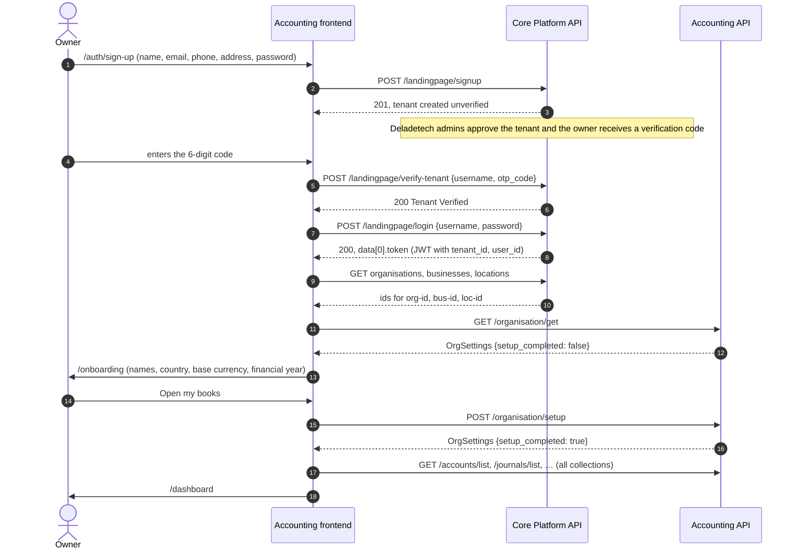
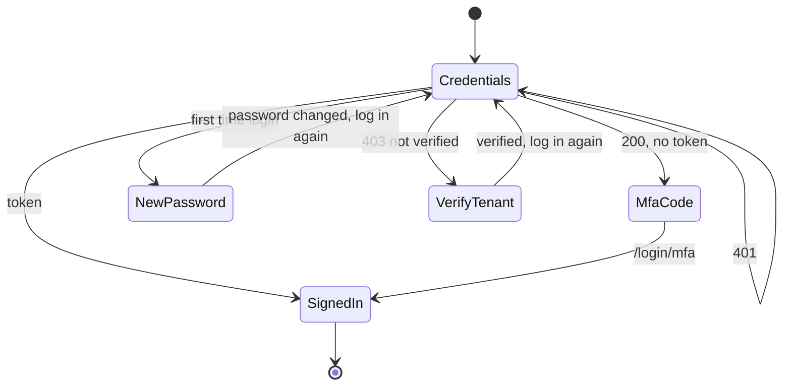

# Sign-up, login and organisation setup

How a new company gets from the sign-up form to its first posted entry, which service handles each step, and what the
accounting API must do on first use. Sign-up and login belong to the Trovesuite **Core Platform** (tvs-coreplatform-bk);
the accounting API only adds the one-off organisation setup at the end.

## 1. The journey



Returning users skip straight from login to `GET /organisation/get`, which reports `setup_completed: true`, and the books load.

When the app is opened from the Core shell, steps 1–11 have already happened in Core: the shell passes
`#token=…&org_id=…&bus_id=…&loc_id=…&app_id=…` in the URL hash, the app stores the values and removes the hash, and continues
at step 12.

## 2. Core Platform routes the frontend calls

All are `POST` under `{CORE_HOST}/api/v1/landingpage`, unauthenticated, and return the standard envelope with `data` as a list.
`username` is the email or the phone number.

| Route | Body | Outcomes the screen handles |
| --- | --- | --- |
| `/signup` | `{ fullname, email, contact, address, password }` | 201 created (tenant unverified). 400 email or contact already exists. 400 weak password |
| `/verify-tenant` | `{ username, otp_code }` | 200 verified. 400 invalid code. 403 not the owner |
| `/login` | `{ username, password }` | see the table below |
| `/login/mfa` (alias of `/login/verify`) | `{ username, otp_code }` | 200 with `data[0].token`. 400 invalid code. 404 unknown user |
| `/change-password-on-first-login` | `{ username, old_password, new_password }` | 200 changed. 401 wrong current password |
| `/forget-password/request` | `{ username }` | 200 code sent. 404 unknown user |
| `/forget-password/verify` | `{ username, otp_code, new_password }` | 200 changed. 400 invalid code |

`POST /landingpage/login` has five outcomes, and the login screen tells them apart by status and `detail`:

| Response | Meaning | Next screen |
| --- | --- | --- |
| 200, `success: true`, `data[0].token` | Signed in | resolve context, then the books |
| 200, `success: true`, `data: []` | MFA is on; a code was emailed | code entry → `/login/mfa` |
| 200, `success: false`, detail starts "First time login detected" | Temporary password | new password → `/change-password-on-first-login` → login again |
| 403, detail contains "not verified" | Tenant not verified yet | verification code → `/verify-tenant` → login again |
| 401 | Wrong username or password | error message |



The frontend matches on the wording "First time login" and "not verified". If Core changes those messages, the login screen
breaks. A stable `error` code on these responses (e.g. `FIRST_LOGIN`, `TENANT_NOT_VERIFIED`, `MFA_REQUIRED`) would remove the
dependency; see open question 1.

The client for these routes is `src/services/coreAuth.ts`. The screens are `src/app/auth/login`, `src/app/auth/sign-up` and
`src/app/auth/forgot-password`.

## 3. Choosing the organisation, business and location

Every accounting call needs `org-id`, `bus-id` and `loc-id` headers, but Core's login response contains only the token.
When the app is not inside the Core shell, after login the frontend calls Core with the new token:

1. `GET /organizations/get-organizations?size=100`: the first active organisation.
2. `GET /businesses/get-businesses?org_id={org}&size=100`: the first active business in it.
3. `GET /locations/get-locations?size=100`: the first active location.

If any list is empty the user is told to finish setting up the company in the Trovesuite portal. Users with several
businesses get the first one; there is no business switcher yet. See open question 2.

## 4. First use of the accounting API

### 4.1 `GET /organisation/get` before setup

For a tenant that has never used Accounting, `GET /organisation/get` must return 200 with `OrgSettings` and
`setup_completed: false`. The frontend sees the flag and opens `/onboarding` instead of loading the books. The values returned
prefill the form, so sensible defaults help: `name` and `legal_name` from the Core organisation name, `email` from the owner,
`country: "GH"`, `base_currency: "GHS"`, `fiscal_year_start: "01-01"`.

### 4.2 The setup gate

Until setup is complete, every accounting route except these returns
**409 `ORGANISATION_NOT_SET_UP`** with detail `Finish setting up the organisation before using the books.`:

- `GET /organisation/get`
- `POST /organisation/setup`
- `GET /users/me`
- `GET /currencies/list`
- `GET /navigation`

### 4.3 `POST /organisation/setup`

Body (`OrganisationSetupInput` in `src/models/accounting.ts`):

```json
{
  "name": "Kumasi Traders",
  "legal_name": "Kumasi Traders Ltd",
  "tin": "C0012345678",
  "country": "GH",
  "base_currency": "GHS",
  "fiscal_year_start": "01-01",
  "address": "Adum, Kumasi",
  "email": "accounts@kumasitraders.com.gh",
  "phone": "+233244000001"
}
```

It can be called once. It sets the base currency, opens twelve monthly periods from `fiscal_year_start`, sets the document
number prefixes for the current year and marks the organisation set up. Validation messages, side effects and the audit event
are in [PROCESSING_RULES.md §15.2](./PROCESSING_RULES.md#152-post-organisationsetup). Response: 200 with `OrgSettings` and
detail `{name} is ready`.

What the books contain at that point (chart of accounts, tax codes, currencies, bank accounts, data sources, rules) is listed in
[PROCESSING_RULES.md §15.1](./PROCESSING_RULES.md#151-tenant-provisioning).

### 4.4 Base currency

Accounting is used outside Ghana, so the base currency is the owner's choice:

- The onboarding form defaults to **GHS** and suggests the currency of the chosen country (Nigeria → NGN, Kenya → KES, …) until
  the owner picks one themselves. Any ISO 4217 code is accepted by the API; the form offers the list in `src/data/locales.ts`.
- After setup it can be changed in Settings → Organisation & controls through `PUT /organisation/update`, **only while no journal is
  `POSTED` or `REVERSED`**. After the first posting the API refuses with
  `The base currency cannot change once entries have been posted.` and the Settings field is locked.
- Every journal amount, report and balance is in the base currency. Other currencies are recorded with an exchange rate
  expressed as base currency per one unit of the foreign currency.
- The frontend formats amounts with the base currency's `symbol` from `GET /currencies/list`, so each currency row needs one.

## 5. Sessions

- The token is kept in `localStorage` (`access_token`, plus `org_id`, `bus_id`, `loc_id`, `app_id`).
- Any 401 from the accounting API clears the session and returns to login: `/auth/login`, or the Core shell's login when
  `NEXT_PUBLIC_FRONTEND_CORE_URL` is set. Inside the Core shell iframe the app posts `{ type: "REDIRECT_TO_LOGIN" }` to the parent
  instead.
- "Sign out" in the user menu does the same.
- The frontend does not refresh tokens; it expects the JWT `exp` claim and treats an expired token as signed out.

## 6. The mock

With `NEXT_PUBLIC_USE_MOCK_API` unset, `src/mock/api/core.ts` stands in for Core at `/mock-core/api/v1/landingpage/*`:

- Every one-time code is `123456`. There is no email.
- Demo users (`ama.mensah@kumasitraders.com.gh` and two colleagues) sign in with `Demo@1234` into a verified tenant whose books
  are already set up. The login screen has a "Continue with the demo company" button.
- Sign-up creates a new tenant with empty books and `setup_completed: false`, so the whole journey above can be tried.
- Context ids are derived from the tenant id instead of calling Core's organisation routes.
- The mock provisions the books at sign-up for convenience. The real API cannot see Core sign-ups, so it should create the books
  when setup runs (open question 3).

## 7. Open questions for Core and backend

1. **Stable codes on login outcomes.** Can Core's `/landingpage/login` return an `error` code for first-login, unverified tenant
   and MFA-required, so the frontend stops matching on message text?
2. **Context after standalone login.** Is "first active organisation, business and location" right? Locations carry no
   `bus_id`, so the frontend cannot pick a location that belongs to the chosen business. Options: a Core endpoint that returns
   the user's permitted org / business / location tree, or making the Core shell the only way in (set
   `NEXT_PUBLIC_FRONTEND_CORE_URL` and drop the standalone login).
3. **When the books are created.** Recommended: `GET /organisation/get` returns defaults with `setup_completed: false` when the
   tenant has no accounting row, without writing anything; `POST /organisation/setup` creates the chart of accounts, tax codes,
   currencies, periods and settings in one transaction. The alternative is provisioning on a Core "tenant subscribed to
   Accounting" event.
4. **Who may run setup.** The catalogue asks for `permission-accounting-organisation-update`. Should it be owner-only, like
   `verify-tenant`?
5. **Verification code delivery.** Core sends the tenant verification code to Deladetech admins, who pass it to the owner.
   Should the sign-up screen say how long approval takes, or should Core email the owner directly once approved?
6. **Sole owners and approvals.** A new tenant has one user, and the preparer of a journal cannot approve it. With the default
   threshold of 50,000 in the base currency, a sole owner cannot post any manual journal at or above it until they invite a
   second user or raise the threshold in Settings. Should setup pick a threshold relative to the base currency (50,000 NGN is
   small), or should approval be off until a second user exists?
7. **Reference exchange rates outside Ghana.** `POST /exchange-rates/fetch-reference` pulls Bank of Ghana rates. A company with
   a NGN or KES base needs its own central bank's rates (or a neutral provider) quoted against its base currency.
