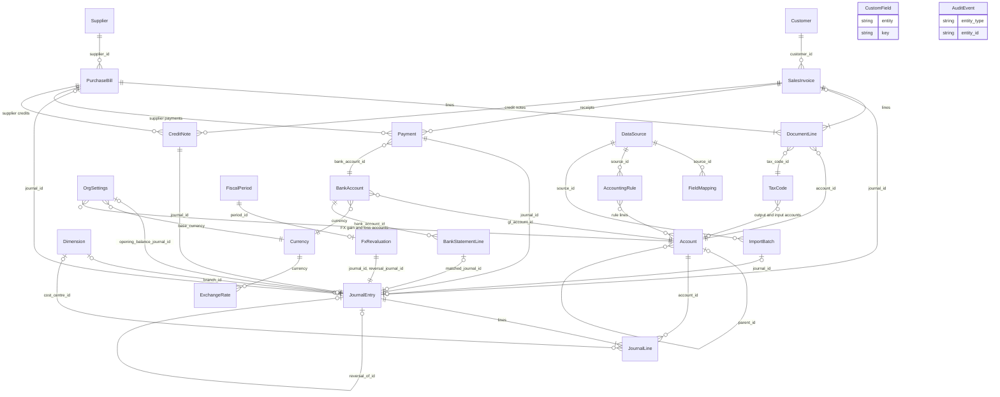

# Accounting data model

This document describes every entity the accounting frontend sends and receives, field by field, together with the request bodies of the write endpoints. It is the wire contract tvs-accounting-bk must serialise to, and it suggests a Postgres table for each entity. Business rules (validation, posting, status transitions) are in `docs/PROCESSING_RULES.md`; this document only covers shapes, types, units and relationships.

**Source of truth.** The in-browser mock backend in `src/mock/api/engine.ts` is the reference implementation, and the entity shapes come from `src/models/accounting.ts`. The endpoint list (methods, paths, query parameters, body and return types) is [API_ENDPOINTS.md](./API_ENDPOINTS.md), generated from `src/services/catalogue.ts`; wire conventions are in [API_CONVENTIONS.md](./API_CONVENTIONS.md) and the sign-up and setup journey in [AUTH_AND_ONBOARDING.md](./AUTH_AND_ONBOARDING.md). If this document disagrees with those files, the files win and this document should be corrected.

---

## 1. Wire conventions

- **Field names** are snake_case, exactly as listed here. Report payloads are snake_case too.
- **Dates** (`date`, `issue_date`, `due_date`, `start_date`, `as_at`, …) are `YYYY-MM-DD` strings with no time or zone.
- **Timestamps** (`created_at`, `updated_at`, `posted_at`, `locked_at`, `occurred_at`, `last_run_at`, `last_reconciled_at`) are ISO-8601 strings in UTC, for example `2026-10-05T09:15:00.000Z` or `2026-10-05T09:15:00+00:00`.
- **Money** is a JSON number rounded to two decimals. Each money field states its currency:
  - **base**: the organisation's base currency (`OrgSettings.base_currency`, default `GHS`). Every journal debit and credit is base.
  - **document currency**: the `currency` of the invoice, bill or payment.
  - **bank currency**: the `currency` of the bank account.
  - **FC**: the foreign currency named in a sibling `currency` field.
- **Exchange rates** are JSON numbers with four decimals (store with at least six), expressed as base currency per one unit of the foreign currency. A base-currency document has rate `1`.
- **Tax rates** are fractions (`0.2` = 20%). `fx_rate_tolerance_pct` is a percentage (`2` = 2%).
- **Ids** are opaque strings. The mock uses prefixed ids (`jn_…`, `inv_…`, `acc_1100`); the API may use UUIDs. Clients must not parse them.
- **Optional fields** (marked "no" in the Required column) may be omitted. A field typed "string or null" is always present but may be `null`.
- **Custom field values** live in `custom_fields`, an object of `key → string`. Numbers, dates and booleans are strings (`"42.5"`, `"2026-10-05"`, `"true"`).
- **Enums** are upper-case strings and are listed with each field. Section 9 collects them.

### 1.1 Standard audit fields

The backend convention (`docs/AUDIT_FIELDS.md` and `docs/API_RESPONSE_FORMAT.md` in the tvs-accounting-bk repository) requires six audit fields on resource rows. In the frontend model they are the `AuditFields` interface:

| Field | Type | Notes |
|---|---|---|
| `created_at` | timestamp | set on insert |
| `updated_at` | timestamp | set on insert and every update |
| `created_by_id` | string or null | platform user id (`cp_users.id`); stored |
| `updated_by_id` | string or null | platform user id; stored |
| `created_by` | string or null | display name resolved from `cp_users` when reading; not stored |
| `updated_by` | string or null | display name resolved when reading; not stored |

Entities in this document marked **Audit fields: yes** include all six in addition to the fields in their table. These are: `Account`, `JournalEntry`, `Customer`, `Supplier`, `SalesInvoice`, `PurchaseBill`, `Payment`, `BankAccount`, `TaxCode`, `Dimension`, `ExchangeRate`, `FxRevaluation`, `CustomField`, `DataSource`, `AccountingRule`, `ImportBatch`.

The frontend model does **not** give audit fields to `FiscalPeriod`, `Currency`, `BankStatementLine`, `FieldMapping` and `OrgSettings` (or to embedded line types and `AuditEvent`, which has its own `occurred_at` / `actor_*`). The API may add them to the first five; the frontend ignores unknown fields.

### 1.2 Tenant scoping (backend-only columns)

Every `acc_` table carries two scoping columns that are **never sent to the client**:

| Column | Source | Notes |
|---|---|---|
| `tenant_id` | JWT claim `tenant_id` | first column of every primary key or unique index, and of every query filter |
| `org_id` | `org-id` request header | the organisation within the tenant; part of every unique key (account codes, document numbers, currency codes, …) |

Child tables (lines, records) should carry both columns as well so that row-level security and partitioning work without joins. Number sequences (section 8) are per `tenant_id` + `org_id` + prefix. How `bus-id` and `loc-id` scope data is an open question in `docs/PROCESSING_RULES.md`.

---

## 2. Entity relationships

`CustomField` and `AuditEvent` are polymorphic: a custom field applies to all records of its `entity` (values stored in each record's `custom_fields`), and an audit event points at any record through `entity_type` and `entity_id`. `Payment.party_id` points at the customer (receipts) or supplier (supplier payments) of its document. `JournalEntry.source.document_id` points at the invoice or bill a document or payment journal belongs to.

---

## 3. Organisation, users and reference data

### 3.1 OrgSettings

Organisation profile and accounting policies. One row per organisation. Returned by `GET /organisation/get`, `POST /organisation/setup` and `PUT /organisation/update`.

Table: `acc_org_settings` (unique on `tenant_id`, `org_id`). Audit fields: no.

| Field | Type | Required | Notes |
|---|---|---|---|
| `name` | string | yes | trading name; not blank |
| `legal_name` | string | yes | |
| `tin` | string | yes | tax identification number; may be empty |
| `country` | string | yes | ISO 3166-1 alpha-2, for example `GH` |
| `base_currency` | string | yes | ISO 4217; default `GHS`; can only change while no journal is `POSTED` or `REVERSED` |
| `setup_completed` | boolean | yes | false until `POST /organisation/setup`; cannot be set through `PUT /organisation/update` |
| `fiscal_year_start` | string | yes | `MM-01`, for example `01-01` |
| `address` | string | yes | may be empty |
| `email` | string | yes | may be empty |
| `phone` | string | yes | may be empty |
| `approval_threshold` | number | yes | base; manual journals with debit total at or above this need approval; ≥ 0; default 50,000 |
| `require_approval_for_manual_journals` | boolean | yes | default true |
| `block_posting_to_locked_periods` | boolean | yes | default true |
| `invoice_prefix` | string | yes | default `INV-{year}-` |
| `bill_prefix` | string | yes | default `BILL-{year}-` |
| `journal_prefix` | string | yes | default `JE-{year}-` |
| `fx_realised_account_id` | string | yes | account id; active, non-group, non-control; default account 6130 |
| `fx_unrealised_account_id` | string | yes | account id; same rules; default account 6140 |
| `fx_rate_tolerance_pct` | number | yes | percentage; ≥ 0; default 2 |
| `default_sales_account_id` | string or null | yes | pre-filled on new invoice lines; active, postable, non-bank `REVENUE` account; default account 4010 |
| `default_purchase_account_id` | string or null | yes | pre-filled on new bill lines; active, postable, non-bank `EXPENSE` or `ASSET` account; default null |
| `default_sales_tax_code_id` | string or null | yes | pre-filled on new invoice lines; active, non-`WITHHOLDING` tax code; default `GH-STD` |
| `default_purchase_tax_code_id` | string or null | yes | pre-filled on new bill lines; same rules; default `GH-STD` |
| `conversion_date` | date or null | no | date opening balances are posted at; set only by `PUT /opening-balances/update` |
| `opening_balance_journal_id` | string or null | no | the current posted opening-balances journal; set only by `PUT /opening-balances/update` |

### 3.2 CurrentUser

A tenant user who can act in Accounting. Comes from the platform's `cp_users`; there is no accounting table. Returned by `GET /users/list` and `GET /users/me`.

| Field | Type | Required | Notes |
|---|---|---|---|
| `id` | string | yes | platform user id; the value stored in `*_by_id` fields |
| `name` | string | yes | display name |
| `email` | string | yes | |
| `role` | string | yes | display role, for example `Finance Manager` |

### 3.3 Currency

Table: `acc_currencies` (primary key `tenant_id`, `org_id`, `code`). Audit fields: no.

| Field | Type | Required | Notes |
|---|---|---|---|
| `code` | string | yes | ISO 4217, three upper-case letters; the identifier (there is no separate id) |
| `name` | string | yes | |
| `symbol` | string | yes | defaults to the code |
| `is_active` | boolean | yes | the base currency is always active; a currency held by a bank account cannot be deactivated |

### 3.4 ExchangeRate

Table: `acc_exchange_rates` (index on `currency`, `date`, `created_at`). Audit fields: yes.

| Field | Type | Required | Notes |
|---|---|---|---|
| `id` | string | yes | |
| `currency` | string | yes | foreign currency code (never the base) |
| `date` | date | yes | the rate applies from this date; never in the future |
| `rate` | number | yes | base per one unit of `currency`; four decimals; > 0 |
| `source` | enum | yes | `MANUAL` or `BANK_OF_GHANA`; only `MANUAL` rates can be deleted |

Several rates may share a currency and date; the one with the latest `created_at` wins.

### 3.5 TaxCode

Table: `acc_tax_codes`. Audit fields: yes. Read-only through the API.

| Field | Type | Required | Notes |
|---|---|---|---|
| `id` | string | yes | |
| `code` | string | yes | short code, for example `GH-STD`; used as the journal line description for tax lines |
| `name` | string | yes | |
| `rate` | number | yes | fraction, for example `0.2` |
| `kind` | enum | yes | `OUTPUT_INPUT` (VAT-type, computed on documents), `WITHHOLDING`, `EXEMPT` |
| `output_account_id` | string or null | yes | account credited with tax on invoices; VAT output used when null |
| `input_account_id` | string or null | yes | account debited with tax on bills; VAT input used when null |
| `is_active` | boolean | yes | |
| `description` | string | yes | |

### 3.6 FiscalPeriod

Table: `acc_fiscal_periods` (unique on `start_date`). Audit fields: no.

| Field | Type | Required | Notes |
|---|---|---|---|
| `id` | string | yes | |
| `name` | string | yes | `{Month} {YYYY}` |
| `start_date` | date | yes | first day of the month |
| `end_date` | date | yes | last day of the month |
| `status` | enum | yes | `OPEN`, `LOCKED`, `CLOSED` |
| `locked_by` | string or null | no | name of the user who locked or closed it; null when `OPEN` (store the user id in the database) |
| `locked_at` | timestamp or null | no | null when `OPEN` |

### 3.7 Dimension

Analysis codes used on journals. Table: `acc_dimensions` (unique on `kind`, lower(`code`)). Audit fields: yes.

| Field | Type | Required | Notes |
|---|---|---|---|
| `id` | string | yes | |
| `code` | string | yes | stored upper-case; unique within `kind` |
| `name` | string | yes | |
| `kind` | enum | yes | `LEGAL_ENTITY`, `BRANCH`, `DEPARTMENT`, `COST_CENTRE`, `PROJECT` |
| `is_active` | boolean | yes | |
| `description` | string | no | |

---

## 4. General ledger

### 4.1 Account

Table: `acc_accounts` (unique on `code`). Audit fields: yes.

| Field | Type | Required | Notes |
|---|---|---|---|
| `id` | string | yes | the mock uses `acc_{code}` |
| `code` | string | yes | four digits; unique |
| `name` | string | yes | |
| `type` | enum | yes | `ASSET`, `LIABILITY`, `EQUITY`, `REVENUE`, `EXPENSE`; inherited from the parent group |
| `subtype` | string | yes | free text; reports rely on `FIXED_ASSET`, `LONG_TERM`, `COST_OF_SALES`, `LOAN_BOOK`; group accounts use `GROUP` |
| `parent_id` | string or null | yes | group account id; null for top-level groups |
| `is_group` | boolean | yes | group accounts cannot be posted to |
| `is_active` | boolean | yes | inactive accounts cannot be posted to by manual journals |
| `is_control` | boolean | yes | AR and AP control accounts; only sub-ledger postings may touch them |
| `is_bank` | boolean | yes | cash and bank GL accounts; treated as cash by the cash flow report |
| `description` | string | no | |
| `custom_fields` | object | no | custom values for entity `Account` |

### 4.2 JournalEntry

Table: `acc_journal_entries` (unique on `number`; index on `date`, `status`, `source_type`). Audit fields: yes (`created_by_id` is the preparer used for maker-checker).

| Field | Type | Required | Notes |
|---|---|---|---|
| `id` | string | yes | |
| `number` | string | yes | `{journal_prefix}{0001}`; one sequence for all journal sources |
| `date` | date | yes | posting date |
| `memo` | string | yes | not blank |
| `reference` | string | no | free reference; defaults to `source.reference` for system journals |
| `status` | enum | yes | `DRAFT`, `PENDING_APPROVAL`, `POSTED`, `REVERSED`; only `POSTED` and `REVERSED` affect balances |
| `source` | SourceRef | yes | where the entry came from (section 4.3) |
| `branch_id` | string or null | yes | `BRANCH` dimension id; copied to every line |
| `lines` | JournalLine[] | yes | at least two when posted; total debit equals total credit |
| `posted_at` | timestamp or null | no | set when the entry becomes `POSTED` |
| `posted_by` | string or null | no | name of the user who posted or approved (store the id) |
| `approved_by` | string or null | no | name of the approver, for entries that went through approval (store the id) |
| `reversal_of_id` | string or null | no | on a reversal: the journal it reverses |
| `reversed_by_id` | string or null | no | on a reversed journal: its reversal |
| `custom_fields` | object | no | custom values for entity `Journal`; omitted when empty |

### 4.3 SourceRef (embedded in JournalEntry)

Store as columns on `acc_journal_entries`: `source_type`, `source_reference`, `source_document_id`.

| Field | Type | Required | Notes |
|---|---|---|---|
| `type` | enum | yes | `MANUAL`, `SALES`, `PURCHASES`, `BANKING`, `STORE_MANAGEMENT`, `LOANS`, `HR`, `IMPORT`, `FX_REVALUATION`, `OPENING_BALANCE`, `YEAR_END`, `SYSTEM` |
| `reference` | string | no | document number, payment number, `TRF-{YYYYMMDD}`, `FX-REVAL-{YYYY-MM}`, batch number, … |
| `document_id` | string | no | invoice or bill id for document and payment journals; such journals cannot be reversed directly |

`SalesInvoice.source` and `PurchaseBill.source` use the same shape (`{ type: "MANUAL" }` for documents entered in the app).

### 4.4 JournalLine

Table: `acc_journal_lines` (foreign key `journal_id`, index on `account_id`). Audit fields: no.

| Field | Type | Required | Notes |
|---|---|---|---|
| `id` | string | yes | |
| `account_id` | string | yes | non-group account |
| `description` | string | no | |
| `debit` | number | yes | base; ≥ 0; exactly one of `debit` and `credit` is non-zero |
| `credit` | number | yes | base; ≥ 0 |
| `branch_id` | string or null | no | copied from the journal |
| `cost_centre_id` | string or null | no | `COST_CENTRE` dimension id |
| `currency` | string or null | no | set on lines carrying a foreign amount (foreign AR/AP and foreign bank lines) |
| `amount_fc` | number or null | no | FC amount in `currency`, on the same side as the debit or credit; required (> 0) on lines posting to a foreign bank GL |

---

## 5. Sales and purchases

### 5.1 Customer and Supplier (Party)

Customers and suppliers share the `Party` shape. Tables: `acc_customers` and `acc_suppliers` (each unique on `code` and on lower(`name`)). Audit fields: yes.

| Field | Type | Required | Notes |
|---|---|---|---|
| `id` | string | yes | |
| `code` | string | yes | `C-0001` for customers, `S-0001` for suppliers; generated |
| `name` | string | yes | unique per kind, case-insensitive |
| `email` | string | yes | may be empty; validated when present |
| `phone` | string | yes | may be empty |
| `city` | string | yes | may be empty |
| `tin` | string | no | |
| `payment_terms_days` | integer | yes | days; ≥ 0; default 30 |
| `credit_limit` | number | yes | ≥ 0; default 0; currency not defined (open question); not enforced |
| `status` | enum | yes | `ACTIVE`, `INACTIVE` |
| `external_reference` | string or null | no | id in the source system, for example `QB-CUS-118` |
| `source` | enum | yes | a `SourceType` value (section 4.3); `MANUAL` for parties created in the app |
| `currency` | string | yes | default currency for new documents; base or an active currency |
| `custom_fields` | object | no | custom values for entity `Customer` or `Supplier` |

### 5.2 SalesInvoice

Table: `acc_sales_invoices` (unique on `number`; index on `customer_id`, `issue_date`, `state`). Audit fields: yes.

| Field | Type | Required | Notes |
|---|---|---|---|
| `id` | string | yes | |
| `number` | string | yes | `{invoice_prefix}{0001}` |
| `customer_id` | string | yes | |
| `issue_date` | date | yes | posting date of the invoice journal |
| `due_date` | date | yes | ≥ `issue_date` |
| `state` | enum | yes | stored lifecycle: `DRAFT`, `APPROVED`, `VOID` (the display status is derived, section 7.1) |
| `lines` | DocumentLine[] | yes | at least one |
| `currency` | string | yes | document currency |
| `exchange_rate` | number | yes | base per one unit of `currency`, fixed when the document is created; `1` for base-currency documents |
| `amount_paid` | number | yes | document currency; sum of receipts and approved credit notes |
| `amount_paid_base` | number | yes | base; carrying value already settled, at the document rate |
| `journal_id` | string or null | yes | the posted journal; null while `DRAFT` |
| `branch_id` | string or null | yes | `BRANCH` dimension id |
| `notes` | string | no | |
| `source` | SourceRef | yes | `{ type: "MANUAL" }` for invoices entered in the app |
| `custom_fields` | object | no | custom values for entity `Invoice` |

Totals (subtotal, tax, total) are not stored or returned; they are computed from the lines and tax codes (`docs/PROCESSING_RULES.md` section 7.3). The API may persist them as derived columns for querying.

### 5.3 PurchaseBill

Table: `acc_purchase_bills` (unique on `number`; partial unique index on `supplier_id`, lower(`supplier_reference`) where `state` is not `VOID`). Audit fields: yes.

Same fields as `SalesInvoice`, with these differences:

| Field | Type | Required | Notes |
|---|---|---|---|
| `number` | string | yes | `{bill_prefix}{0001}` |
| `supplier_id` | string | yes | replaces `customer_id` |
| `supplier_reference` | string | yes | the supplier's own invoice number; unique per supplier among non-void bills |
| `amount_paid` | number | yes | document currency; sum of supplier payments and approved supplier credits |
| `custom_fields` | object | no | custom values for entity `Bill` |

### 5.4 DocumentLine

Embedded in invoices and bills. Tables: `acc_sales_invoice_lines` and `acc_purchase_bill_lines` (same shape, each with a foreign key to its document). Audit fields: no.

| Field | Type | Required | Notes |
|---|---|---|---|
| `id` | string | yes | generated by the server |
| `description` | string | yes | not blank |
| `quantity` | number | yes | > 0; decimals allowed (store `numeric(18,3)`) |
| `unit_price` | number | yes | document currency; > 0 |
| `tax_code_id` | string | yes | |
| `account_id` | string | yes | revenue account on invoices; expense or asset account on bills |

### 5.5 CreditNote

A customer credit note against an invoice or a supplier credit against a bill. Returned by `/credit-notes/*` and `/supplier-credits/*`.

Tables: `acc_credit_notes`, `acc_supplier_credits` (or one table with a `kind` column), plus line tables shaped like `DocumentLine`. Audit fields: yes.

| Field | Type | Required | Notes |
|---|---|---|---|
| `id` | string | yes | |
| `number` | string | yes | `CN-{year}-####` / `SCN-{year}-####`; unique per organisation |
| `party_id` | string | yes | customer or supplier of the document |
| `document_id` | string | yes | invoice or bill id |
| `date` | date | yes | |
| `state` | enum | yes | `APPROVED`, `VOID` |
| `reason` | string | yes | |
| `supplier_reference` | string | no | supplier credits only |
| `lines` | DocumentLine[] | yes | |
| `currency` | string | yes | the document's currency |
| `exchange_rate` | number | yes | the document's rate |
| `base_amount` | number | yes | base carrying value released from AR/AP |
| `journal_id` | string or null | yes | |
| `branch_id` | string or null | yes | the document's branch |

The document's `amount_paid` / `amount_paid_base` include approved credits: they mean "settled by payments and credits".

### 5.6 Payment

Customer receipts and supplier payments share one shape. Table: `acc_payments` with a backend-only `direction` column (`RECEIPT` or `PAYMENT`), unique on (`direction`, `number`). Separate `acc_receipts` and `acc_supplier_payments` tables are an equally valid choice. Audit fields: yes.

| Field | Type | Required | Notes |
|---|---|---|---|
| `id` | string | yes | |
| `number` | string | yes | `RCT-2026-0001` or `PAY-2026-0001` |
| `party_id` | string | yes | the document's customer (receipt) or supplier (payment) |
| `document_id` | string | yes | the invoice (receipt) or bill (payment) settled |
| `date` | date | yes | ≥ the document's `issue_date` |
| `amount` | number | yes | document currency; > 0; ≤ outstanding |
| `currency` | string | yes | the document's currency |
| `exchange_rate` | number | yes | rate on the payment date; four decimals; `1` for base-currency documents |
| `base_amount` | number | yes | base; value banked or paid out = round2(`amount` × `exchange_rate`) |
| `fx_gain_loss` | number | yes | base; realised exchange difference; positive is a gain, negative a loss |
| `method` | enum | yes | `BANK_TRANSFER`, `MOBILE_MONEY`, `CASH`, `CHEQUE` |
| `bank_account_id` | string | yes | |
| `reference` | string | no | |
| `journal_id` | string | yes | the settlement journal |

The carrying value a payment released is `base_amount − fx_gain_loss` for receipts and `base_amount + fx_gain_loss` for supplier payments.

---

## 6. Banking and FX revaluation

### 6.1 BankAccount

Table: `acc_bank_accounts` (unique on `gl_account_id`). Audit fields: yes. Read-only through the API apart from `last_reconciled_at` (reconciliation) and `statement_balance` / `statement_date` (statement import).

| Field | Type | Required | Notes |
|---|---|---|---|
| `id` | string | yes | |
| `name` | string | yes | |
| `bank` | string | yes | bank name, or `Petty cash` / `MTN Mobile Money` |
| `account_number` | string | yes | masked, for example `••••4471` |
| `gl_account_id` | string | yes | the `is_bank` GL account that carries its balance |
| `currency` | string | yes | bank currency |
| `statement_balance` | number | yes | bank currency; balance on the latest statement |
| `statement_date` | date | yes | date of the latest statement |
| `last_reconciled_at` | timestamp or null | yes | set by `POST /reconciliation/complete` |

### 6.2 BankStatementLine

Table: `acc_bank_statement_lines` (partial unique index on `matched_journal_id` where not null). Audit fields: no.

| Field | Type | Required | Notes |
|---|---|---|---|
| `id` | string | yes | |
| `bank_account_id` | string | yes | |
| `date` | date | yes | |
| `description` | string | yes | bank narrative |
| `amount` | number | yes | bank currency (assumed); positive is money in, negative money out |
| `status` | enum | yes | `UNMATCHED`, `SUGGESTED`, `MATCHED` |
| `matched_journal_id` | string or null | yes | set when `MATCHED`; a journal matches at most one line |
| `suggested_journal_id` | string or null | yes | feed or import suggestion when `SUGGESTED` |
| `reference` | string or null | no | the bank's transaction reference, when the statement file has one |
| `import_id` | string or null | no | groups lines added by one `POST /bank-statement-lines/import`; null for feed lines |

### 6.3 FxRevaluation

Table: `acc_fx_revaluations` (unique on `period_id`), with lines in `acc_fx_revaluation_lines`. Audit fields: yes.

| Field | Type | Required | Notes |
|---|---|---|---|
| `id` | string | yes | |
| `period_id` | string | yes | one revaluation per period |
| `as_at` | date | yes | the period's `end_date` |
| `rates` | object | yes | currency code → rate used (store as `jsonb`) |
| `lines` | FxRevaluationLine[] | yes | every open balance considered, including zero differences |
| `net_difference` | number | yes | base; sum of line differences; positive is a net gain |
| `journal_id` | string | yes | revaluation journal dated `as_at` |
| `reversal_journal_id` | string | yes | its reversal, dated the next day |

### 6.4 FxRevaluationLine

Also the `lines` of `GET /revaluations/preview`. Audit fields: no.

| Field | Type | Required | Notes |
|---|---|---|---|
| `kind` | enum | yes | `RECEIVABLE`, `PAYABLE`, `BANK` |
| `currency` | string | yes | foreign currency |
| `label` | string | yes | `{document number} · {party name}` or the bank account name |
| `account_id` | string | yes | AR control, AP control or the bank GL |
| `amount_fc` | number | yes | FC; open amount as at `as_at` |
| `carrying_base` | number | yes | base; current carrying value |
| `rate` | number | yes | rate on `as_at` |
| `revalued_base` | number | yes | base; round2(`amount_fc` × `rate`) |
| `difference` | number | yes | base; positive is a gain |

---

## 7. Configuration, integrations and audit

### 7.1 CustomField

Table: `acc_custom_fields` (unique on `entity`, `key`). Audit fields: yes.

| Field | Type | Required | Notes |
|---|---|---|---|
| `id` | string | yes | |
| `entity` | enum | yes | `Customer`, `Supplier`, `Invoice`, `Bill`, `Journal`, `Account` (title case, as written); never changes |
| `key` | string | yes | lower_snake_case starting with a letter; unique per entity; never changes |
| `label` | string | yes | |
| `type` | enum | yes | `TEXT`, `LONG_TEXT`, `NUMBER`, `DATE`, `SELECT`, `BOOLEAN`; cannot change once any record holds a value |
| `scope` | enum | yes | `FINANCIAL` (business data) or `SOURCE_REFERENCE` (id in an external system) |
| `options` | string[] | no | `SELECT` only; at least two, unique |
| `required` | boolean | yes | ignored for `BOOLEAN` |
| `description` | string | no | help text under the input |
| `default_value` | string | no | must be valid for the type; applied by the frontend when a form opens |
| `is_active` | boolean | yes | inactive fields are hidden and not validated; their values are kept |
| `position` | integer | yes | order within the entity, lowest first, renumbered 1…n on move |
| `show_in_list` | boolean | yes | show as a column in list pages |

Values are stored on each owning record as a `jsonb` column `custom_fields`.

### 7.2 DataSource

Table: `acc_data_sources`. Audit fields: yes.

| Field | Type | Required | Notes |
|---|---|---|---|
| `id` | string | yes | |
| `name` | string | yes | |
| `provider` | string | yes | for example `Trovesuite`, `QuickBooks` |
| `kind` | enum | yes | `TROVESUITE`, `ACCOUNTING_SYSTEM`, `FILE`, `BANK`, `API` |
| `status` | enum | yes | `CONNECTED`, `WARNING`, `ERROR`, `NOT_CONNECTED` |
| `description` | string | yes | |
| `sync_direction` | enum | yes | `INBOUND`, `OUTBOUND`, `BIDIRECTIONAL` |
| `schedule` | string | yes | human-readable, for example `Every 15 minutes`, `Manual` |
| `entities` | string[] | yes | record kinds brought in, for example `Sales`, `Customers` |
| `last_run_at` | timestamp or null | yes | |
| `last_run_status` | enum or null | yes | `SUCCESS`, `PARTIAL`, `FAILED` |
| `records_synced` | integer | yes | running count |
| `error_count` | integer | yes | records held for review |
| `connection` | object | yes | setting name → value; secret values (names containing token, secret, key, password) are returned masked as `••••••••`; store secrets outside this table |
| `status_message` | string | no | explanation for `WARNING` or `ERROR` |

### 7.3 FieldMapping

Table: `acc_field_mappings` (unique on `source_id`, `entity`, `target_field`). Audit fields: no.

| Field | Type | Required | Notes |
|---|---|---|---|
| `id` | string | yes | |
| `source_id` | string | yes | data source id |
| `entity` | string | yes | source record kind, for example `Sales`, `Invoices` |
| `source_field` | string | yes | field name in the source |
| `target_field` | string | yes | dotted Trovesuite field, for example `journal.date`, `amounts.total`, `custom.{key}` |
| `transform` | string | yes | human-readable transform, `—` when none |
| `required` | boolean | yes | required mappings cannot be deleted |

### 7.4 AccountingRule and AccountingRuleLine

Tables: `acc_accounting_rules` and `acc_accounting_rule_lines`. Audit fields: yes on the rule, no on its lines.

`AccountingRule`:

| Field | Type | Required | Notes |
|---|---|---|---|
| `id` | string | yes | |
| `name` | string | yes | |
| `event` | string | yes | source event code, for example `store.sale.completed` |
| `source_id` | string | yes | data source id |
| `description` | string | yes | |
| `is_active` | boolean | yes | |
| `lines` | AccountingRuleLine[] | yes | |
| `sample` | object | yes | basis → example amount (base), used to preview the rule |
| `postings_count` | integer | yes | number of journals posted by the rule |

`AccountingRuleLine`:

| Field | Type | Required | Notes |
|---|---|---|---|
| `side` | enum | yes | `DEBIT`, `CREDIT` |
| `account_id` | string | yes | |
| `basis` | enum | yes | `TOTAL`, `SUBTOTAL`, `TAX`, `COST`, `PRINCIPAL`, `INTEREST`, `FEES` |
| `label` | string | yes | |

### 7.5 ImportBatch and ImportRecord

Tables: `acc_import_batches` (unique on `number`) and `acc_import_records` (unique on `batch_id`, `row`). Audit fields: yes on the batch, no on records.

`ImportBatch`:

| Field | Type | Required | Notes |
|---|---|---|---|
| `id` | string | yes | |
| `number` | string | yes | `IMP-0001` |
| `source_id` | string | yes | data source id |
| `entity` | string | yes | record kind, for example `Sales`, `Invoices`, `Bills`, `Customers`, `Opening balances`, `Bank statement lines` |
| `file_name` | string or null | yes | null for batches delivered by a source |
| `status` | enum | yes | `NEEDS_REVIEW`, `POSTED`, `PARTIALLY_POSTED`, `FAILED` |
| `records` | ImportRecord[] | yes | |
| `journal_id` | string or null | yes | journal posted for financial entities |

`ImportRecord`:

| Field | Type | Required | Notes |
|---|---|---|---|
| `row` | integer | yes | 1-based row number; identifies the record within its batch |
| `external_reference` | string | yes | id in the source |
| `summary` | string | yes | |
| `amount` | number | yes | signed; currency not defined (assumed base); 0 for non-financial rows |
| `status` | enum | yes | `VALID`, `WARNING`, `ERROR` |
| `message` | string | no | validation message |
| `posted` | boolean | yes | |

### 7.6 AuditEvent

Table: `acc_audit_events` (index on `occurred_at`, `entity_type`, `entity_id`, `actor_id`). Append-only. Audit fields: no (it uses `occurred_at` and `actor_*`).

| Field | Type | Required | Notes |
|---|---|---|---|
| `id` | string | yes | |
| `occurred_at` | timestamp | yes | |
| `actor_id` | string or null | yes | user id, or a service id such as `svc_integrations` |
| `actor_name` | string | yes | display name (resolve from `cp_users` when reading) |
| `actor_type` | enum | yes | `USER`, `SYSTEM`, `INTEGRATION` |
| `action` | string | yes | action code, for example `JOURNAL.POSTED`; full list in `docs/PROCESSING_RULES.md` section 16 |
| `entity_type` | string | yes | display entity name: `Account`, `Journal`, `Fiscal period`, `Customer`, `Supplier`, `Invoice`, `Bill`, `Receipt`, `Supplier payment`, `Statement line`, `Bank account`, `Data source`, `Field mapping`, `Custom field`, `Currency`, `Exchange rate`, `Accounting rule`, `Import batch`, `Organisation`, `Dimension` |
| `entity_id` | string or null | yes | id of the record (currency code for currencies; null for settings and reference-rate fetches) |
| `entity_label` | string | yes | human label, usually the record's number, code or name |
| `summary` | string | yes | one-sentence description |
| `changes` | object[] | no | `{ field, from, to }`, where `from` and `to` are strings or null (store as `jsonb`) |

---

## 8. Number sequences (backend-only)

The frontend does not see this table. Suggested: `acc_number_sequences` with `tenant_id`, `org_id`, `prefix`, `last_value`, primary key (`tenant_id`, `org_id`, `prefix`), incremented under a row lock in the same transaction as the insert. Prefixes in use: the three `OrgSettings` prefixes, `RCT-2026-`, `PAY-2026-`, `C-`, `S-`, `IMP-`.

---

## 9. Request bodies

Bodies are JSON objects. Fields not listed are ignored by well-behaved endpoints (the API should bind only these).

### 9.1 JournalDraftInput and JournalDraftLine

Used by `POST /journals/add` (with `intent`) and `PUT /journals/update`.

`JournalDraftInput`:

| Field | Type | Required | Notes |
|---|---|---|---|
| `date` | date | yes | |
| `memo` | string | yes | not blank |
| `reference` | string | no | |
| `branch_id` | string or null | yes | `BRANCH` dimension id |
| `lines` | JournalDraftLine[] | yes | |
| `custom_fields` | object | no | `Journal` custom values |
| `intent` | `DRAFT` or `POST` | no | `POST /journals/add` only; anything other than `POST` saves a draft |

`JournalDraftLine`:

| Field | Type | Required | Notes |
|---|---|---|---|
| `account_id` | string | yes | |
| `description` | string | no | |
| `debit` | number | yes | base; ≥ 0 |
| `credit` | number | yes | base; ≥ 0 |
| `cost_centre_id` | string or null | no | |
| `currency` | string or null | no | required with `amount_fc` on foreign bank GL lines |
| `amount_fc` | number or null | no | FC amount in `currency` |

### 9.2 DocumentInput

Used by `POST /invoices/add` and `POST /bills/add`, each with `approve`.

| Field | Type | Required | Notes |
|---|---|---|---|
| `party_id` | string | yes | customer id (invoices) or supplier id (bills) |
| `issue_date` | date | yes | |
| `due_date` | date | yes | ≥ `issue_date` |
| `supplier_reference` | string | bills only | the supplier's invoice number |
| `branch_id` | string or null | yes | |
| `notes` | string | no | |
| `currency` | string | yes | document currency |
| `exchange_rate` | number | yes | base per one unit; > 0 for foreign currencies; ignored (stored as 1) for the base currency |
| `lines` | object[] | yes | `DocumentLine` without `id`: `description`, `quantity`, `unit_price`, `tax_code_id`, `account_id` |
| `custom_fields` | object | no | `Invoice` or `Bill` custom values |
| `approve` | boolean | no | `true` (or `"true"`) approves and posts immediately; otherwise a draft is saved |

### 9.3 PaymentInput

Used by `POST /receipts/add` and `POST /supplier-payments/add`.

| Field | Type | Required | Notes |
|---|---|---|---|
| `document_id` | string | yes | invoice id (receipts) or bill id (payments) |
| `date` | date | yes | |
| `amount` | number | yes | document currency |
| `exchange_rate` | number | yes | rate on the payment date; rounded to four decimals; ignored for base-currency documents |
| `method` | enum | yes | `BANK_TRANSFER`, `MOBILE_MONEY`, `CASH`, `CHEQUE` |
| `bank_account_id` | string | yes | |
| `reference` | string | no | |

### 9.4 ImportInput

Used by `POST /imports/add`.

| Field | Type | Required | Notes |
|---|---|---|---|
| `source_id` | string | yes | |
| `entity` | string | yes | |
| `file_name` | string or null | yes | |
| `records` | object[] | yes | `ImportRecord` without `posted`: `row`, `external_reference`, `summary`, `amount`, `status`, `message?`; at least one |
| `post` | boolean | yes | post valid rows immediately |

### 9.5 OrganisationSetupInput

Used by `POST /organisation/setup`.

| Field | Type | Required | Notes |
|---|---|---|---|
| `name` | string | yes | trading name |
| `legal_name` | string | yes | |
| `tin` | string | no | |
| `country` | string | yes | ISO 3166-1 alpha-2, upper case |
| `base_currency` | string | yes | ISO 4217, upper case |
| `fiscal_year_start` | string | yes | `MM-01` |
| `address` | string | no | |
| `email` | string | no | |
| `phone` | string | no | |

### 9.6 CreditNoteInput

Used by `POST /credit-notes/add` and `POST /supplier-credits/add`. Rules in `docs/PROCESSING_RULES.md` section 19.

| Field | Type | Required | Notes |
|---|---|---|---|
| `document_id` | string | yes | approved invoice (credit notes) or bill (supplier credits) |
| `date` | date | yes | not before the document's issue date |
| `reason` | string | yes | |
| `supplier_reference` | string | supplier credits | the supplier's credit note number; unique per supplier among non-void credits |
| `lines` | object[] | yes | `DocumentLine` without `id`; total with tax ≤ the document's outstanding amount |

### 9.7 OpeningBalancesInput

Used by `PUT /opening-balances/update`. Rules in `docs/PROCESSING_RULES.md` section 18.

| Field | Type | Required | Notes |
|---|---|---|---|
| `date` | date | yes | conversion date; on or before the first non-opening transaction |
| `lines` | object[] | yes | `{ account_id, debit, credit }`; replaces every account balance; zero lines are dropped; no control, group, inactive, foreign-bank or Opening Balance Equity accounts |
| `receivables` | object[] | yes | new unpaid customer invoices: `{ party_id, reference, issue_date, due_date, amount }`; base currency |
| `payables` | object[] | yes | new unpaid supplier bills, same shape |
| `removed_item_ids` | string[] | no | existing opening invoices / bills to void; must be unpaid |

### 9.8 StatementImportInput

Used by `POST /bank-statement-lines/import`. Rules in `docs/PROCESSING_RULES.md` section 11.3a.

| Field | Type | Required | Notes |
|---|---|---|---|
| `bank_account_id` | string | yes | |
| `file_name` | string | no | shown in the audit summary |
| `statement_date` | date | yes | date of the closing balance; on or after every line and the account's current `statement_date`; not in the future |
| `closing_balance` | number | yes | bank currency, as printed on the statement |
| `lines` | object[] | yes | 1–2,000 of `{ date, description, amount, reference? }`; amount signed, positive is money in |

Response `StatementImportResult`: `{ import_id, imported, duplicates, suggested, expected_closing_balance, balance_difference, lines: BankStatementLine[] }`.

### 9.9 Inline request bodies

These bodies have no named type in the engine.

| Endpoint | Body |
|---|---|
| `PUT /organisation/update` | `Partial<OrgSettings>`; `setup_completed`, `conversion_date` and `opening_balance_journal_id` are ignored |
| `POST /accounts/add` | `{ code, name, parent_id, subtype, description?, is_bank?, custom_fields? }` |
| `PUT /accounts/update` | `{ name?, description?, is_active?, custom_fields? }` |
| `POST /customers/add`, `POST /suppliers/add` | `Partial<Party>` with `name` required; `code`, `status`, `source` and audit fields are ignored on create |
| `PUT /customers/update`, `PUT /suppliers/update` | `Partial<Party>`; the mock requires `name` |
| `POST /journals/reject` | `{ reason }` |
| `POST /journals/reverse` | `{ date, reason }` |
| `POST /invoices/void`, `POST /bills/void` | `{ reason }` |
| `POST /credit-notes/void`, `POST /supplier-credits/void` | `{ reason }` |
| `PUT /fiscal-periods/update-status` | `{ status: "OPEN" \| "LOCKED" \| "CLOSED" }` |
| `POST /bank-accounts/transfer` | `{ from, to, amount, date, memo, rate? }`: `from` and `to` are bank account ids; `amount` is in the source account's currency; `rate` is base per unit of the foreign side |
| `POST /reconciliation/match` | `{ statement_line_id, journal_id }` |
| `POST /reconciliation/create-entry` | `{ statement_line_id, account_id, memo }` |
| `POST /data-sources/connect` | `{ entities: string[], schedule, connection: Record<string, string> }` |
| `POST /field-mappings/add`, `PUT /field-mappings/update` | `{ source_id, entity, source_field, target_field, transform, required }` |
| `PUT /accounting-rules/update` | `{ is_active }` |
| `POST /custom-fields/add` | `{ entity, key, label, type, scope, options?, required, description?, default_value?, show_in_list }` |
| `PUT /custom-fields/update` | any of `{ label, description, type, scope, options, required, default_value, show_in_list, is_active }` |
| `POST /custom-fields/move` | `{ direction }`: negative moves up, otherwise down |
| `PUT /custom-fields/values` | `{ values: Record<string, string> }` (query `entity`, `record_id`) |
| `POST /currencies/add` | `{ code, name, symbol }` |
| `PUT /currencies/update` | `{ is_active }` |
| `POST /exchange-rates/add` | `{ currency, date, rate }` |
| `POST /dimensions/add` | `{ kind, code, name, description? }` |
| `PUT /dimensions/update` | `{ is_active }` |

Endpoints not listed take no body (ids and options are query parameters).

---

## 10. Derived and report shapes

These shapes are computed, not stored.

**Document display status and outstanding amounts.** The frontend derives these from each invoice or bill (`src/store/selectors.ts`); the API does not return them today. `status` is `DRAFT`, `OPEN`, `PARTIALLY_PAID`, `PAID`, `OVERDUE` or `VOID`; `total_base` and `outstanding` are base; `outstanding_fc` is document currency. Definitions are in `docs/PROCESSING_RULES.md` section 7.1.

**Report payloads** (definitions in `docs/PROCESSING_RULES.md` section 17):

| Endpoint | `data` shape |
|---|---|
| `GET /reports/trial-balance` | `{ rows: [{ account: Account, debit, credit }], totals: { debit, credit, difference } }` |
| `GET /reports/general-ledger` | `{ opening, rows: [{ journal: JournalEntry, line: JournalLine, balance }], totals: { debit, credit, difference }, closing }` |
| `GET /reports/income-statement` | `{ revenue, cost_of_sales, operating, total_revenue, total_cost_of_sales, gross_profit, total_operating, net_income }`; each section is `[{ account: Account, amount }]` |
| `GET /reports/balance-sheet` | `{ current_assets, fixed_assets, current_liabilities, long_term_liabilities, equity, current_earnings, total_current_assets, total_fixed_assets, total_current_liabilities, total_long_term_liabilities, total_assets, total_liabilities, total_equity, total_liabilities_and_equity, difference }`; sections are `[{ account, amount }]` |
| `GET /reports/cash-flow` | `{ operating, investing, financing, total_operating, total_investing, total_financing, opening, net_change, closing }`; sections are `[{ label, amount }]` |
| `GET /reports/ar-ageing`, `GET /reports/ap-ageing` | `AgeingReport`: `{ as_at, buckets: string[], rows: [{ party_id, party_code, party_name, buckets: { "<bucket label>": number }, total, documents: [{ document_id, number, issue_date, due_date, days_overdue, bucket, outstanding }] }], totals: { "<bucket label>": number, total } }` |
| `GET /reports/monthly-trend` | `MonthlyTrendReport`: `{ from_date, to_date, months: [{ month: "YYYY-MM", revenue, expenses, net_income, closing_cash }] }` |
| `GET /reports/tax-summary` | `TaxSummaryReport`: `{ from_date, to_date, return_due_day, months: TaxSummaryMonth[], totals: { output_tax, input_tax, net_payable, withholding_tax }, next_return: TaxSummaryMonth \| null, accounts: { output, input, withholding: [{ account_id, code, name, balance }] } }`; `TaxSummaryMonth` = `{ month: "YYYY-MM", output_tax, input_tax, net_payable, withholding_tax, due_date, status: "IN_PROGRESS" \| "DUE" \| "OVERDUE" \| "FILED" \| "NOTHING_DUE", filing: { journal_id, number, date, amount } \| null }` |
| `GET /reports/customer-statement`, `GET /reports/supplier-statement` | `PartyStatement`: `{ kind, party_id, party_name, party_code, currency, currencies, from_date, to_date, opening_balance, entries: [{ date, type, number, document_id, description, charge, credit, balance }], total_charges, total_credits, closing_balance, ageing: { "<bucket label>": number, total }, open_documents: [{ document_id, number, issue_date, due_date, total, outstanding, bucket }] }`; amounts in the statement `currency` |
| `GET /dashboard/statistics` | `DashboardStatistics`: `{ as_at, revenue_mtd, expenses_mtd, net_income_mtd, revenue_ytd, net_income_ytd, cash_balance, receivables, overdue_receivables, overdue_invoices, payables, overdue_payables, payables_due_7_days, journals_pending_approval, draft_journals, unmatched_statement_lines }` |
| `GET /opening-balances/get`, `PUT /opening-balances/update` | `OpeningBalancesView`: `{ conversion_date, journal_id, journal_number, lines: [{ account_id, debit, credit }], receivables: SalesInvoice[], payables: PurchaseBill[], opening_equity_balance, first_transaction_date, locked_reason }` |
| `GET /revaluations/preview` | `{ rates: { "<currency>": number }, lines: FxRevaluationLine[], missing: string[] }` |
| `GET /fiscal-years/list` | `{ items: FiscalYearView[] }`; `FiscalYearView` = `{ id, name, start_date, end_date, status: "OPEN" \| "CLOSED", periods: { total, open, locked, closed }, net_income, closing_journal_id, closing_journal_number, closed_at, closed_by }`. Derived from periods and journals, not stored |
| `GET /fiscal-years/close-preview` | `YearEndPreview`: `{ fiscal_year: FiscalYearView, retained_earnings_account_id, lines: [{ account_id, debit, credit }], net_income, blockers: string[], warnings: string[] }` |
| `POST /fiscal-years/close` | `{ fiscal_year: FiscalYearView, journal: JournalEntry \| null }` |
| `GET /navigation` | `{ items: [{ method, path, module, summary }] }` |

All report amounts are base, except statements, which are in the document currency.

---

## 11. Enumerations

| Enum | Values | Used by |
|---|---|---|
| `AccountType` | `ASSET`, `LIABILITY`, `EQUITY`, `REVENUE`, `EXPENSE` | `Account.type` |
| `SourceType` | `MANUAL`, `SALES`, `PURCHASES`, `BANKING`, `STORE_MANAGEMENT`, `LOANS`, `HR`, `IMPORT`, `FX_REVALUATION`, `OPENING_BALANCE`, `YEAR_END`, `SYSTEM` | `SourceRef.type`, `Party.source` |
| `JournalStatus` | `DRAFT`, `PENDING_APPROVAL`, `POSTED`, `REVERSED` | `JournalEntry.status` |
| `PartyStatus` | `ACTIVE`, `INACTIVE` | `Party.status` |
| `DocumentState` | `DRAFT`, `APPROVED`, `VOID` | `SalesInvoice.state`, `PurchaseBill.state` |
| `DocumentDisplayStatus` (derived) | `DRAFT`, `OPEN`, `PARTIALLY_PAID`, `PAID`, `OVERDUE`, `VOID` | frontend lists |
| `PaymentMethod` | `BANK_TRANSFER`, `MOBILE_MONEY`, `CASH`, `CHEQUE` | `Payment.method` |
| `StatementLineStatus` | `UNMATCHED`, `SUGGESTED`, `MATCHED` | `BankStatementLine.status` |
| `TaxCode.kind` | `OUTPUT_INPUT`, `WITHHOLDING`, `EXEMPT` | `TaxCode.kind` |
| `PeriodStatus` | `OPEN`, `LOCKED`, `CLOSED` | `FiscalPeriod.status` |
| `Dimension.kind` | `LEGAL_ENTITY`, `BRANCH`, `DEPARTMENT`, `COST_CENTRE`, `PROJECT` | `Dimension.kind` |
| `DataSourceKind` | `TROVESUITE`, `ACCOUNTING_SYSTEM`, `FILE`, `BANK`, `API` | `DataSource.kind` |
| `DataSourceStatus` | `CONNECTED`, `WARNING`, `ERROR`, `NOT_CONNECTED` | `DataSource.status` |
| `DataSource.sync_direction` | `INBOUND`, `OUTBOUND`, `BIDIRECTIONAL` | `DataSource.sync_direction` |
| `DataSource.last_run_status` | `SUCCESS`, `PARTIAL`, `FAILED` (or null) | `DataSource.last_run_status` |
| `ImportBatchStatus` | `NEEDS_REVIEW`, `POSTED`, `PARTIALLY_POSTED`, `FAILED` | `ImportBatch.status` |
| `ImportRecord.status` | `VALID`, `WARNING`, `ERROR` | `ImportRecord.status` |
| `CustomFieldEntity` | `Customer`, `Supplier`, `Invoice`, `Bill`, `Journal`, `Account` | `CustomField.entity`, `PUT /custom-fields/values?entity=` |
| `CustomFieldType` | `TEXT`, `LONG_TEXT`, `NUMBER`, `DATE`, `SELECT`, `BOOLEAN` | `CustomField.type` |
| `CustomFieldScope` | `FINANCIAL`, `SOURCE_REFERENCE` | `CustomField.scope` |
| `ExchangeRateSource` | `MANUAL`, `BANK_OF_GHANA` | `ExchangeRate.source` |
| `FxRevaluationLine.kind` | `RECEIVABLE`, `PAYABLE`, `BANK` | `FxRevaluationLine.kind` |
| `RuleAmountBasis` | `TOTAL`, `SUBTOTAL`, `TAX`, `COST`, `PRINCIPAL`, `INTEREST`, `FEES` | `AccountingRuleLine.basis`, `AccountingRule.sample` keys |
| `AccountingRuleLine.side` | `DEBIT`, `CREDIT` | `AccountingRuleLine.side` |
| `ActorType` | `USER`, `SYSTEM`, `INTEGRATION` | `AuditEvent.actor_type` |

---

## 12. Suggested Postgres tables

All tables carry the backend-only `tenant_id` and `org_id` columns (section 1.2). Suggested types: money `numeric(18,2)`, rates `numeric(18,6)`, tax rates `numeric(9,6)`, quantities `numeric(18,3)`, dates `date`, timestamps `timestamptz`, maps and change lists `jsonb`, string lists `text[]`.

| Entity | Table | Key constraints (within `tenant_id`, `org_id`) |
|---|---|---|
| OrgSettings | `acc_org_settings` | one row per organisation |
| Account | `acc_accounts` | unique `code` |
| FiscalPeriod | `acc_fiscal_periods` | unique `start_date` |
| Dimension | `acc_dimensions` | unique (`kind`, lower(`code`)) |
| Currency | `acc_currencies` | primary key `code` |
| ExchangeRate | `acc_exchange_rates` | index (`currency`, `date`, `created_at`) |
| TaxCode | `acc_tax_codes` | unique `code` |
| JournalEntry | `acc_journal_entries` | unique `number`; `source_*` columns |
| JournalLine | `acc_journal_lines` | foreign key `journal_id`; index `account_id` |
| Customer | `acc_customers` | unique `code`; unique lower(`name`) |
| Supplier | `acc_suppliers` | unique `code`; unique lower(`name`) |
| SalesInvoice | `acc_sales_invoices` | unique `number` |
| PurchaseBill | `acc_purchase_bills` | unique `number`; unique (`supplier_id`, lower(`supplier_reference`)) where `state` <> `VOID` |
| DocumentLine | `acc_sales_invoice_lines`, `acc_purchase_bill_lines` | foreign key to the document |
| Payment | `acc_payments` | backend-only `direction`; unique (`direction`, `number`) |
| CreditNote | `acc_credit_notes`, `acc_credit_note_lines` | backend-only `direction` (customer / supplier); unique (`direction`, `number`) |
| BankAccount | `acc_bank_accounts` | unique `gl_account_id` |
| BankStatementLine | `acc_bank_statement_lines` | unique `matched_journal_id` where not null |
| FxRevaluation | `acc_fx_revaluations` | unique `period_id` |
| FxRevaluationLine | `acc_fx_revaluation_lines` | foreign key `revaluation_id` |
| CustomField | `acc_custom_fields` | unique (`entity`, `key`) |
| DataSource | `acc_data_sources` | secrets held outside the table |
| FieldMapping | `acc_field_mappings` | unique (`source_id`, `entity`, `target_field`) |
| AccountingRule | `acc_accounting_rules` | |
| AccountingRuleLine | `acc_accounting_rule_lines` | foreign key `rule_id` |
| ImportBatch | `acc_import_batches` | unique `number` |
| ImportRecord | `acc_import_records` | unique (`batch_id`, `row`) |
| AuditEvent | `acc_audit_events` | append-only; index (`occurred_at`), (`entity_type`, `entity_id`) |
| (sequences) | `acc_number_sequences` | primary key `prefix` |
