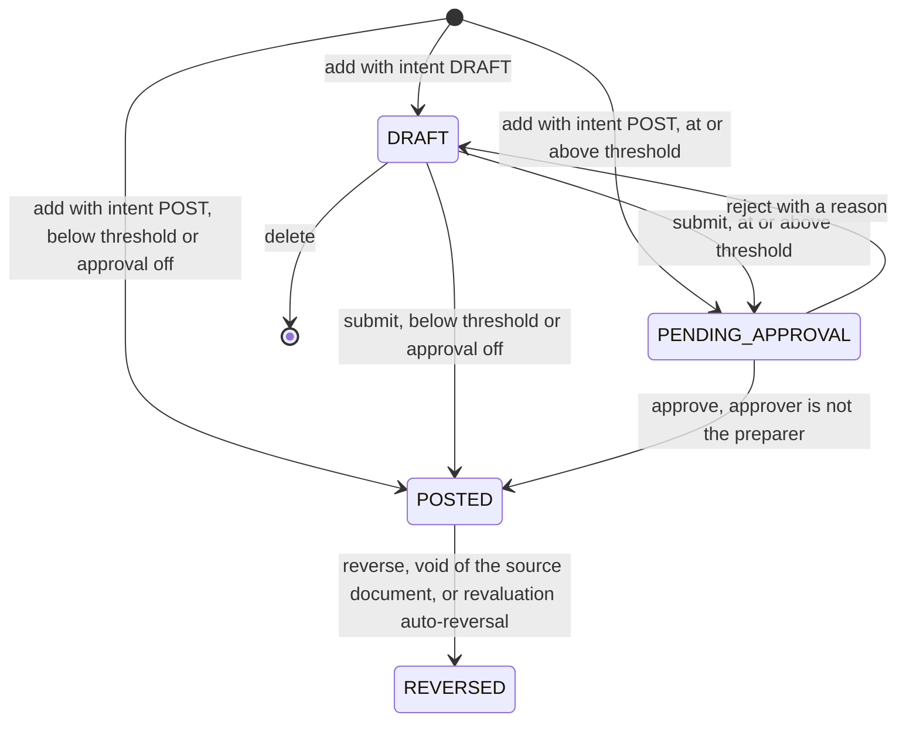
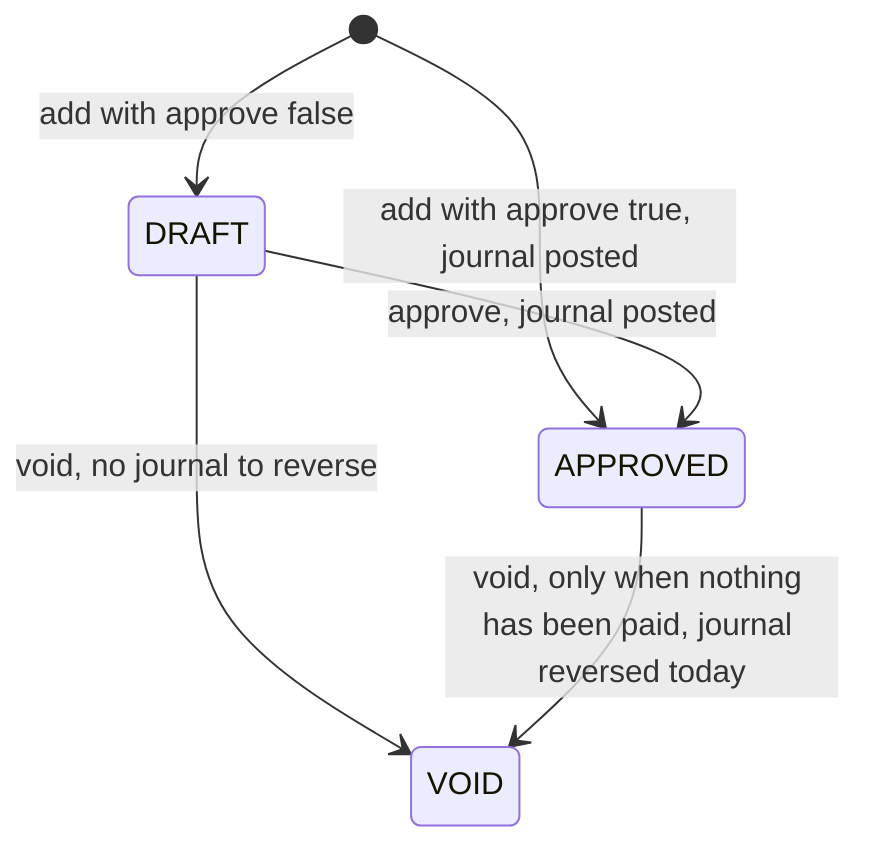

# Accounting processing rules

This document specifies the business rules that tvs-accounting-bk must enforce so that the accounting frontend works against the real API without changes. It covers every write operation the frontend calls: the validation it must perform (with the exact user-facing error messages), the rows it creates or changes, the journals it posts, the audit events it records and what it returns. It also defines how the read-only reports are calculated. It is written for the backend engineers implementing the .NET API.

**Source of truth.** The in-browser mock backend in `src/mock/api/engine.ts` is the reference implementation of these rules; when this document and the engine disagree, the engine wins and this document should be corrected. The HTTP layer that maps endpoints to engine actions is `src/mock/api/routes.ts` (with request handling in `src/mock/api/worker.ts` and `src/mock/api/http.ts`). The endpoint list (methods, paths, query parameters, body types, permissions) is [API_ENDPOINTS.md](./API_ENDPOINTS.md), generated from `src/services/catalogue.ts`. Entity shapes are described in [DATA_MODEL.md](./DATA_MODEL.md). Headers, envelope and pagination are in [API_CONVENTIONS.md](./API_CONVENTIONS.md); sign-up, login and the setup journey are in [AUTH_AND_ONBOARDING.md](./AUTH_AND_ONBOARDING.md).

---

## Contents

1. Conventions used in this doc
2. Numbering
3. Fiscal periods and posting dates
4. Journals
5. Chart of accounts
6. Customers and suppliers
7. Sales invoices and purchase bills
8. Receipts and supplier payments
9. Multi-currency and exchange rates
10. FX revaluation
11. Banking
12. Tax
13. Custom fields
14. Integrations
15. Organisation setup, settings, dimensions and users
16. Audit trail
17. Reports
18. Opening balances
19. Credit notes and supplier credits
20. Open questions for backend
21. Mock simplifications the API must not copy

---

## 1. Conventions used in this doc

### 1.1 Transport

- All paths are relative to `/api/v1`. Resource ids go in the query string (`?journal_id=…`), never in the path. Wire format is snake_case JSON.
- Every response uses the standard Trovesuite envelope (`success`, `status_code`, `detail`, `error`, `data`, `field_errors`, `pagination`). See `docs/API_RESPONSE_FORMAT.md` in the tvs-accounting-bk repository for the envelope, `docs/AUDIT_FIELDS.md` there for the six audit fields, and `docs/RBAC_ROLES.md` there for how the permission ids in the catalogue (`permission-accounting-{resource}-{verb}`) are seeded and enforced.
- Every `/list` endpoint accepts `page` (1-based, default 1), `size` (default 20, maximum 100, the `PagedQuery` cap; larger values are clamped), `sort_by`, `sort_order` (`asc` or `desc`) and `search`, and returns `data.items[]` plus `pagination`. Module filters are equality matches on a field; `from_date` and `to_date` are inclusive bounds on the date part of the list's date field. Filtering, search and sorting happen before pagination, and `pagination.total` counts every matching row. An explicit `sort_by` without `sort_order` sorts ascending; without `sort_by` each list uses its documented default order.
- Lists of records that carry custom fields (journals, invoices, bills) also accept `cf_<key>=<value>`, an equality filter on that custom field's value. For a `BOOLEAN` field, `cf_<key>=false` also matches records where the field was never set. `sort_by=cf_<key>` sorts by that value, and `search` matches custom field values too.
- The journal, invoice and bill list pages and the receipt and supplier payment pages read one page at a time (`size=25`) with the user's filters, search, sort and page on the query string. Their stat cards and tab counts come from the matching `/statistics` endpoint, never from the loaded page. Exports page through the same list query at `size=100`. Other screens still read whole collections by paging at `size=100` until `has_next` is false; that moves to per-screen queries in later steps.

### 1.2 Request pipeline and error mapping

The mock applies these checks in this order before running any business rule. The first six rows mirror `TroveRequestHeadersMiddleware` in the API template (same order, status codes and messages); the real API should produce the same status codes and `error` codes.

| Check | Status | `error` | `detail` |
|---|---|---|---|
| Missing `app-id`, `authorization`, `bus-id`, `loc-id` or `org-id` header (checked in that order) | 400 | `MISSING_HEADER` | `Validation failed.` with `field_errors: { "{header}": "Required header '{header}' is missing. Include it on every /api/v1/* request." }` |
| `app-id` is not the accounting app id | 400 | `INVALID_APP_ID` | `Validation failed.` with `field_errors: { "app-id": "Header 'app-id' must be '{app id}'." }` |
| `authorization` is not `Bearer <token>` | 401 | `UNAUTHORIZED` | `Validation failed.` with `field_errors: { "authorization": "Header 'authorization' must be a Bearer JWT." }` |
| Token has no `tenant_id` claim | 401 | `UNAUTHORIZED` | `Validation failed.` with `field_errors: { "authorization": "JWT must include a tenant_id claim for platform context validation." }` |
| Token expired | 401 | `TOKEN_EXPIRED` | `Token expired` |
| Tenant has no books, `org-id` / `bus-id` / `loc-id` are not the tenant's, or the token's `user_id` is not a tenant user | 403 | `FORBIDDEN` | `Invalid platform context: org-id, bus-id, loc-id, and app-id are not configured for this user/tenant, or the user has no access.` |
| Organisation not set up and route not in the allowed list (section 15.1) | 409 | `ORGANISATION_NOT_SET_UP` | `Finish setting up the organisation before using the books.` |
| No such route | 404 | `NOT_FOUND` | `No route for {METHOD} {path}.` |
| Body is not valid JSON | 400 | `VALIDATION_FAILED` | `The request body is not valid JSON.` |
| Required query parameter missing | 400 | `VALIDATION_FAILED` | `Query parameter '{name}' is required.` with `field_errors: { "{name}": "{name} is required." }` |
| Record looked up by the route and not found | 404 | `NOT_FOUND` | `{Label} not found.` |
| Business rule failed | 400 | `VALIDATION_FAILED` | the rule's message, verbatim |
| Unexpected exception | 500 | `INTERNAL_ERROR` | `Something went wrong on the server.` |

Notes:

- Business-rule failures return HTTP 400 with the engine's message in `detail` and `field_errors: null`. The frontend shows `detail` to the user, so the messages in this document are user-facing copy and should be returned verbatim. The backend may additionally fill `field_errors`, but `detail` must still carry the message.
- Only some routes look the record up themselves and return 404 (the `/get` endpoints, `PUT /dimensions/update`, `PUT /currencies/update`, `PUT /accounting-rules/update`, `GET /reports/general-ledger`, `GET /users/me`). Every other write endpoint passes the id to the engine, which reports a missing record as a 400 business-rule failure (for example `Account not found.`, or `Only drafts can be edited.` for a journal id that does not exist). This is recorded as an open question; the recommended behaviour is 404 for any unknown id.
- Validation is first-failure: the engine checks rules in the order listed in each section and returns the first message that applies. Tests written against the mock depend on that order.
- Each write operation is atomic. The mock works on a copy of the state and only keeps it if every step succeeds, so a failure part-way through (for example a period check after an exchange rate was resolved) leaves nothing behind.

### 1.3 Success responses

- Creates that the routes mark as such return HTTP 201: `POST /accounts/add`, `/journals/add`, `/customers/add`, `/suppliers/add`, `/invoices/add`, `/bills/add`, `/receipts/add`, `/supplier-payments/add`, `/bank-accounts/transfer`, `/reconciliation/create-entry`, `/revaluations/run`, `/currencies/add`, `/exchange-rates/add`, `/custom-fields/add`, `/field-mappings/add`, `/imports/add`, `/dimensions/add`. Everything else returns 200 (including `POST /organisation/setup` and `POST /exchange-rates/fetch-reference`, which also create rows).
- On success the engine returns a short message that the mock puts in `detail` (for example `JE-2026-0042 posted`). The frontend shows it as a toast, so the real API should return the same messages. They are listed per operation as "Detail". Where no message is given, `detail` is the default `Success`.

### 1.4 Notation

- `{name}` in a quoted message is a placeholder. Money placeholders are formatted as `{symbol} {amount}` with thousands separators and two decimals, for example `GH₵ 1,234.50` or `US$ 980.00`; negatives are `-GH₵ 12.00`. The base-currency symbol comes from the base currency's `symbol` in the currency table; other currencies use their usual symbol (`US$`, `€`, `£`, `₦`, `CFA`, `CN¥`, `R`, `AED`) or the ISO code. Rates are formatted with four decimals. Dates in messages are raw `YYYY-MM-DD`.
- "Today" means the current date of the organisation. The mock pins it to `2026-10-05` so that the demo data stays stable; the API must use the real date (see open questions on time zone).
- "The actor" is the user identified by the JWT `user_id`. The actor is stamped into `created_by_id` / `updated_by_id`, into `posted_by`, `approved_by`, `locked_by`, and into the audit event.
- "Base" means the organisation's base currency (`OrgSettings.base_currency`, default `GHS`). "FC" means the foreign (document or bank) currency amount.
- `round2` means rounding to two decimals. The mock uses `Math.round(x * 100) / 100` on floating-point numbers; the API must use decimals (see section 21).
- "Ledger-affecting" journals are those with status `POSTED` or `REVERSED`. A reversed journal stays in the ledger and is cancelled by its own reversal entry, which is itself `POSTED`.

### 1.5 Standard accounts (account roles)

The engine refers to some accounts by role. In the seed they are the following; ids are `acc_{code}`. A new tenant receives the same chart (section 15.1).

| Role used in this doc | Code | Name | Flags |
|---|---|---|---|
| Cash | 1010 | Cash on Hand | `is_bank` |
| Bank (operating) | 1020 | GCB Bank – Operating | `is_bank` |
| Bank (payroll) | 1030 | Ecobank – Payroll | `is_bank` |
| Mobile money | 1040 | MTN MoMo Merchant Wallet | `is_bank` |
| Foreign bank (USD) | 1050 | Ecobank – USD Domiciliary | `is_bank` |
| AR control | 1100 | Accounts Receivable | `is_control`, subtype `RECEIVABLE` |
| VAT input | 1400 | VAT Input Recoverable | subtype `TAX_RECOVERABLE` |
| AP control | 2010 | Accounts Payable | `is_control`, subtype `PAYABLE` |
| VAT output | 2100 | VAT & Levies Payable | subtype `TAX_PAYABLE` |
| WHT payable | 2120 | Withholding Tax Payable | subtype `TAX_PAYABLE` |
| Retained earnings | 3100 | Retained Earnings | subtype `RETAINED_EARNINGS` |
| Opening Balance Equity | 3900 | Opening Balance Equity | subtype `OPENING_BALANCE`; balancing side of opening balances (section 18) |
| Sales revenue | 4010 | Sales Revenue | |
| Transport | 6040 | Transport & Logistics | used by import posting only |
| FX realised | 6130 | Exchange Gains & Losses – Realised | `OrgSettings.fx_realised_account_id` |
| FX unrealised | 6140 | Exchange Gains & Losses – Unrealised | `OrgSettings.fx_unrealised_account_id` |

The engine hard-codes the AR control, AP control, VAT input and VAT output accounts (and cash, sales and transport for imports). Only the two FX accounts are configurable in `OrgSettings`. How the API identifies the others is an open question.

"Bank GL" means the general-ledger account linked to a bank account (`BankAccount.gl_account_id`).

---

## 2. Numbering

Human-readable numbers are generated by the server at creation time.

| Record | Field | Prefix | Example |
|---|---|---|---|
| Journal entry (all sources) | `number` | `OrgSettings.journal_prefix` (set to `JE-{year}-` at setup) | `JE-2026-0001` |
| Sales invoice | `number` | `OrgSettings.invoice_prefix` (`INV-{year}-`) | `INV-2026-0001` |
| Purchase bill | `number` | `OrgSettings.bill_prefix` (`BILL-{year}-`) | `BILL-2026-0001` |
| Customer receipt | `number` | `RCT-2026-` (hard-coded) | `RCT-2026-0001` |
| Supplier payment | `number` | `PAY-2026-` (hard-coded) | `PAY-2026-0001` |
| Customer | `code` | `C-` | `C-0001` |
| Supplier | `code` | `S-` | `S-0001` |
| Import batch | `number` | `IMP-` | `IMP-0001` |

Rules:

- The next number is the highest numeric suffix among existing records of that type whose number starts with the current prefix, plus one, left-padded with zeros to at least four digits. Past 9999 the number simply grows (`JE-2026-10000`).
- Sequences are per organisation (per tenant and `org-id`). Records with a different prefix are ignored, so changing a prefix in settings starts that prefix at `0001`.
- Journal numbers come from one sequence shared by every source: manual journals (including drafts), invoice and bill postings, receipts, payments, transfers, statement entries, revaluations, reversals and import postings.
- Drafts consume a number when they are created (journals and documents alike). Because the next number is derived from the current maximum, deleting the highest-numbered draft journal lets its number be issued again. The API must decide whether gaps and reuse are acceptable (open question); a database sequence will produce gaps but never reuse.
- Account codes and dimension codes are entered by the user and are not generated.
- The receipt and payment prefixes ignore organisation settings and contain the year 2026. This is a defect in the mock; see open questions.

---

## 3. Fiscal periods and posting dates

### 3.1 The posting-date check

Every operation that posts a journal runs the same check on the posting date. In order:

1. `Choose a date.` when the date is empty.
2. `No fiscal period covers {date}. Add the period in Fiscal periods first.` when no period's `start_date`–`end_date` range (inclusive) contains the date.
3. `{period name} is {locked|closed}. Reopen it in Fiscal periods before posting to it.` when the period's status is not `OPEN` **and** `OrgSettings.block_posting_to_locked_periods` is true. When the setting is false, both `LOCKED` and `CLOSED` periods accept postings (see open questions).
4. `Entries cannot be posted with a future date.` when the date is after today.

Which date is checked:

| Operation | Date checked |
|---|---|
| Create journal with `intent: POST`, submit, approve | journal `date` |
| Reverse journal | reversal `date` |
| Create invoice or bill with `approve: true`, approve invoice or bill | `issue_date` |
| Void an approved invoice or bill | today (the reversal is dated today) |
| Receipt or supplier payment | payment `date` |
| Bank transfer | transfer `date` |
| Create entry from statement line | statement line `date` |
| FX revaluation | the period's `end_date`, then the next day (both must pass) |
| Post an import batch (financial entities) | today |

Saving a draft journal or draft document does not check the period.

### 3.2 `PUT /fiscal-periods/update-status`

Query `period_id`; body `{ status: "OPEN" | "LOCKED" | "CLOSED" }`.

Validation, in order:

- `Period not found.` when the id is unknown.
- Moving a period of a closed financial year (section 3.4) to anything other than `CLOSED`: `{year name} is closed. Reopen the year before changing its periods.`
- Moving to `OPEN`: `Reopen {later period name} first. Periods close in order.` when any period that starts later is `CLOSED`.
- Moving to `CLOSED`:
  - `Close {earlier period name} first. Periods close in order.` when any period that starts earlier is not `CLOSED` (a `LOCKED` earlier period also blocks).
  - `{journal number} is still a draft in this period.` or `{journal number} is still awaiting approval in this period.` when any journal dated inside the period is `DRAFT` or `PENDING_APPROVAL`.
- Moving to `LOCKED`: no checks.

The mock does not validate that `status` is one of the three values, and it accepts a transition to the current status (it re-records the audit event). The API should reject both.

Side effects:

- `status` is set. For `LOCKED` and `CLOSED`, `locked_by` is the actor's name and `locked_at` is now; for `OPEN` both are cleared.
- Audit `PERIOD.REOPENED`, `PERIOD.LOCKED` or `PERIOD.CLOSED` (entity type `Fiscal period`), summary `{name}: {from} → {to}.` with a `status` change.

Response: the `FiscalPeriod`. Detail: `{name} is now {open|locked|closed}`.

### 3.3 Period generation

Periods are generated when the organisation is set up (section 15.2): twelve monthly `OPEN` periods for the financial year that contains today, starting in the month given by `fiscal_year_start`. Later years are added by `POST /fiscal-years/add` or automatically by a year-end close (section 3.4). Period ids in the mock are `per_{YYYY}_{MM}` and names are `{Month} {YYYY}`.

### 3.3a `GET /fiscal-periods/statistics`

`{ items: [{ period_id, posted_count, posted_total, open_count }] }`, one item per period. Over journals dated within the period: `posted_count` counts `POSTED` and `REVERSED` journals, `posted_total` sums their debits, and `open_count` counts `DRAFT` and `PENDING_APPROVAL` journals (which block closing the period). The fiscal periods page shows them per month; the financial year cards read `GET /fiscal-years/list` and the close dialog reads `GET /fiscal-years/close-preview`.

### 3.4 Financial years and year-end close

A **financial year** is not stored. It is derived from the periods: each period belongs to the year that starts on the most recent `fiscal_year_start` (`MM-01`) on or before its start date.

- `id` = `fy_{start year}`; `name` = `FY {start year}` when the year starts in January, otherwise `FY {start year}/{last two digits of the next year}`.
- `start_date` = the start month's first day; `end_date` = the day before the next year's start.
- The **closing entry** of a year is a `POSTED` journal with `source.type` `YEAR_END`, `source.reference` equal to the year name, and no `reversal_of_id`.
- `status` = `CLOSED` when the year has a closing entry, or when all its periods are `CLOSED` and it has no income or expense balances (nothing to close); otherwise `OPEN`.
- `net_income` = income statement net income for the year (closing entries excluded, section 17).

**`GET /fiscal-years/list`** returns `{ items: FiscalYearView[] }`, oldest first: `{ id, name, start_date, end_date, status, periods: { total, open, locked, closed }, net_income, closing_journal_id, closing_journal_number, closed_at, closed_by }` (`closed_at` / `closed_by` from the closing journal's `posted_at` / `posted_by`).

**`GET /fiscal-years/close-preview?fiscal_year_id=`** (404 `Fiscal year not found.`) returns `YearEndPreview` `{ fiscal_year, retained_earnings_account_id, lines, net_income, blockers, warnings }`. It can be called at any time; the close only succeeds when `blockers` is empty.

Closing lines:

- For every non-group `REVENUE` and `EXPENSE` account, the signed balance (section 17) over the year, including any closing entries. Accounts at zero are skipped.
- Revenue with a positive (credit) balance is debited by that amount; expenses with a positive (debit) balance are credited. Negative balances go on the opposite side.
- `net_income` = sum of revenue balances − sum of expense balances.
- One more line on the retained earnings account: credit `net_income` when it is a profit, debit its absolute value when it is a loss. The lines always balance.
- No lines when the year has no income or expense balances.
- The retained earnings account is the first active, non-group account with subtype `RETAINED_EARNINGS`.

Blockers, in this order:

1. `{name} is already closed.`
2. `{name} ends on {end date}. It can be closed from {day after}.` while `end_date` ≥ today.
3. `Close {earlier year} first. Years close in order.` when an earlier year is `OPEN`.
4. `{n} entr(y is|ies are) still draft or awaiting approval in {name}: {first three numbers}…. Post or delete them first.` for `DRAFT` / `PENDING_APPROVAL` journals dated in the year.
5. `No active Retained Earnings account. Add an equity account with subtype Retained earnings.`

Warnings (do not block): Opening Balance Equity (subtype `OPENING_BALANCE`) is not zero at `end_date`; draft invoices or bills dated in the year; bank statement lines in the year that are not `MATCHED`.

**`POST /fiscal-years/close?fiscal_year_id=`** fails with the first blocker. Otherwise:

- When there are closing lines, a journal is posted dated `end_date`: memo `Year-end close {name}: {profit|loss} of {amount} to retained earnings`, reference the year name, source `{ type: "YEAR_END", reference: name }`, each line described `Year-end close`. It is posted straight to `POSTED` (no approval) and is not subject to the posting-date check.
- Every period in the year that is not `CLOSED` becomes `CLOSED` (`locked_by` the actor, `locked_at` now).
- If the next year has no periods, its twelve `OPEN` periods are created.
- Audit `FISCAL_YEAR.CLOSED` (entity type `Fiscal year`).

Response: 200 `{ fiscal_year: FiscalYearView, journal: JournalEntry | null }`. Detail: `{name} closed, {journal number} posted`.

**`POST /fiscal-years/reopen?fiscal_year_id=`**, body `{ reason }`:

- `Fiscal year not found.`; `{name} is not closed.`; `Reopen {later year} first. Years reopen in reverse order.` when a later year is `CLOSED`; reason required.
- The closing entry (if any) is reversed with a reversal dated `end_date` (section 4, reversal rules; source stays `YEAR_END`).
- The year's `CLOSED` periods become `LOCKED`, so nothing can be posted until a month is reopened deliberately.
- Audit `FISCAL_YEAR.REOPENED` with the reason.

**`POST /fiscal-years/add`** creates the twelve `OPEN` periods of the year after the latest one. It fails with `{name} can be opened from {date}.` until 92 days before that year starts. Audit `FISCAL_YEAR.OPENED`. Response 201 with the new `FiscalYearView`.

Other guards: `POST /journals/reverse` rejects `YEAR_END` journals (`Year-end entries are undone by reopening the year in Fiscal periods.`).

Effect on reports (section 17): the income statement, dashboard profit figures and monthly profit chart exclude `YEAR_END` journals, so a closed year still reports its profit. The balance sheet, trial balance and general ledger include them: after the close, retained earnings holds the profit and the year's income and expense accounts are zero.

---

## 4. Journals

### 4.1 Lifecycle

- Only `POSTED` and `REVERSED` journals affect balances and reports.
- Only drafts can be edited or deleted. Posted entries are corrected by reversal.
- A reversal is a new `POSTED` journal with debits and credits swapped. It cannot itself be reversed.
- Journals created by the system (document postings, payments, transfers, statement entries, revaluations, reversals, imports) are created directly as `POSTED` and never go through approval.

### 4.2 Approval rule

A manual journal needs approval when **all** of these hold:

- it is being posted (`intent: POST` on create, or `POST /journals/submit`);
- `OrgSettings.require_approval_for_manual_journals` is true;
- the total of the debit column (rounded to two decimals) is greater than or equal to `OrgSettings.approval_threshold` (base currency). The comparison is inclusive even though the message says "above".

Segregation of duties: the approver must not be the user who created the journal (`created_by_id`). The submitter is not checked separately, and the mock does not stop the preparer from rejecting their own entry (open question).

### 4.3 Line validation

When a manual journal is posted (on create with `intent: POST`, and on submit), its lines are validated as follows. "Used" lines are those with an `account_id`, a debit or a credit; completely blank lines are ignored. `{n}` is the 1-based position among used lines.

1. `A journal needs at least two lines.` when fewer than two lines are used.
2. For each used line, in order:
   - `Line {n}: choose an account.` when the account does not exist.
   - `Line {n}: {account name} is a group account and cannot be posted to.` when `is_group`.
   - `Line {n}: {account name} is inactive.` when not `is_active`.
   - `Line {n}: {account name} is a control account. Use an invoice, bill or payment so the sub-ledger stays in step.` when `is_control`. Manual journals (`source.type = MANUAL`) may never touch control accounts. Drafts with any other source type would be allowed to, but only manual drafts exist today.
   - `Line {n}: amounts cannot be negative.` when the debit or credit is below zero.
   - `Line {n}: enter a debit or a credit, not both.`
   - `Line {n}: enter an amount.` when both are zero.
   - `Line {n}: {account name} is held in {currency}. Enter the {currency} amount as well.` when the account is the GL account of a bank account whose currency is not the base currency, unless the line has `currency` equal to that bank currency and `amount_fc` greater than zero.
3. `Debits ({total debit}) and credits ({total credit}) differ by {difference}.` when the rounded totals differ by 0.005 or more (or the debit total is zero).

System-generated journals skip this validation in the mock (they are balanced by construction). The API should still assert that every journal it writes is balanced and posts only to existing, non-group accounts.

### 4.4 `POST /journals/add`

Body: `JournalDraftInput` plus `intent`. `intent` equal to `"POST"` posts; any other value (or none) saves a draft.

Validation, in order:

- `Add a memo describing the entry.` when `memo` is blank.
- `Choose a date.` when `date` is empty.
- Custom field rules for entity `Journal` (section 13.4).
- When posting: the posting-date check on `date` (section 3.1), then line validation (section 4.3).

Drafts are not line-validated: a draft may be unbalanced or use control accounts. It is validated when submitted.

Side effects:

- A journal is created with: a new `number`; `status` `DRAFT`, `POSTED` or `PENDING_APPROVAL` (section 4.2); `source: { type: "MANUAL", reference }`; `reference` trimmed; `memo` trimmed; `branch_id`; `custom_fields` normalised (section 13.4); `posted_at` and `posted_by` set only when `POSTED`; `approved_by`, `reversal_of_id` and `reversed_by_id` null; audit fields stamped with the actor.
- Lines whose debit and credit are both zero are dropped. Each kept line gets a new id, `debit` and `credit` rounded to two decimals, the journal's `branch_id`, its `cost_centre_id` (or null), a trimmed `description`, and `currency` / `amount_fc` only when `currency` was supplied.
- Audit `JOURNAL.DRAFTED`, `JOURNAL.POSTED` or `JOURNAL.SUBMITTED` (entity type `Journal`), summary = memo.

Response: 201 with the `JournalEntry`. Detail:

- `{number} saved as draft`
- `{number} posted`
- `{number} is {total}, above the {threshold} threshold. Sent for approval.`

### 4.5 `PUT /journals/update`

Query `journal_id`; body `JournalDraftInput`.

Validation:

- `Only drafts can be edited.` when the journal does not exist or is not `DRAFT`.
- Custom field rules for `Journal`.

The mock does not re-check that `memo` and `date` are present on update; the API should apply the same two checks as on create.

Side effects: `date`, `memo` (trimmed), `reference` (trimmed, or removed when blank; unlike create there is no fallback), `branch_id` and `custom_fields` (merged, section 13.4) are replaced. All lines are replaced with new ids; on update the mock keeps zero-amount lines and does not trim descriptions (the API may drop zero lines as create does). The number does not change. No audit event is recorded (open question).

Response: the `JournalEntry`. Detail: `{number} updated`.

### 4.6 `POST /journals/submit`

Query `journal_id`. Posts a draft, or sends it for approval.

Validation, in order:

- `Only drafts can be posted.` when the journal does not exist or is not `DRAFT`.
- Posting-date check on the journal's `date`.
- Line validation (control accounts are rejected for manual journals).

Side effects: status becomes `PENDING_APPROVAL` when the approval rule applies, otherwise `POSTED` with `posted_at` = now and `posted_by` = actor. Audit `JOURNAL.SUBMITTED` or `JOURNAL.POSTED`, summary = memo.

Response: the `JournalEntry`. Detail: `{number} sent for approval` or `{number} posted`.

### 4.7 `POST /journals/approve`

Query `journal_id`.

Validation, in order:

- `This entry is not awaiting approval.` when the journal does not exist or is not `PENDING_APPROVAL`.
- `You prepared this entry, so someone else has to approve it (maker-checker).` when the actor is the journal's `created_by_id`.
- Posting-date check on the journal's `date` (the period may have been locked since submission).

Lines are not re-validated at approval in the mock (an account could have been deactivated in the meantime); the API should re-run line validation.

Side effects: status `POSTED`; `posted_at` = now; `posted_by` and `approved_by` = actor. Audit `JOURNAL.APPROVED`, summary `Approved and posted: {memo}`, change `status` `PENDING_APPROVAL` → `POSTED`.

Response: the `JournalEntry`. Detail: `{number} approved and posted`.

### 4.8 `POST /journals/reject`

Query `journal_id`; body `{ reason }`.

Validation, in order:

- `This entry is not awaiting approval.`
- `Say why the entry is being sent back.` when `reason` is blank.

Side effects: status back to `DRAFT`. The reason is not stored on the journal; it only appears in the audit summary. Audit `JOURNAL.REJECTED`, summary `Sent back to draft: {reason}`, change `status` `PENDING_APPROVAL` → `DRAFT`.

Response: the `JournalEntry`. Detail: `{number} returned to the preparer`.

### 4.9 `DELETE /journals/delete`

Query `journal_id`.

Validation: `Only drafts can be deleted. Posted entries are reversed.` when the journal does not exist or is not `DRAFT`.

Side effects: the journal and its lines are deleted. Audit `JOURNAL.DELETED`, summary `Deleted draft: {memo}`.

Response: `data: null`. Detail: `Draft {number} deleted`.

### 4.10 `POST /journals/reverse`

Query `journal_id`; body `{ date, reason }`.

Validation, in order:

- `Only posted entries can be reversed.` when the journal does not exist or is not `POSTED`.
- `This entry is itself a reversal.` when `reversal_of_id` is set.
- `This entry belongs to a document. Void the invoice, bill or payment instead.` when `source.document_id` is set (invoice, bill, receipt and payment journals).
- `Give a reason for the reversal. It is kept on the audit trail.` when `reason` is blank.
- `The reversal date cannot be before the original entry.` when `date` is earlier than the journal's date (an empty date also fails here).
- Posting-date check on `date`.

Side effects (shared with voids and revaluations, called "reverse into" below):

- A new journal is created with `status: POSTED`, `date` = the reversal date, `memo` = `Reversal of {original number} – {reason}`, the original `reference`, `branch_id` and a copy of the original `source`. Each original line is copied with `debit` and `credit` swapped, keeping `description`, `cost_centre_id`, `currency` and `amount_fc`. `posted_at` = now, `posted_by` = actor, `reversal_of_id` = original id.
- The original journal's status becomes `REVERSED`, `reversed_by_id` = the new journal's id, and its update stamp is refreshed.
- Audit `JOURNAL.REVERSED` on the original journal, summary `Reversed by {reversal number}: {reason}`, change `status` `POSTED` → `REVERSED`.

Response: 200 with the **reversal** `JournalEntry`. Detail: `{original number} reversed by {reversal number}`.

### 4.11 Lists and statistics

**`GET /journals/list`.** Each item is the `JournalEntry` plus `total`, the sum of its line debits (equal to the credits for any balanced journal).

- `search`: number, memo, reference, `created_by`, source type, source reference, custom field values.
- Filters: `status`, `source_type` (`source.type`), `branch_id`, `account_id` (journals with at least one line on that account); `from_date` / `to_date` on `date`; `cf_<key>`.
- Default order: `date` descending, then `number` descending.

**`GET /journals/statistics`.** Computed over every journal, ignoring list filters.

| Field | Definition |
|---|---|
| `status_counts` | Count per `status` (`DRAFT`, `PENDING_APPROVAL`, `POSTED`, `REVERSED`), plus `ALL` |
| `posted_this_month_count`, `posted_this_month_total` | `POSTED` journals dated from the 1st of this month to today; total is the sum of `total` |
| `pending_approval_count`, `pending_approval_total` | `PENDING_APPROVAL` journals |
| `integration_share_pct` | Journals whose `source.type` is not one the ledger creates itself (`MANUAL`, `SALES`, `PURCHASES`, `BANKING`, `FX_REVALUATION`, `OPENING_BALANCE`, `YEAR_END`), as a whole-number percentage of all journals; 0 when there are none |

---

## 5. Chart of accounts

### 5.1 Structure

- Accounts form a tree through `parent_id`. Group accounts (`is_group: true`, subtype `GROUP`) cannot be posted to; their balances are the sum of their descendants.
- The standard chart has six top-level groups: `1000` Assets, `2000` Liabilities, `3000` Equity, `4000` Revenue, `5000` Cost of Sales (type `EXPENSE`), `6000` Operating Expenses (type `EXPENSE`). Posting accounts sit directly under them.
- Account types: `ASSET` and `EXPENSE` are debit-normal; `LIABILITY`, `EQUITY` and `REVENUE` are credit-normal.
- `subtype` is free text, but reports depend on these values: `FIXED_ASSET` (balance sheet and cash flow investing), `LONG_TERM` (long-term liabilities and cash flow financing), `COST_OF_SALES` (income statement), `LOAN_BOOK` (cash flow labels). Other subtypes in the standard chart: `CASH`, `RECEIVABLE`, `INVENTORY`, `PREPAYMENT`, `TAX_RECOVERABLE`, `PAYABLE`, `TAX_PAYABLE`, `PAYROLL`, `ACCRUAL`, `CAPITAL`, `RETAINED_EARNINGS`, `OPERATING_REVENUE`, `OTHER_INCOME`, `OPERATING_EXPENSE`.
- `is_control` marks the AR and AP control accounts. They can only be posted to by invoices, bills, receipts, payments, revaluations and imports. The API cannot create control accounts.
- `is_bank` marks cash and bank GL accounts. The cash flow report treats every `is_bank` account as cash.

### 5.2 `POST /accounts/add`

Body: `{ code, name, parent_id, subtype, description?, is_bank?, custom_fields? }`.

Validation, in order:

- Custom field rules for `Account`.
- `Account code must be four digits.` when the trimmed code is not exactly four digits.
- `Code {code} is already used.`
- `Give the account a name.`
- `Choose the group this account belongs to.` when `parent_id` is not an existing group account.

Side effects: a posting account is created with `type` inherited from the parent, `is_group: false`, `is_active: true`, `is_control: false`, `is_bank` from the body, trimmed name and description, normalised custom fields. The mock uses `acc_{code}` as the id. Audit `ACCOUNT.CREATED`, label `{code} {name}`, summary `Added {name} under {parent name}.`

Response: 201 with the `Account`. Detail: `{code} {name} added`.

Not validated by the mock: `subtype`, name uniqueness, whether the parent is active.

### 5.3 `PUT /accounts/update`

Query `account_id`; body `{ name?, description?, is_active?, custom_fields? }`.

Validation, in order:

- `Account not found.`
- `Name cannot be empty.` when `name` is supplied and blank.
- Custom field rules for `Account` (when `custom_fields` is supplied).

Side effects: name (trimmed), description (trimmed, removed when blank), `is_active` and custom fields (merged) are updated. Code, type, parent and flags cannot change. Audit `ACCOUNT.UPDATED` is always recorded, with `changes` for `name` and `is_active` only.

Response: the `Account`. Detail: `Account updated`.

The mock lets any account be deactivated, including accounts with a balance, control accounts, bank GL accounts and the accounts referenced by `OrgSettings` (open question).

### 5.4 `GET /accounts/balances`

Query `as_at` (default today). Returns `{ as_at, items: [{ account_id, balance, has_postings }] }` with one item per account, groups included.

- `balance`: signed balance (section 17, shared definitions) from ledger-affecting journals dated on or before `as_at`. A group's balance is the sum of the posting accounts beneath it.
- `has_postings`: the account appears on a line of a `POSTED` or `REVERSED` journal dated on or before `as_at`. Always false for groups.

The chart of accounts shows these balances and uses them to warn before deactivating an account that still has one.

---

## 6. Customers and suppliers

Customers and suppliers share one shape (`Party`) and one set of rules. `{kind}` below is `customer` or `supplier`.

### 6.1 `POST /customers/add`, `POST /suppliers/add`

Body: `Partial<Party>` with `name` required.

Validation, in order:

- `Name is required.`
- `Enter a valid email address.` when `email` is given and does not match `something@something.tld`.
- `A {kind} called {name} already exists.` when another party of the same kind has the same name, case-insensitive.
- `Payment terms cannot be negative.`
- `{currency} is not an active currency.` when `currency` is not the base currency and is not an active currency.
- Custom field rules for `Customer` or `Supplier`.
- `Credit limit cannot be negative.`

Side effects: a party is created with `code` from the `C-` or `S-` sequence; trimmed `email`, `phone` and `city` (empty string when absent); `tin` (omitted when blank); `payment_terms_days` (default 30); `credit_limit` (default 0); `status: ACTIVE`; `external_reference` (null when blank); `source: MANUAL`; `currency` (default base); normalised custom fields. `status` and `source` in the body are ignored on create. Audit `CUSTOMER.CREATED` or `SUPPLIER.CREATED`, summary `Added {kind} {name}.`

Response: 201 with the party. Detail: `{name} added`.

### 6.2 `PUT /customers/update`, `PUT /suppliers/update`

Query `customer_id` or `supplier_id`; body `Partial<Party>`. The same validation runs, plus `{kind} not found.` (lower-case kind) when the id is unknown. The mock requires `name` in the body; omitting it causes a server error.

Side effects: the body is merged onto the record, the name is trimmed and custom fields are merged. The mock merges every supplied property (including `code`, `status`, `source` and audit fields); the API must restrict updates to editable fields (open question on which). Changing `status` to `INACTIVE` is how a party is deactivated. Changing a party's currency does not affect existing documents. Audit `CUSTOMER.UPDATED` or `SUPPLIER.UPDATED`, summary `Updated {name}.`

Response: the party. Detail: `{name} updated`.

Notes:

- `credit_limit` is stored but never enforced.
- An inactive customer cannot receive new invoices (section 7.2). The mock does not block bills for inactive suppliers (open question).

### 6.3 `GET /customers/balances`, `GET /suppliers/balances`

Returns `{ as_at, items: [{ party_id, outstanding, overdue, open_count, outstanding_fc }], totals: { outstanding, overdue, with_balance_count, overdue_count } }` as at today.

- Only parties with at least one document with `outstanding_base > 0` (section 7.8) appear in `items`, ordered by `outstanding` descending. The client shows zero for everyone else.
- `outstanding`: sum of `outstanding_base` over the party's invoices (or bills). Base currency at the document rates, so it equals the party's line on the ageing report as at today.
- `overdue`: the same over documents whose display status is `OVERDUE`.
- `open_count`: number of those documents.
- `outstanding_fc`: sum of `outstanding` (document currency) over documents whose currency is the party's own currency and is not the base currency; 0 otherwise.
- `totals`: sums of `outstanding` and `overdue` over the items, the number of items, and the number with `overdue > 0`.

The customer and supplier screens list parties from the cached reference collection and join these balances by `party_id`.

---

## 7. Sales invoices and purchase bills

Invoices and bills ("documents") follow the same rules with the sides of the journal swapped.

### 7.1 Lifecycle and display status

`state` is the stored lifecycle (`DRAFT`, `APPROVED`, `VOID`). The status shown in lists is derived, never stored. Given the document total in document currency and today:

1. `VOID` when `state` is `VOID`.
2. `DRAFT` when `state` is `DRAFT`.
3. `PAID` when `amount_paid` ≥ total − 0.005.
4. `OVERDUE` when `due_date` < today.
5. `PARTIALLY_PAID` when `amount_paid` > 0.
6. `OPEN` otherwise.

`OVERDUE` takes precedence over `PARTIALLY_PAID`. The frontend computes this itself (`src/lib/documents.ts`, `src/store/selectors.ts`); the API does not need to return it.

Outstanding amounts used by lists, ageing and the dashboard (also derived):

- `total_base` = round2(total × `exchange_rate`).
- `outstanding` (base) = `total_base` − `amount_paid_base` for `APPROVED` documents, otherwise 0.
- `outstanding_fc` (document currency) = total − `amount_paid` for `APPROVED` documents, otherwise 0.

### 7.2 Validation (`POST /invoices/add`, `POST /bills/add`)

Body: `DocumentInput` plus `approve` (true or the string `"true"` approves; anything else saves a draft). `party_id` is the customer for invoices and the supplier for bills.

Validation, in order:

- `Choose a customer.` / `Choose a supplier.` when `party_id` is empty.
- `Choose an issue date.`
- `Choose a due date.`
- Currency check (section 9.2) on `currency` and `exchange_rate`.
- `The due date cannot be before the issue date.`
- `Add at least one line.`
- For each line `{n}` (1-based):
  - `Line {n}: add a description.`
  - `Line {n}: quantity must be greater than zero.`
  - `Line {n}: unit price must be greater than zero.`
  - `Line {n}: choose an account.`
  - `Line {n}: choose a tax code.`
- Custom field rules for `Invoice` or `Bill`.
- Invoices only: `{customer name} is inactive.` when the customer's status is not `ACTIVE`.
- Bills only:
  - `Enter the supplier's invoice number.` when `supplier_reference` is blank.
  - `{supplier name} invoice {supplier_reference} is already {bill number}.` when a non-void bill from the same supplier has the same reference (case-insensitive, trimmed).
- When approving: the posting-date check on `issue_date`.

The mock does not check that `party_id` exists (an unknown id causes a server error), nor that line accounts and tax codes exist, are active, are postable, are not control accounts, or suit the document type. The API should validate all of these (open question on the exact messages).

### 7.3 Totals and tax

For each line, `line amount` = round2(`quantity` × `unit_price`).

- `subtotal` = round2(sum of line amounts).
- Tax is computed per tax code, only for codes with `kind: OUTPUT_INPUT` and `rate` > 0: tax for a code = round2(sum over its lines of line amount × `rate`). `rate` is a fraction (0.2 means 20%).
- `tax` = round2(sum of the per-code tax amounts).
- `total` = round2(`subtotal` + `tax`).

Codes with `kind: WITHHOLDING` or `EXEMPT`, and zero-rated codes, add no tax. All amounts here are in the document currency. Totals are not stored on the document; they are recomputed from the lines wherever needed.

### 7.4 Journal produced on approval

When a document is approved (at creation or later), one `POSTED` journal is written:

- `date` = `issue_date`; `branch_id` = the document's branch.
- `memo` = `Sales invoice {number} – {customer name}` or `Supplier bill {number} – {supplier name}`.
- `source` = `{ type: "SALES" | "PURCHASES", reference: {document number}, document_id: {document id} }`; `reference` = the document number.
- The document's `journal_id` is set to it.

Amounts are converted with the document's `exchange_rate` (1 for base-currency documents): base amount = round2(document-currency amount × rate).

Sales invoice:

| Line | Account | Debit | Credit | Description | `currency` / `amount_fc` |
|---|---|---|---|---|---|
| 1 | AR control | round2(total × rate) | | customer name | document currency / total (foreign documents only; null otherwise) |
| one per distinct line account | the line's revenue account | | round2(sum of that account's line amounts × rate) | | |
| one per taxed tax code | the code's `output_account_id`, or VAT output when null | | round2(code's tax × rate) | tax code `code` | |

Purchase bill:

| Line | Account | Debit | Credit | Description | `currency` / `amount_fc` |
|---|---|---|---|---|---|
| one per distinct line account | the line's expense or asset account | round2(sum of that account's line amounts × rate) | | | |
| one per taxed tax code | the code's `input_account_id`, or VAT input when null | round2(code's tax × rate) | | tax code `code` | |
| last | AP control | | round2(total × rate) | supplier name | document currency / total (foreign documents only) |

Rounding: the party line always equals round2(total × rate). Any difference between it and the sum of the other lines is added to the largest non-party line, so the journal balances exactly.

Note that a tax code with no input account (for example `VFRS-3`, flat-rate VAT) still posts its tax on bills to the VAT input account through the fallback (open question).

### 7.5 Create (`POST /invoices/add`, `POST /bills/add`)

Side effects:

- A document is created with a new `number`; the party id (`customer_id` or `supplier_id`); dates; `state` `APPROVED` or `DRAFT`; lines with new ids; `currency`; `exchange_rate` (forced to 1 for base-currency documents, otherwise as given); `amount_paid: 0`; `amount_paid_base: 0`; `journal_id` (set when approved, otherwise null); `branch_id`; `notes`; `source: { type: "MANUAL" }`; normalised custom fields. Bills also store the trimmed `supplier_reference`.
- When approved, the journal in section 7.4 is posted.
- Audit `INVOICE.APPROVED` / `INVOICE.DRAFTED` (entity type `Invoice`), summary `{number} for {customer name} · {total}`; or `BILL.APPROVED` / `BILL.DRAFTED` (entity type `Bill`), summary `{number} from {supplier name} · {total}`. The total is in document currency.

Response: 201 with the `SalesInvoice` or `PurchaseBill`. Detail: `{number} approved and posted` or `{number} saved as draft`.

There are no endpoints to edit or delete draft documents (open question).

### 7.6 Approve (`POST /invoices/approve`, `POST /bills/approve`)

Query `invoice_id` or `bill_id`.

Validation, in order:

- `Only draft invoices can be approved.` / `Only draft bills can be approved.` when the document does not exist or is not `DRAFT`.
- Currency check on the stored `currency` and `exchange_rate` (the currency may have been switched off since).
- Bills only: custom field rules for `Bill` on the stored values (for example a required purchase order number). Invoices are not re-checked (open question).
- Posting-date check on `issue_date`.

The stored draft `exchange_rate` is used; the rate is not refreshed at approval. The customer's or supplier's status is not re-checked.

Side effects: the journal in section 7.4 is posted; `state` becomes `APPROVED`; `journal_id` is set. Audit `INVOICE.APPROVED` / `BILL.APPROVED`, summary `Approved and posted as {journal number}.`

Response: the document. Detail: `{number} approved · {journal number} posted`.

### 7.7 Void (`POST /invoices/void`, `POST /bills/void`)

Query `invoice_id` or `bill_id`; body `{ reason }`.

Validation, in order:

- `Document not found.`
- `Already void.`
- `Payments or credit notes have been recorded against it. Void those first.` when `amount_paid` > 0.
- `Give a reason for voiding.`
- When the document has a `POSTED` journal: the posting-date check on today.

Side effects:

- If the document's journal is `POSTED`, it is reversed into a new journal dated today with memo `Reversal of {journal number} – void {document number}: {reason}` (section 4.10 describes the reversal mechanics). Drafts have no journal, so nothing is posted.
- `state` becomes `VOID`.
- Audit `INVOICE.VOIDED` / `BILL.VOIDED`, summary `Voided: {reason}`, change `state` `APPROVED` → `VOID` (the mock records `APPROVED` as the old value even for drafts).

Response: `data: null`. Detail: `{number} voided`.

To void a paid or credited document, void its payments (section 8.6) and credit notes (section 19.2) first.

### 7.7a Edit a draft (`PUT /invoices/update`, `PUT /bills/update`)

Query `invoice_id` or `bill_id`; body is the same shape as create (section 7.2), without `approve`.

Validation, in order:

- `Invoice not found.` / `Bill not found.`
- Not `DRAFT`: `Only draft invoices can be edited. Issue a credit note, or void it and raise a new one.` (bills: `Only draft bills can be edited. Record a supplier credit, or void it and enter a new one.`)
- Every create rule in section 7.2, including required custom fields.
- A changed customer or supplier must be `ACTIVE`: `{name} is inactive.` Keeping an inactive party that the draft already had is allowed.
- Bills: `Enter the supplier's invoice number.`; and a duplicate check against the supplier's other non-void bills (this draft excluded): `{supplier} invoice {reference} is already {number}.`

Side effects:

- Party, dates, lines (new line ids), currency, exchange rate (forced to 1 for the base currency), branch, notes and custom fields are replaced. `number`, `state` and `source` do not change.
- No journal: drafts never post.
- Audit `INVOICE.UPDATED` / `BILL.UPDATED`, summary `Draft edited · {party} · {total}`, with a `total` change when the total moved.

Response: the updated document. Detail: `Draft {number} saved`. "Save & approve" in the UI is this call followed by approve (section 7.6).

### 7.7b Delete a draft (`DELETE /invoices/delete`, `DELETE /bills/delete`)

Query `invoice_id` or `bill_id`.

- Not `DRAFT`: `Only drafts can be deleted. Approved documents are voided.`
- `source.type` other than `MANUAL` (import, opening balance, integration): `This draft came from {source}. Void it instead so the source record stays traceable.`

The document is removed. Its number is not reserved, so the next document can reuse it if it was the latest. Audit `INVOICE.DELETED` / `BILL.DELETED`. Response `data: null`, detail `Draft {number} deleted`.

### 7.8 Lists and statistics

**`GET /invoices/list`, `GET /bills/list`.** Each item is the stored document plus derived fields, computed at read time:

| Field | Definition |
|---|---|
| `party_code`, `party_name` | From the customer or supplier; empty string if missing |
| `status` | Display status (section 7.1) |
| `days_overdue` | Days from `due_date` to today when `status = OVERDUE`, otherwise 0 |
| `subtotal`, `tax`, `total` | Line totals in document currency (section 7.3) |
| `outstanding` | Unpaid amount in document currency |
| `total_base`, `outstanding_base` | The same in base currency, at the document rate |

- `search`: number, party name and code, supplier reference, source reference, currency, notes, custom field values.
- Filters: `state` (stored), `status` (display), `customer_id` or `supplier_id`, `currency`; `from_date` / `to_date` on `issue_date`; `cf_<key>`.
- `open=true` keeps only documents with `outstanding_base > 0`. The payment and credit-note forms request `open=true&sort_by=due_date&sort_order=asc&size=100` for their document pickers.
- `sort_by` accepts any of the item's fields, derived ones included (for example `outstanding_base`, `days_overdue`, `party_name`).
- Default order: `issue_date` descending, then `number` descending.

**`GET /invoices/get`, `GET /bills/get`.** Query `invoice_id` or `bill_id`; 404 `Invoice not found.` / `Bill not found.` Returns the list item (all fields above) plus:

| Field | Definition |
|---|---|
| `tax_by_code` | `[{ tax_code_id, amount }]`, document currency, one per tax code with a non-zero rate (section 7.3) |
| `journal_number` | Number of the posting journal, null for drafts |
| `payments` | Receipts (or supplier payments) against the document as `PaymentListItem`s (section 8.5), oldest first |
| `credits` | Credit notes (or supplier credits) against it as `CreditListItem`s (section 19.4), voided ones included, oldest first |
| `realised_fx` | Sum of `fx_gain_loss` over `payments` that are not `VOID`, base currency |

**`GET /invoices/statistics`, `GET /bills/statistics`.** Computed over every invoice (or bill), ignoring list filters. Amounts are base currency.

| Field | Definition |
|---|---|
| `status_counts` | Count per display status, plus `ALL` |
| `outstanding`, `open_count` | Sum and count of `outstanding_base` over documents with `outstanding_base > 0`. Equals the ageing report total as at today |
| `overdue`, `overdue_count` | Same over `status = OVERDUE` |
| `due_7_days` | `outstanding_base` of open documents due from today to today + 7 days inclusive |
| `settled_this_month`, `settled_this_month_count` | Sum of `base_amount` and count of receipts (for invoices) or supplier payments (for bills) that are not `VOID`, dated from the 1st of this month to today |
| `currencies` | Distinct document currencies, sorted; the frontend's currency filter options |

---

## 8. Receipts and supplier payments

`POST /receipts/add` records money received against one sales invoice; `POST /supplier-payments/add` records money paid against one purchase bill. Both take `PaymentInput` and share these rules. Each payment settles exactly one document.

### 8.1 Validation

In order:

- `Choose the document being paid.` when `document_id` is not an invoice (for receipts) or a bill (for payments).
- `Only approved documents can be paid.`
- `Enter an amount greater than zero.` (the amount is rounded to two decimals first).
- `Amount is more than the {outstanding} outstanding.` when the amount exceeds the outstanding document-currency balance (total − `amount_paid`) by more than 0.005. Overpayments are not allowed.
- `Payment date cannot be before the document date.` when `date` is before `issue_date` (an empty date also fails here).
- `Choose the bank or cash account.` when `bank_account_id` is unknown.
- `{bank name} holds {bank currency}. Use it only for {bank currency} documents.` when the bank account is in a foreign currency different from the document's currency. A base-currency bank account can settle a document in any currency.
- `Enter the {currency} rate on the payment date.` when the document is in a foreign currency and the rate (rounded to four decimals) is not greater than zero. For base-currency documents the rate is forced to 1.
- Posting-date check on `date`.

`method` is not validated by the mock; it must be one of `BANK_TRANSFER`, `MOBILE_MONEY`, `CASH`, `CHEQUE`.

### 8.2 Amounts and realised FX

Let `amount` be the payment in document currency, `doc rate` the document's `exchange_rate` and `pay rate` the payment rate.

- **Carrying value released** (base): if the payment clears the document (`amount` ≥ outstanding − 0.005), carrying = round2(total × doc rate) − `amount_paid_base`, so the last payment absorbs any rounding left over. Otherwise carrying = round2(`amount` × doc rate).
- **Bank value** (base): `bank base` = round2(`amount` × pay rate).
- **Realised gain (+) or loss (−)** (base): receipts `bank base − carrying`; payments `carrying − bank base`.

For base-currency documents both rates are 1, so there is never an FX difference.

Example: a USD 1,000 invoice approved at 12.0000 carries AR of GH₵ 12,000.00. A receipt of USD 400 at 12.5000 releases carrying of GH₵ 4,800.00, puts GH₵ 5,000.00 in the bank and records a realised gain of GH₵ 200.00. A later receipt of the remaining USD 600 at 12.2000 releases GH₵ 7,200.00 (12,000 − 4,800), banks GH₵ 7,320.00 and records a gain of GH₵ 120.00.

### 8.3 Journal produced

One `POSTED` journal:

- `date` = payment date; `branch_id` = the document's branch; `reference` = the payment `reference`, or the payment number when blank.
- `memo` = `Receipt {number} from {customer name} for {invoice number}` or `Payment {number} to {supplier name} for {bill number}`.
- `source` = `{ type: "SALES" | "PURCHASES", reference: {payment number}, document_id: {invoice or bill id} }`.

Receipt:

| Account | Debit | Credit | Description | `currency` / `amount_fc` |
|---|---|---|---|---|
| Bank GL | bank base | | | bank currency / `amount` (foreign bank only) |
| AR control | | carrying | customer name | document currency / `amount` (foreign document only) |
| FX realised (only when non-zero) | loss | gain | `Realised exchange loss` / `Realised exchange gain` | |

Supplier payment:

| Account | Debit | Credit | Description | `currency` / `amount_fc` |
|---|---|---|---|---|
| AP control | carrying | | supplier name | document currency / `amount` (foreign document only) |
| Bank GL | | bank base | | bank currency / `amount` (foreign bank only) |
| FX realised (only when non-zero) | loss | gain | `Realised exchange loss` / `Realised exchange gain` | |

### 8.4 Side effects and response

- A `Payment` row is created: new `number`; `party_id` (the document's customer or supplier); `document_id`; `date`; `amount` (document currency); `currency` (the document's); `exchange_rate` (pay rate); `base_amount` (bank base); `fx_gain_loss`; `method`; `bank_account_id`; `reference` (trimmed, omitted when blank); `journal_id`; `state` `POSTED`; `void_reason` null.
- The document's `amount_paid` increases by `amount` and `amount_paid_base` increases by the carrying value released (both rounded to two decimals).
- Audit `RECEIPT.RECORDED` (entity type `Receipt`) or `PAYMENT.RECORDED` (entity type `Supplier payment`), label = payment number, summary `{amount} from|to {party name} against {document number}.` followed by ` Realised exchange gain|loss {amount}.` when there is one.

Response: 201 with the `Payment`. Detail: `{number} recorded · {amount}` plus the same FX note.

`amount_paid` (document currency) drives the display status and the overpayment check; `amount_paid_base` (base, at the document rate) drives every base-currency outstanding figure. They must both be maintained.

Payment journals carry `source.document_id`, so they cannot be reversed through `POST /journals/reverse`; void the payment instead (section 8.6).

### 8.6 Void (`POST /receipts/void`, `POST /supplier-payments/void`)

Query `receipt_id` or `supplier_payment_id`; body `{ reason }`. Used when a cheque bounces, a transfer fails, or money was recorded against the wrong document. Payments are never edited or deleted.

Validation, in order:

- `Receipt not found.` / `Payment not found.`
- `Already void.`
- `Give a reason for voiding.`
- `{number} is matched to a bank statement line. Unmatch it in Banking → Reconciliation first.` when any statement line has `matched_journal_id` = the payment's journal.
- Posting-date check on today.

Side effects:

- The payment's journal, when `POSTED`, is reversed into a new journal dated today with memo `Reversal of {journal number} – void {payment number}: {reason}` (section 4.10). The reversal also reverses any realised FX line, so the gain or loss disappears with the payment.
- The document's `amount_paid` falls by `amount` and `amount_paid_base` by the carrying value the payment released (the debit or credit on the AR or AP control line of its journal), both floored at 0. The document is owed again and its display status is recomputed.
- `state` becomes `VOID`; `void_reason` = the trimmed reason.
- Audit `RECEIPT.VOIDED` / `PAYMENT.VOIDED`, summary `Voided: {reason} · {amount} is owed again on {document number}`, change `state` `POSTED` → `VOID`.

Response: the `Payment`. Detail: `{number} voided · {document number} is owed again`.

Void payments stay in lists (filter `state=VOID`) but are excluded from list totals, statistics, `realised_fx`, customer and supplier statements, and FX revaluation of open documents. Payments stored before `state` existed count as `POSTED`.

### 8.5 Lists and statistics

**`GET /receipts/list`, `GET /supplier-payments/list`.** Each item is the `Payment` plus `party_name`, `document_number` and `bank_account_name`, resolved at read time (empty string when the record is missing). `state` is always present (`POSTED` when not stored) and `void_reason` is null unless void.

- `search`: number, reference, party name, document number.
- Filters: `party_id`, `document_id`, `method`, `bank_account_id`, `state` (`POSTED` or `VOID`); `from_date` / `to_date` on `date`.
- Default order: `date` descending, then `number` descending.
- `data.totals` = `{ count, base_amount }` over **every** matching payment that is not `VOID`, not only the returned page, so a filtered list can show its total.

**`GET /receipts/get`, `GET /supplier-payments/get`.** Query `receipt_id` or `supplier_payment_id`; 404 `Receipt not found.` / `Supplier payment not found.` Returns the list item plus `journal_number` and `is_reconciled` (true while a statement line is matched to its journal; the void button is disabled then).

**`GET /receipts/statistics`, `GET /supplier-payments/statistics`.** Computed over every payment of that kind that is not `VOID`, ignoring list filters. "Today" is the server date.

| Field | Definition |
|---|---|
| `this_month` | `{ month: "YYYY-MM", total, count }`: payments dated from the 1st of this month to today; `total` is the sum of `base_amount` |
| `last_month` | Same shape for the whole previous calendar month |
| `year_to_date` | `{ from_date, total, count }`: from the start of the fiscal year containing today (from `fiscal_year_start`) to today |
| `mobile_money_share_pct` | Payments with `method = MOBILE_MONEY` as a whole-number percentage of all payments, by count; 0 when there are none |
| `months` | Distinct `YYYY-MM` values of payment dates, newest first; the frontend's month filter options |

---

## 9. Multi-currency and exchange rates

### 9.1 Conventions

- The base currency is `OrgSettings.base_currency` (ISO 4217, default `GHS`). Every journal debit and credit is in base currency.
- An exchange rate is **base currency per one unit of the foreign currency** (for example 1 USD = 12.86 GHS is stored as `12.86`). Converting: base = round2(FC × rate).
- Rates are stored with four decimals (manual rates and payment rates are rounded to four decimals; the mock does not round document and transfer rates, see section 21).
- The rate "on" a date is the latest rate for that currency dated on or before the date; ties on the same date are broken by the latest `created_at`, whatever the source.
- Documents fix their rate at creation (`exchange_rate`). Later rate changes never alter posted documents.
- Foreign amounts are carried on journal lines in `currency` and `amount_fc` (same side as the debit or credit) for foreign AR/AP lines and foreign bank lines.
- **Rate tolerance**: when a user types a document or payment rate that differs from the reference rate on that date by more than `OrgSettings.fx_rate_tolerance_pct` percent (|typed − reference| ÷ reference × 100), the frontend shows a warning. This is a client-side warning only; the mock does not reject such rates (open question whether the API should).

### 9.2 Currency check on documents

Used by document create and approve. For any currency other than the base:

- `{currency} is not set up. Add it in Settings → Currencies.`
- `{currency} is switched off. Turn it on in Settings → Currencies.`
- `Enter the {currency} exchange rate.` when the rate is not greater than zero.

### 9.3 `POST /currencies/add`

Body `{ code, name, symbol }`.

Validation: `Use the three-letter ISO code, e.g. USD.` (after trimming and upper-casing); `{code} is already set up.`; `Name is required.`

Side effects: the currency is created active, with `symbol` defaulting to the code. Audit `CURRENCY.ADDED` (entity type `Currency`, entity id = code), summary `Added {name} ({code}). Record a rate before using it.`

Response: 201 with the `Currency`. Detail: `{code} added`.

### 9.4 `PUT /currencies/update`

Query `currency_code`; body `{ is_active }`. The route returns 404 `Currency not found.` for an unknown code, and returns the currency unchanged (no audit) when `is_active` is absent or already has that value. Otherwise:

- `The base currency is always on.`
- `{bank name} holds {code}. A currency with a bank account cannot be switched off.` when deactivating a currency used by a bank account.

Side effects: `is_active` is toggled. Audit `CURRENCY.ACTIVATED` or `CURRENCY.DEACTIVATED`. Deactivating does not affect open documents; their balances are still revalued.

Response: the `Currency`. Detail: `{code} switched on` / `{code} switched off`.

### 9.4a `GET /currencies/exposure`

Returns `{ as_at, items: [{ currency, open_documents, receivable, payable }] }` as at today, one item per non-base currency with at least one open document, ordered by code.

- `receivable`: sum of `outstanding` (document currency, section 7.8) over invoices in that currency with `outstanding > 0`.
- `payable`: the same over bills.
- `open_documents`: number of those invoices and bills.

Settings → Currencies shows these next to each currency; the bank accounts per currency come from the cached bank account collection.

### 9.5 `POST /exchange-rates/add`

Body `{ currency, date, rate }`.

Validation, in order:

- `Choose a foreign currency.` when the currency does not exist or is the base currency. (An inactive currency is accepted.)
- `Enter a rate greater than zero.` (after rounding to four decimals).
- `Choose the date the rate applies from.`
- `Rates cannot be recorded for future dates.`

Side effects: a rate is created with `source: MANUAL`. Several rates may exist for the same currency and date; the newest wins. Audit `FX_RATE.RECORDED`, label `{currency} {date}`, summary `1 {currency} = {rate} from {date}` with the percentage move against the previous rate, and a `rate` change when a previous rate exists.

Response: 201 with the `ExchangeRate`. Detail: `{currency} rate recorded`.

### 9.6 `DELETE /exchange-rates/delete`

Query `exchange_rate_id`.

Validation: `Rate not found.`; `Reference rates from Bank of Ghana cannot be deleted. Record a manual rate instead.` when `source` is not `MANUAL`.

Any manual rate may be deleted; documents keep the rate they were created with, so deletion does not affect them. Audit `FX_RATE.DELETED`.

Response: `data: null`. Detail: `Rate deleted`.

### 9.7 `POST /exchange-rates/fetch-reference`

Downloads today's Bank of Ghana reference rates. For each active, non-base currency that has no `BANK_OF_GHANA` rate dated today and has at least one earlier rate, a rate dated today with `source: BANK_OF_GHANA` is created, stamped with the integrations service actor (`svc_integrations`, "Trovesuite Integrations"). The mock simulates the value by drifting the last rate; the API must call the real reference-rate source.

When nothing is added the response is `data: 0`, detail `Rates are already up to date for today`, and no audit is recorded. Otherwise audit `FX_RATE.FETCHED` (entity id null, label `Bank of Ghana`), and the response is the number of currencies added with detail `Bank of Ghana rates fetched for {codes}`.

---

## 10. FX revaluation

Month-end revaluation restates open foreign-currency balances at the month-end rate. The adjustment is posted on the last day of the month and automatically reversed on the first day of the next month, so documents and bank balances are always carried at their historical rate between revaluations.

### 10.1 `GET /revaluations/preview`

Query `as_at` (required). Returns `{ rates, lines, missing }`:

- `rates`: for every non-base currency (active or not) that has a rate on or before `as_at`, the rate on `as_at`.
- `missing`: currencies with exposure but no rate. Exposure is any `APPROVED` foreign invoice or bill issued on or before `as_at` (even if fully paid) and any foreign bank account (even with a zero balance).
- `lines`: one `FxRevaluationLine` per open balance, computed below. Lines whose currency has no rate are omitted.

Receivables and payables (one line per document): for each `APPROVED` foreign invoice (kind `RECEIVABLE`) or bill (kind `PAYABLE`) issued on or before `as_at`:

- payments considered are those against the document dated on or before `as_at`;
- `amount_fc` = round2(total − sum of those payments' `amount`); documents with `amount_fc` ≤ 0.005 are skipped;
- `carrying_base` = round2(round2(total × doc rate) − sum of the carrying released by those payments), where carrying released by a payment = `base_amount − fx_gain_loss` for receipts and `base_amount + fx_gain_loss` for supplier payments;
- `rate` = the currency's rate on `as_at`; `revalued_base` = round2(`amount_fc` × rate);
- `difference` = `revalued_base − carrying_base` for receivables and `carrying_base − revalued_base` for payables (positive is a gain);
- `account_id` = AR control or AP control; `label` = `{document number} · {party name}`.

Foreign bank accounts (kind `BANK`, one line per account): from ledger-affecting journals dated on or before `as_at`, the bank GL's base balance (debits − credits) is `carrying_base` and its FC balance (sum of `amount_fc`, positive on debit lines and negative on credit lines) is `amount_fc`. Accounts where both are zero are skipped. `revalued_base` = round2(`amount_fc` × rate) and `difference` = `revalued_base − carrying_base`. `account_id` = the bank GL; `label` = the bank account name.

### 10.2 `POST /revaluations/run`

Query `period_id`. Revalues as at the period's `end_date`.

Validation, in order:

- `Choose a month end.` when the period does not exist.
- `{period name} has not ended yet. Revalue after the month closes.` when `end_date` is today or later.
- `{period name} has already been revalued.` (one revaluation per period).
- Posting-date check on `end_date`, then on the following day.
- `No {currencies} rate on or before {as_at}. Record one in Settings → Currencies.` when the preview reports missing rates.
- `Nothing to revalue: no open foreign balances moved.` when every line's difference is zero.

Revaluation journal (`POSTED`, `date` = `end_date`, `memo` = `Foreign currency revaluation – {period name}`, `reference` and `source.reference` = `FX-REVAL-{YYYY-MM}`, `source.type` = `FX_REVALUATION`, `branch_id` null):

- One line per account (AR control, AP control, each foreign bank GL) with the sum of that account's differences: a positive sum is a debit, a negative sum is a credit, described `Revaluation – {currencies}`. A gain is a debit on every side because receivables and bank balances grow while payables shrink.
- One balancing line on the FX unrealised account for the net of all differences: a net gain is a credit (`Unrealised exchange gain`), a net loss a debit (`Unrealised exchange loss`).
- Lines carry no `currency` / `amount_fc`, so foreign-currency balances are not changed, only their base value.

Day-one reversal: the revaluation journal is immediately reversed into a journal dated the day after `end_date` with reason `automatic reversal of month-end revaluation` (memo `Reversal of {number} – automatic reversal of month-end revaluation`). The revaluation journal becomes `REVERSED`.

An `FxRevaluation` record is created with `period_id`, `as_at`, the `rates` used, all preview `lines` (including zero differences), `net_difference` = round2(sum of differences), `journal_id` and `reversal_journal_id`.

Audit `FX.REVALUED` (entity type `Journal`, entity id = revaluation journal), summary `Revalued {n} open foreign balance(s) at {as_at}: net unrealised gain|loss {amount}. Reversed on {next day} by {reversal number}.`

Response: 201 with the `FxRevaluation`. Detail: `{period name} revalued · {journal number} posted, reversed on {next day}`.

### 10.3 `GET /revaluations/list`

Standard list (section 1.1), newest `as_at` first. Each `FxRevaluation` is returned with `period_name` (the period's name) and `journal_number` / `reversal_journal_number` (the numbers of `journal_id` and `reversal_journal_id`), so the history needs no journal lookups.

---

## 11. Banking

### 11.1 Bank accounts

Bank accounts (`GET /bank-accounts/list`, filters `currency`, `is_active`; `GET /bank-accounts/get?bank_account_id=`) link a bank or cash account to a GL account and a currency. `statement_balance` and `statement_date` describe the latest bank statement and are in the bank account's currency. A foreign bank account's ledger balance is shown in its own currency (the FC balance of its GL account); base-currency accounts show the base balance.

#### `POST /bank-accounts/add`

Body `BankAccountInput { name, bank, account_number, currency, gl_account_id? }`.

Validation, in order:

- `Give the account a name.` · `Enter the bank or provider.` · `Enter the account number (or a dash for cash).` · `Choose the currency.`
- `{name} already exists.` when another bank account has the same name (case-insensitive).
- `{code} is not switched on. Turn it on in Settings → Currencies.` for a foreign currency that is not active.
- With `gl_account_id`: `Link a bank or cash ledger account.` unless it is a postable `is_bank` account; `{code} {name} is inactive.`; `{code} {name} is already linked to {bank}.`
- Without `gl_account_id`: a new GL account is opened under the top-level Assets group, subtype `CASH`, `is_bank: true`, named after the bank account. Its code is the first free multiple of ten from 1010 to 1090, else the first free code from 1010 to 1098; if none is free: `No free ledger code between 1010 and 1098. Link an existing ledger account instead.` Audit `ACCOUNT.CREATED`.

The bank account starts with `statement_balance` 0, `statement_date` today, `last_reconciled_at` null and `is_active` true. No opening balance is posted; use opening balances (section 18) or a journal. Audit `BANK_ACCOUNT.CREATED`. Response 201, detail `{name} added`.

#### `PUT /bank-accounts/update`

Query `bank_account_id`; body `{ name?, bank?, account_number?, currency?, is_active? }`. The GL link cannot change.

- The add rules for name, bank, account number and duplicate name apply to the merged values.
- Currency change: `{name} already has postings or statement lines in {old}. Open a new account for {new}.` when any ledger-affecting journal touches the GL account or any statement line exists; otherwise the new currency must be active.
- Deactivation (`is_active: false`): `{name} still holds {balance}. Transfer it out before deactivating.` when the GL balance (all dates, own currency or base) is not zero; `{name} has {n} unmatched statement line(s). Reconcile them first.`
- Renaming also renames the GL account when the GL name still equals the old bank name.
- (De)activation sets the GL account's `is_active` to match, so manual journals cannot post to it either.

Audit `BANK_ACCOUNT.UPDATED`, `BANK_ACCOUNT.DEACTIVATED` or `BANK_ACCOUNT.REACTIVATED` with per-field changes. Detail `{name} saved` / `deactivated` / `reactivated`; `Nothing to change` when the body changes nothing.

Inactive bank accounts are refused by receipts and payments (section 8.1), transfers (section 11.2) and statement imports (section 11.3a) with `{name} is inactive.` They stay in balances, activity, reconciliation history and reports.

### 11.1a `GET /bank-accounts/balances`

Query `as_at` (default today). One item per bank account, from ledger-affecting journals dated on or before `as_at`:

- `ledger_balance`: in the account's currency. For a foreign account, the sum of `amount_fc` on its GL lines (positive on debits, negative on credits); otherwise debits − credits.
- `ledger_balance_base`: debits − credits on the GL account (base, at booked rates).
- `statement_balance`, `statement_date`: copied from the bank account.
- `statement_difference` = round2(`statement_balance` − `ledger_balance`). It compares the latest statement with the ledger at `as_at`, so payments after the statement date show here until the next statement arrives.
- `statement_lines`, `unmatched_lines`: the account's statement lines, and those not `MATCHED`.

Totals: `total_base` = sum of `ledger_balance_base`; `unmatched_lines` = sum over accounts; `out_of_agreement` = accounts with a non-zero `statement_difference`.

### 11.1b `GET /bank-accounts/activity`

Standard list (section 1.1) of ledger-affecting journals with at least one line on a bank GL account, newest `date` first and, within a date, highest journal number first. Filters: `bank_account_id` (only journals touching that account), `statement_status`, `from_date` / `to_date` on the journal date, `search` (memo, number).

Per journal:

- Scope lines are the lines on the bank accounts in scope (the filtered account, or every bank account). `bank_account_id` is the account of the first scope line.
- `is_transfer`: the journal's bank lines (all bank accounts, regardless of filter) include both a debit and a credit.
- `amount_base` = round2(sum of debit − credit on scope lines); positive is money in. Unfiltered, a transfer nets to about zero.
- `amount` / `currency`: when the account is foreign and either the list is filtered or the journal is not a transfer, the FC movement on scope lines in the account's currency; otherwise `amount_base` in the base currency.
- `statement_status`: `MATCHED` when a statement line is matched to the journal, else `SUGGESTED` when one suggests it, else null.

### 11.1c `GET /reconciliation/get`

Query `bank_account_id` (required; 400 when missing, 404 when unknown). Amounts are in the account's currency (see 11.1a for foreign accounts).

- `lines`: the account's statement lines, oldest first, each with `matched_journal_number` / `matched_journal_memo` and `suggested_journal_number` / `suggested_journal_memo` (null when there is no such journal).
- Window: from the first day of the month of the earliest statement line (or of `statement_date` when there are none) to `statement_date`.
- `candidates`: ledger-affecting journals in the window that touch the bank GL, are not matched to any of the account's lines, and have a non-zero net on the bank GL (`amount`). `in_transit` is true when no line suggests the journal either; these are listed as "not yet on statement".
- `ledger_balance`: ledger balance at `statement_date`.
- `ledger_only_total` = sum of candidate amounts; `statement_only` = sum of amounts of lines not `MATCHED`.
- `adjusted_balance` = round2(`ledger_balance` − `ledger_only_total` + `statement_only`); `difference` = round2(`statement_balance` − `adjusted_balance`). Zero means everything on the statement is explained by the ledger.
- `counts`: lines by status.

The ranking of candidates for a line (closest amount, then closest date) is presentation and stays in the client.

### 11.2 `POST /bank-accounts/transfer`

Body `{ from, to, amount, date, memo, rate? }`. `amount` is in the currency of the account the money leaves (`from`); `rate` converts the foreign side.

Validation, in order:

- `Choose two different accounts.`
- `Choose both accounts.` when either bank account is unknown.
- `Enter an amount greater than zero.` (after rounding to two decimals).
- `Transfers between two different foreign currencies are not supported.`
- `Enter the {currency} rate for this transfer.` when either side is foreign and `rate` is not greater than zero. A transfer between two accounts in the same foreign currency also needs a rate.
- Posting-date check on `date`.

Amounts: when one side is foreign (`fc` is that currency), base = round2(`amount` × rate) if the source is foreign, otherwise `amount`; FC amount = `amount` if the source is foreign, otherwise round2(`amount` ÷ rate). Base-only transfers use the amount as is.

Journal (`POSTED`, `date`, `branch_id` null, `source: { type: "BANKING", reference: "TRF-{YYYYMMDD}" }`, memo = the given memo or `Transfer from {from name} to {to name}` with ` ({fc amount} @ {rate})` when foreign):

| Account | Debit | Credit | `currency` / `amount_fc` |
|---|---|---|---|
| Destination bank GL | base | | bank currency / FC amount (foreign account only) |
| Source bank GL | | base | bank currency / FC amount (foreign account only) |

No realised FX is computed on transfers (open question). Audit `BANK.TRANSFER` (entity type `Journal`, entity id = the journal), summary `{amount} from {from name} to {to name}.`

Response: 201 with the `JournalEntry`. Detail: `Transfer posted as {journal number}`.

### 11.3 Statement lines

`BankStatementLine.amount` is positive for money in and negative for money out. Status is `UNMATCHED`, `SUGGESTED` (a suggestion with `suggested_journal_id`) or `MATCHED` (`matched_journal_id`). Lines come from a bank feed or from a statement file (section 11.3a). Matching compares the statement amount with the journal's base-currency movement on the bank GL; for foreign bank accounts this mixes currencies (open question).

### 11.3a `POST /bank-statement-lines/import`

The browser reads the bank's CSV export, the user maps its columns (date and date format, description, one signed amount or separate money in / money out columns, optional reference), and rows that cannot be read (balance rows, headings, bad dates) are skipped on the client with a reason. The API receives structured lines (`StatementImportInput`), not the file.

Validation (400, whole batch rejected, nothing saved):

1. The bank account exists (otherwise `Bank account not found.`).
2. At least one line and at most 2,000.
3. `statement_date` is a real date, not after today, and not before the account's current `statement_date` (`{bank} already has a statement to {date}. Import statements ending on or after that date.`).
4. `closing_balance` is a finite number.
5. Every line has a real date on or before `statement_date`, a non-empty description and a non-zero amount. Errors name the line numbers (first five, then `and N more`).

Processing:

- **Duplicates.** A line is the same transaction as a held one when date, amount (2 dp) and description (trimmed, whitespace collapsed, case-insensitive) agree. Counts matter: if the account holds the key twice and the file has it three times, one line is new. This lets overlapping exports be re-imported safely while keeping genuine repeats (two identical charges on one day). Reference is stored but not part of the key, because feed lines have none.
- **Suggestions.** For each new line, in file order: candidate journals affect the ledger, touch the bank's GL account, have a net movement on it equal to the line amount (within 0.005), are within 7 days of the line date, and are not already matched or suggested on any line (including lines earlier in this import). The closest date wins, then the lower journal number. A hit sets `SUGGESTED`; otherwise `UNMATCHED`. Nothing is matched automatically.
- New lines get `import_id` (one id per call) and `reference` when given.
- The bank account's `statement_balance` becomes `closing_balance` and `statement_date` becomes `statement_date`.
- `expected_closing_balance` = previous `statement_balance` + new lines dated after the previous `statement_date`; `balance_difference` = `closing_balance` − expected. A difference does not block the import (the reconciliation summary shows it as unexplained), but usually means the file is missing lines.
- Audit `BANK_STATEMENT.IMPORTED` on the bank account.

Response: 201 with `StatementImportResult` `{ import_id, imported, duplicates, suggested, expected_closing_balance, balance_difference, lines }`. Detail: `{n} lines imported, {d} already held, {s} matched suggested` (zero parts omitted).

### 11.3b `POST /bank-statement-lines/preview`

Read-only; nothing is stored or audited. Body `{ bank_account_id, lines: [{ date, description, amount }] }` (400 when `bank_account_id` is missing or `lines` is not an array, 404 for an unknown account). Applies the import's normalisation (amount rounded to 2 dp, description trimmed with whitespace collapsed) and duplicate rule (section 11.3a) against the account's held lines, without the import's other validation, so the user can see the split while still mapping columns.

Returns `held` (one flag per incoming line, in order; true when it is already held), `new_count`, `duplicate_count`, `brought_forward` / `statement_date` (the account's current statement), and `expected_closing` = round2(`brought_forward` + the new lines dated after `statement_date`), the same figure the import reports as `expected_closing_balance`.

### 11.4 `POST /reconciliation/match`

Body `{ statement_line_id, journal_id }` (both required; missing values return 400 with `field_errors`).

Validation, in order:

- `Statement line not found.`
- `Ledger entry not found.`
- `Amounts differ: statement {line amount}, ledger {net}.` where net = round2(sum of debit − credit on the line's bank GL in that journal), when the two differ by more than 0.005.
- `{journal number} is already matched to another statement line.`

The mock does not check the journal's status or whether the line is already matched (a match simply replaces the previous one).

Side effects: `status: MATCHED`, `matched_journal_id` set, `suggested_journal_id` cleared. Audit `RECON.MATCHED` (entity type `Statement line`), label = line description, summary `Matched to {journal number}.`

Response: the `BankStatementLine`. Detail: `Matched to {journal number}`.

### 11.5 `POST /reconciliation/unmatch`

Query `statement_line_id`.

Validation: `Line is not matched.` when the line does not exist or is not `MATCHED`.

Side effects: `status: UNMATCHED`, `matched_journal_id` cleared. No audit is recorded (open question).

Response: the `BankStatementLine`. Detail: `Match removed`.

### 11.6 `POST /reconciliation/create-entry`

Body `{ statement_line_id, account_id, memo }`. Posts a journal for a bank-only item (charges, interest) and matches it.

Validation, in order:

- `Statement line not found.`
- `Choose an account to post the other side to.` when the account is unknown or a group.
- `Use a receipt or payment for customer and supplier money.` when the account is a control account.
- Posting-date check on the line's `date`.

The mock does not check that the account is active or that the line is not already matched, and it adds no `amount_fc` for foreign bank accounts. The API should check all three.

Journal (`POSTED`, `date` = line date, `memo` = the given memo or the line description, `branch_id` null, `source: { type: "BANKING", reference: {first 24 characters of the description} }`), with amount = |line amount|:

| Line amount | Debit | Credit |
|---|---|---|
| Positive (money in) | Bank GL | chosen account |
| Negative (money out) | chosen account | Bank GL |

The statement line becomes `MATCHED` to the new journal. Audit `RECON.ENTRY_CREATED` (entity type `Journal`), summary `Created from statement line "{description}" and matched.`

Response: 201 with the new `JournalEntry`. Detail: `{journal number} posted and matched`.

### 11.7 `POST /reconciliation/complete`

Query `bank_account_id`.

Validation: `Bank account not found.`; `{n} statement line(s) are not matched yet.` when any of the account's statement lines is not `MATCHED` (`SUGGESTED` counts as not matched).

Side effects: `last_reconciled_at` = now. The mock does not compare the statement balance with the ledger balance (open question). Audit `RECON.COMPLETED` (entity type `Bank account`), summary `Reconciled to statement dated {statement_date}.`

Response: the `BankAccount`. Detail: `{bank name} reconciled`.

---

## 12. Tax

Tax codes are read-only (`GET /tax-codes/list`); there are no endpoints to create or edit them. The standard codes, all in Ghana, are:

| Code | Name | `rate` | `kind` | Output account | Input account | Active |
|---|---|---|---|---|---|---|
| `GH-STD` | Standard rated | 0.20 | `OUTPUT_INPUT` | VAT output (2100) | VAT input (1400) | yes |
| `VFRS-3` | VAT flat rate (retail) | 0.03 | `OUTPUT_INPUT` | VAT output (2100) | none | no |
| `ZERO` | Zero rated | 0 | `OUTPUT_INPUT` | VAT output (2100) | VAT input (1400) | yes |
| `EXEMPT` | Exempt | 0 | `EXEMPT` | none | none | yes |
| `WHT-SVC` | Withholding tax – services | 0.075 | `WITHHOLDING` | WHT payable (2120) | none | yes |

`GH-STD` is a single combined rate: VAT 15% + NHIL 2.5% + GETFund levy 2.5%, all charged on the same base. There is no separate COVID-19 levy code.

Rules:

- Document tax is computed as in section 7.3 and posted per code to the code's output account (invoices) or input account (bills), falling back to VAT output or VAT input when the code has none.
- `WITHHOLDING` codes compute no tax on documents and nothing posts to the WHT payable account from documents or payments. How withholding should be applied is an open question.
- `is_active` on tax codes is not checked when documents are validated (open question).
- The monthly VAT summary, return status and tax account balances come from `GET /reports/tax-summary` (section 17.10). A VAT return is settled by a journal with `source.reference` `VAT-{YYYY-MM}` for the month it settles; a withholding remittance uses `WHT-{YYYY-MM}`. There is no endpoint that files a return; the settlement is posted as an ordinary journal.

---

## 13. Custom fields

Custom fields let an organisation add its own fields to six entities. Values are stored in the entity's `custom_fields` map (key → string).

### 13.1 Definitions

- Entities: `Customer`, `Supplier`, `Invoice`, `Bill`, `Journal`, `Account`.
- Types: `TEXT`, `LONG_TEXT`, `NUMBER`, `DATE`, `SELECT`, `BOOLEAN`.
- Scopes: `FINANCIAL` (business data, for example a sales region or a PO number) and `SOURCE_REFERENCE` (identifiers in an external system, for example a QuickBooks id). The engine treats both scopes the same way; the scope only affects how the field is grouped and labelled in the UI and audit summaries.
- `key` is lower_snake_case, unique per entity, and never changes. `entity` never changes either. `position` orders fields within an entity (lowest first). `show_in_list` adds a column to list pages. Inactive fields are hidden and not validated, but their stored values are kept.

### 13.2 `POST /custom-fields/add`

Body `{ entity, key, label, type, scope, options?, required, description?, default_value?, show_in_list }`.

Validation, in order:

- `Key must be lower_snake_case and start with a letter.` (pattern `^[a-z][a-z0-9_]*$` after trimming).
- `Label is required.`
- `{entity} already has a field called {key}.`
- Option rules:
  - `SELECT`: `A dropdown needs at least two options.` (after trimming and dropping blanks); `Dropdown options must be unique.`; `The default must be one of the options.`
  - `BOOLEAN`: `The default for a yes/no field is yes or no.` when `default_value` is not `true` or `false`.
  - `NUMBER`: `The default must be a number.`

`entity`, `type` and `scope` are not validated against their enums by the mock; the API should.

Side effects: the field is created active, with `position` = (highest position for that entity, or 0) + 1, trimmed label, description and default (blank becomes absent). The mock stores `options` as sent (untrimmed). Audit `CUSTOM_FIELD.CREATED`, label `{entity}.{key}`, summary `Added {label} to {entity} (financial|source reference).`

Response: 201 with the `CustomField`. Detail: `{label} added to {entity}`.

### 13.3 `PUT /custom-fields/update`, `DELETE /custom-fields/delete`, `POST /custom-fields/move`

`PUT /custom-fields/update` (query `custom_field_id`; body: any of `label`, `description`, `type`, `scope`, `options`, `required`, `default_value`, `show_in_list`, `is_active`). Validation, in order:

- `Field not found.`
- `Label is required.` when `label` is supplied and blank.
- `{n} record(s) already hold a {label}. Its type cannot change; add a new field instead.` when changing the type of a field that any record holds a value for.
- Option rules (section 13.2) on the merged definition.
- `"{option}" is still used on some records. Change those first or keep the option.` when a `SELECT` option that a record uses is removed.

Side effects: the patch is applied, label, description and default are trimmed, and `options` is cleared when the type is not `SELECT`. Deactivation is `is_active: false`. Audit `CUSTOM_FIELD.UPDATED` only when something changed, with one change per modified property. Response: the `CustomField`; detail `{label} saved`. The mock applies the whole body, so `key`, `entity`, `id` or `position` in the body would be overwritten; the API must ignore them.

`DELETE /custom-fields/delete` (query `custom_field_id`). Validation:

- `Field not found.`
- `{n} record(s) hold a {label}. Deactivate it instead so the history is kept.` when any record holds a value. The field is not deactivated automatically.
- `{label} is the target of a field mapping ({source field}). Remove the mapping first.` when a field mapping targets `custom.{key}` (the check ignores the entity).

Side effects: the definition is deleted. Audit `CUSTOM_FIELD.DELETED`, summary `Deleted unused field {label}.` Response: `data: null`; detail `{label} deleted`.

`POST /custom-fields/move` (query `custom_field_id`; body `{ direction }`, negative means up, anything else down). Validation: `Field not found.` The field swaps places with its neighbour within the entity and all of that entity's positions are renumbered 1…n. Moving past either end is a no-op. No audit. Response: the `CustomField`; no detail message.

### 13.4 Values

Value validation (`validateCustomValues`) runs for the active fields of the entity, in `position` order, against the submitted map (blank values count as missing):

| Type | Rule | Message |
|---|---|---|
| any except `BOOLEAN` | required and blank | `{label} is required.` |
| `NUMBER` | must parse as a finite number | `{label} must be a number.` |
| `DATE` | must be `YYYY-MM-DD` and a real date | `{label} must be a date.` |
| `SELECT` | must equal one of the options | `{label} must be one of: {options joined by ", "}.` |
| `BOOLEAN` | must be `true` or `false` | `{label} must be yes or no.` |
| `TEXT`, `LONG_TEXT` | none | |

Normalisation: values are trimmed; blank values remove the key; keys not in the submitted map are kept from the previous values (so a partial map merges); values for inactive or unknown keys are kept. Values are always strings on the wire (`"42.5"`, `"2026-10-05"`, `"true"`).

Important detail: validation only sees the submitted map, not the merged result. A record update that omits a required field's key fails with `{label} is required.` even if the record already has a value (this applies to account, party and journal updates). Default values (`default_value`) are applied by the frontend when it opens a form, not by the engine. Unknown keys are not rejected. All three behaviours are open questions.

### 13.5 `PUT /custom-fields/values`

Query `entity` and `record_id`; body `{ values }`. Sets custom values on one record without touching anything else. Allowed on posted journals and approved or void documents, because custom values never affect the ledger.

Validation: `{entity} not found.` when the record does not exist (an invalid `entity` causes a server error in the mock); value validation for the entity.

Side effects: values are normalised and merged. When nothing changed the response is the record with detail `Nothing changed` and no audit. Otherwise the record's update stamp is refreshed and audit `CUSTOM_FIELDS.UPDATED` is recorded with `entity_type` = the entity name (`Customer`, `Invoice`, …), label = the record's number, name or code, and one change per modified key (labelled with the field label).

Response: the updated record. Detail: `Details saved`.

### 13.6 `GET /custom-fields/usage`

`{ items: [{ custom_field_id, record_count }] }`, one item per field (active or not). `record_count` is the number of records of the field's entity whose value for the field's key is present and not empty. Settings shows it next to each field and in the edit form, where it explains why the type and key cannot change.

---

## 14. Integrations

### 14.1 Data sources

`DataSource` rows describe connectors (Trovesuite apps, other accounting systems, files, bank feeds, APIs). There are no endpoints to create or delete them; they come from provisioning.

`POST /data-sources/connect` (query `data_source_id`; body `{ entities, schedule, connection }`):

- `Source not found.`
- `Pick at least one kind of record to bring in.` when `entities` is empty.
- `{connection key} is required.` for the first connection value that is blank.

Side effects: `status: CONNECTED`, `status_message` cleared, `error_count: 0`, `entities` and `schedule` replaced, `connection` replaced with values masked as `••••••••` for any key whose name contains `token`, `secret`, `key` or `password` (case-insensitive), `last_run_at` = now, `last_run_status: SUCCESS`. Audit `SOURCE.CONNECTED` when the previous status was `NOT_CONNECTED`, otherwise `SOURCE.RECONNECTED`, with a `status` change. Response: the `DataSource`; detail `{name} connected`. The API must store secrets in a secret store and never return them.

`POST /data-sources/disconnect` (query `data_source_id`): `Source not found.` Sets `status: NOT_CONNECTED` and clears `connection`; history, mappings and batches are kept. Audit `SOURCE.DISCONNECTED`, summary `{name} disconnected. History is kept.` Response: the `DataSource`; detail `{name} disconnected`.

`POST /data-sources/sync` (query `data_source_id`):

- `Source not found.`
- `{name} is not connected yet.` when `NOT_CONNECTED`.
- The source's `status_message`, or `{name} cannot sync until the connection is fixed.`, when `ERROR`.

Side effects: `last_run_at` = now, `last_run_status` = `PARTIAL` when the source is in `WARNING`, otherwise `SUCCESS`, `records_synced` increased by the number of records synced. The mock invents the count. Audit `SYNC.COMPLETED`, summary `Manual sync: {n} records` plus `, {error_count} still held for review` when there are held errors. Response: the record count; detail `{name}: {n} records synced`.

### 14.2 Field mappings

A mapping maps a `source_field` from a data source's `entity` to a Trovesuite `target_field`, with an optional `transform` description. Target fields use dotted names, for example `journal.date`, `amounts.total`, `customer.external_reference`, `dimension.branch`, `line.tax_code`, `custom.{key}` for custom fields.

`POST /field-mappings/add` and `PUT /field-mappings/update` (query `field_mapping_id`) take `Omit<FieldMapping, "id">`:

- `Both the source field and the Trovesuite field are required.`
- `{target field} is already mapped from {existing source field}.` when another mapping for the same `source_id` and `entity` has the same `target_field`.
- Update only: `Mapping not found.`

Create audits `MAPPING.CREATED` (label `{source field} → {target field}`). Update applies the body and records no audit. Detail `Mapping added` / `Mapping updated`; response the `FieldMapping` (201 on create). `source_id` is not checked to exist.

`DELETE /field-mappings/delete` (query `field_mapping_id`): `Mapping not found.`; `Required mappings cannot be removed. Change the source field instead.` when `required`. Deletes without audit. Response `data: null`; detail `Mapping removed`.

### 14.3 Accounting rules

An accounting rule describes how an external event (for example `store.sale.completed`) becomes a journal: a list of debit and credit lines, each with an account and an amount basis (`TOTAL`, `SUBTOTAL`, `TAX`, `COST`, `PRINCIPAL`, `INTEREST`, `FEES`). `sample` holds example amounts for previewing the rule.

`PUT /accounting-rules/update` (query `rule_id`; body `{ is_active }`): 404 `Rule not found.` for an unknown id; when `is_active` is absent or unchanged the rule is returned as is. Otherwise `is_active` is toggled and audit `RULE.ACTIVATED` or `RULE.DEACTIVATED` is recorded, summary `Activated|Deactivated posting rule for {event}.` Detail `{name} activated|deactivated`.

The mock does not execute rules; `postings_count` is static. Applying rules to incoming events is backend work that the frontend does not yet drive (open question).

### 14.4 Import batches

An import batch holds rows brought in from a file or a source. The frontend parses and validates rows, then sends them with their status.

Row statuses: `VALID` (ready to post), `WARNING` (postable, with a message) and `ERROR` (held). Batch statuses: `NEEDS_REVIEW` (saved, not posted), `POSTED` (all rows posted), `PARTIALLY_POSTED` (posted, with error rows held), `FAILED` (the source could not deliver the batch; only set by sources, never by the engine).

`POST /imports/add` (body `ImportInput`):

- `The file has no rows to import.`

Side effects: a batch is created with a new `IMP-` number, `status: NEEDS_REVIEW`, every row's `posted: false`. Audit `IMPORT.UPLOADED`, summary `{entity}: {n} rows from {file name or "source"}.` When `post` is true, the batch is posted immediately (below); if posting fails, the whole request fails and no batch is created. Response: 201 with the `ImportBatch`; detail `{number} saved for review`, or the posting message.

`POST /imports/post` (query `import_batch_id`):

- `Batch not found.`
- `Batch is already posted.` when `status` is `POSTED`.

Posting rules (shared with `post: true` on add):

- Postable rows are rows not in `ERROR` and not yet posted. `There are no valid rows left to post. Fix or reprocess the failed rows first.` when there are none.
- total = round2(sum of |row amount|) over postable rows.
- For the financial entities `Sales`, `Invoices` and `Bills` with total > 0, one balanced journal is posted, dated today (posting-date check on today), memo `Imported {entity in lower case} – {batch number}` plus ` ({file name})` when there is one, `source: { type: "IMPORT", reference: {batch number} }`, `branch_id` null. The mock assumes every amount includes standard-rate tax at 20%: net = round2(total ÷ 1.2), tax = total − net.

| Entity | Debit | Credit |
|---|---|---|
| `Sales` | Cash: total | Sales revenue: net (`{n} imported rows`); VAT output: tax |
| `Invoices` | AR control: total | Sales revenue: net; VAT output: tax |
| `Bills` | Transport: net (`{n} imported bills`); VAT input: tax | AP control: total |

- The batch's `journal_id` is set to that journal (a second posting overwrites it).
- Other entities (`Customers`, `Opening balances`, `Bank statement lines`, …) post no journal and create no records in the mock; their rows are only marked posted.
- Every postable row becomes `posted: true`. The batch becomes `PARTIALLY_POSTED` when any row is `ERROR`, otherwise `POSTED`.
- Audit `IMPORT.POSTED`, summary `Posted {n} row(s)` plus `; {m} held with errors`.

Response: the `ImportBatch`. Detail `{number}: {n} row(s) posted` plus `, {m} held for correction`.

The import posting in the mock is a placeholder: it ignores field mappings, tax codes, parties and the individual rows, and it posts to AR or AP without creating invoices or bills, which puts the control accounts out of step with the sub-ledger. The real API must turn each row into proper records using the source's field mappings and accounting rules (open question).

`POST /imports/reprocess` (query `import_batch_id` and `row`):

- `Record not found.` when the batch or row does not exist.
- `Only failed rows need reprocessing.` when the row is not `ERROR`.

Side effects: the row becomes `VALID` with message `Corrected and revalidated by {actor name}.`; a `FAILED` batch becomes `NEEDS_REVIEW` (and a `POSTED` batch would become `PARTIALLY_POSTED`). The mock does not actually re-validate the row. Audit `IMPORT.ROW_REPROCESSED`, label `{batch number} row {row}`. Response: the `ImportRecord`; detail `Row {row} is ready to post`.

### 14.5 Import lists, detail, statistics and the reference check

**`GET /imports/list`.** Each item is an `ImportListItem`: the batch (rows included) plus `source_name` (the data source's name, or its id when unknown), `row_count`, `valid_count`, `warning_count`, `error_count` and `posted_count`.

- `search`: number, file name, entity, source name.
- Filters: `source_id`, `status`; `attention=true` keeps `NEEDS_REVIEW`, `FAILED` and `PARTIALLY_POSTED` batches.
- Default order: `created_at` descending.

**`GET /imports/get`.** Query `import_batch_id`; the same item. 404 `Import batch not found.`

**`GET /imports/statistics`.** Over every batch: `batch_count`; `row_count`, `posted_rows` and `held_rows` (sums of `row_count`, `posted_count` and `error_count`); `needs_attention` (batches `NEEDS_REVIEW` or `FAILED`); `status_counts { ALL, ATTENTION, POSTED }`, where `ATTENTION` matches the `attention=true` filter.

**`POST /imports/check-references`.** Read-only; body `{ references: string[] }`, at most 5000 (400 `references must be an array of strings.` / `At most 5000 references per check.`). Blank references are ignored. Returns `{ items: [{ reference, batch_id, batch_number }] }` for each reference that some earlier batch already holds as a row's `external_reference`, compared case-insensitively; `reference` is echoed as sent (trimmed) and the batch is the earliest by `created_at`. The import wizard calls it before validating rows and marks matches `ERROR` (`Already imported in {batch number}.`).

---

## 15. Organisation setup, settings, dimensions and users

### 15.1 Tenant provisioning

When a tenant signs up through Trovesuite Core, the accounting books are provisioned with:

- the standard chart of accounts and tax codes (sections 5.1 and 12);
- the standard currency list with only the base currency (`GHS`) active, and no exchange rates;
- the standard base-currency bank accounts with `statement_balance` 0, `statement_date` today and `last_reconciled_at` null (foreign bank accounts are not provisioned);
- the standard data sources, all `NOT_CONNECTED`, and the standard accounting rules with `postings_count` 0;
- twelve `OPEN` monthly periods for the current calendar year;
- no parties, documents, journals, payments, statement lines, import batches, revaluations, custom fields, field mappings, dimensions or audit events;
- organisation settings with the trading and legal name from sign-up, the owner's email, empty TIN, address and phone, the default policies (approval threshold 50,000, approval required, posting to locked periods blocked, FX accounts 6130 and 6140, rate tolerance 2%) and `setup_completed: false`;
- one user, the owner.

Until setup is completed, every route returns 409 `ORGANISATION_NOT_SET_UP` except `GET /organisation/get`, `POST /organisation/setup`, `GET /users/me`, `GET /currencies/list` and `GET /navigation`.

### 15.2 `POST /organisation/setup`

Body `OrganisationSetupInput`: `{ name, legal_name, tin?, country, base_currency, fiscal_year_start, address?, email?, phone? }`.

Validation, in order:

- `This organisation is already set up. Change its details in Settings.` when `setup_completed` is true.
- `Trading name is required.`
- `Legal name is required.`
- `Choose the country the business is registered in.` when `country` is not two upper-case letters (ISO 3166-1 alpha-2).
- `The financial year must start on the first day of a month.` when `fiscal_year_start` is not `MM-01`.
- `Choose the base currency (three-letter ISO code, e.g. GHS).` when `base_currency` is not three upper-case letters.

Side effects:

- The base currency is adopted: it is added (name = code, usual symbol) if missing and activated. If it differs from the previous base, the previous base is deactivated, and bank accounts, customers and suppliers in the previous base, plus draft invoices and bills in the previous base (with `exchange_rate` reset to 1), are moved to the new base.
- Settings are updated with the trimmed inputs, `country`, `base_currency`, `fiscal_year_start`, prefixes `INV-{year}-`, `BILL-{year}-` and `JE-{year}-` for the current year, and `setup_completed: true`.
- All periods are replaced with twelve `OPEN` monthly periods for the financial year that contains today, starting in the `fiscal_year_start` month.
- Audit `ORGANISATION.SET_UP` (entity type `Organisation`, entity id null), summary `Set up {name} with {base currency} as the base currency.`

Response: 200 with `OrgSettings`. Detail: `{name} is ready`.

### 15.3 `PUT /organisation/update`

Body `Partial<OrgSettings>`. `setup_completed` in the body is ignored.

Validation, in order:

- `Trading name is required.` when `name` is supplied and blank.
- When `base_currency` changes: `The base currency cannot change once entries have been posted.` when any journal is `POSTED` or `REVERSED`; otherwise the base-currency adoption in section 15.2 runs (with its validation message).
- `Approval threshold cannot be negative.`
- `Choose an active, postable account for exchange differences.` when `fx_realised_account_id` or `fx_unrealised_account_id` is supplied and is not an existing, active, non-group, non-control account.
- `Choose an active, postable revenue account as the default for sales.` when `default_sales_account_id` is supplied and is not an existing, active, non-group, non-control, non-bank `REVENUE` account.
- `Choose an active, postable expense or asset account as the default for purchases.` for `default_purchase_account_id` on the same rules with `EXPENSE` or `ASSET`.
- `Choose an active VAT or exempt tax code as the default.` when `default_sales_tax_code_id` or `default_purchase_tax_code_id` is supplied and is not an existing, active, non-`WITHHOLDING` tax code.
- An empty string for any of the four defaults is stored as `null` (no default).
- `Rate tolerance cannot be negative.`

Side effects: the patch is merged into the settings. When no supplied value differs from the current one, the response detail is `Nothing changed` and no audit is recorded. Otherwise audit `SETTINGS.UPDATED` (entity type `Organisation`, entity id null, label `Settings`), summary `Updated {changed fields}.` with one change per field.

Response: `OrgSettings`. Detail: `Settings saved`.

Not validated by the mock: prefixes (an empty prefix is accepted), `fiscal_year_start` (changing it does not regenerate periods), `country`, email format.

### 15.4 Dimensions

Dimensions are the analysis codes used on journals: `LEGAL_ENTITY`, `BRANCH`, `DEPARTMENT`, `COST_CENTRE`, `PROJECT`. Journals carry a `branch_id` (copied to each line) and each line may carry a `cost_centre_id`. The mock does not check that these ids exist, are active or have the right kind (open question).

`POST /dimensions/add` (body `{ kind, code, name, description? }`):

- `Code and name are required.`
- `Code {code} is already used.` when a dimension of the same kind has the same code (case-insensitive).

Side effects: the dimension is created active with the code upper-cased. Audit `DIMENSION.CREATED`, label `{code} {name}`. Response: 201 with the `Dimension`; detail `{name} added`. `kind` is not validated by the mock.

`PUT /dimensions/update` (query `dimension_id`; body `{ is_active }`): 404 `Dimension not found.`; returns the dimension unchanged when `is_active` is absent or equal. Otherwise toggles `is_active` without an audit event. Detail `{name} activated|deactivated`.

### 15.5 Users

- `GET /users/list` lists the tenant's users who can act in Accounting (from `cp_users`), with `id`, `name`, `email` and `role`.
- `GET /users/me` returns the calling user (404 `User not found.` when the token's user is not a tenant user).

---

## 16. Audit trail

Every audit event records `occurred_at` (now), the actor (`actor_id`, `actor_name`; `actor_type` is always `USER` in the mock), `action`, `entity_type`, `entity_id`, `entity_label`, `summary` and optional `changes` (`field`, `from`, `to`, all strings or null). Events are written in the same transaction as the change.

| Action | Entity type | Entity id | Emitted when |
|---|---|---|---|
| `ACCOUNT.CREATED` | `Account` | account | Account added |
| `ACCOUNT.UPDATED` | `Account` | account | Account updated (always, even with no changes) |
| `JOURNAL.DRAFTED` | `Journal` | journal | Manual journal saved as draft |
| `JOURNAL.POSTED` | `Journal` | journal | Manual journal posted on create or submit |
| `JOURNAL.SUBMITTED` | `Journal` | journal | Manual journal sent for approval on create or submit |
| `JOURNAL.APPROVED` | `Journal` | journal | Pending journal approved and posted |
| `JOURNAL.REJECTED` | `Journal` | journal | Pending journal sent back to draft |
| `JOURNAL.DELETED` | `Journal` | journal | Draft deleted |
| `JOURNAL.REVERSED` | `Journal` | original journal | Journal reversed through `POST /journals/reverse` |
| `PERIOD.REOPENED` | `Fiscal period` | period | Period set to `OPEN` |
| `PERIOD.LOCKED` | `Fiscal period` | period | Period set to `LOCKED` |
| `PERIOD.CLOSED` | `Fiscal period` | period | Period set to `CLOSED` |
| `CUSTOMER.CREATED` | `Customer` | customer | Customer added |
| `CUSTOMER.UPDATED` | `Customer` | customer | Customer updated |
| `SUPPLIER.CREATED` | `Supplier` | supplier | Supplier added |
| `SUPPLIER.UPDATED` | `Supplier` | supplier | Supplier updated |
| `INVOICE.DRAFTED` | `Invoice` | invoice | Invoice saved as draft |
| `INVOICE.APPROVED` | `Invoice` | invoice | Invoice approved (on create or later) |
| `INVOICE.VOIDED` | `Invoice` | invoice | Invoice voided |
| `BILL.DRAFTED` | `Bill` | bill | Bill saved as draft |
| `BILL.APPROVED` | `Bill` | bill | Bill approved (on create or later) |
| `BILL.VOIDED` | `Bill` | bill | Bill voided |
| `RECEIPT.RECORDED` | `Receipt` | payment | Customer receipt recorded |
| `PAYMENT.RECORDED` | `Supplier payment` | payment | Supplier payment recorded |
| `BANK.TRANSFER` | `Journal` | transfer journal | Bank transfer posted |
| `RECON.MATCHED` | `Statement line` | statement line | Statement line matched |
| `RECON.ENTRY_CREATED` | `Journal` | new journal | Journal created from a statement line |
| `RECON.COMPLETED` | `Bank account` | bank account | Reconciliation completed |
| `SYNC.COMPLETED` | `Data source` | data source | Manual sync run |
| `SOURCE.CONNECTED` | `Data source` | data source | Source connected for the first time |
| `SOURCE.RECONNECTED` | `Data source` | data source | Source connected again |
| `SOURCE.DISCONNECTED` | `Data source` | data source | Source disconnected |
| `MAPPING.CREATED` | `Field mapping` | mapping | Field mapping added |
| `CUSTOM_FIELD.CREATED` | `Custom field` | field | Custom field defined |
| `CUSTOM_FIELD.UPDATED` | `Custom field` | field | Custom field definition changed |
| `CUSTOM_FIELD.DELETED` | `Custom field` | field | Unused custom field deleted |
| `CUSTOM_FIELDS.UPDATED` | the record's entity (`Customer`, `Supplier`, `Invoice`, `Bill`, `Journal`, `Account`) | record | Custom values changed on one record |
| `CURRENCY.ADDED` | `Currency` | currency code | Currency added |
| `CURRENCY.ACTIVATED` | `Currency` | currency code | Currency switched on |
| `CURRENCY.DEACTIVATED` | `Currency` | currency code | Currency switched off |
| `FX_RATE.RECORDED` | `Exchange rate` | rate | Manual rate recorded |
| `FX_RATE.DELETED` | `Exchange rate` | rate | Manual rate deleted |
| `FX_RATE.FETCHED` | `Exchange rate` | null | Reference rates fetched (only when at least one was added) |
| `FX.REVALUED` | `Journal` | revaluation journal | Month-end revaluation posted |
| `RULE.ACTIVATED` | `Accounting rule` | rule | Rule switched on |
| `RULE.DEACTIVATED` | `Accounting rule` | rule | Rule switched off |
| `IMPORT.UPLOADED` | `Import batch` | batch | Batch created |
| `IMPORT.POSTED` | `Import batch` | batch | Batch rows posted |
| `IMPORT.ROW_REPROCESSED` | `Import batch` | batch | Failed row marked valid |
| `ORGANISATION.SET_UP` | `Organisation` | null | Organisation set up |
| `SETTINGS.UPDATED` | `Organisation` | null | Settings changed |
| `DIMENSION.CREATED` | `Dimension` | dimension | Dimension added |

The seed data also contains `SYNC.PARTIAL` and `SYNC.FAILED` events (entity type `Data source`, actor type `INTEGRATION`), which the API should emit from scheduled syncs.

Writes that record **no** audit event in the mock: draft journal edit, statement line unmatch, field mapping update and delete, custom field move, dimension activate or deactivate, and the no-op paths ("Nothing changed", unchanged toggles). Journals posted as a side effect (invoice and bill approvals, payments, void reversals, revaluation reversals) are covered by the parent action's event only; no separate `JOURNAL.*` event is written for them.

`GET /audit-logs/list` supports `search` (summary, entity label, actor name, action), filters `entity_type`, `actor_id`, `actor_type`, `actor_name` (exact; covers integrations and the posting engine, which have no user id), and `from_date` / `to_date` on the date part of `occurred_at`; default sort is `occurred_at` descending. The audit screen pages through it 50 at a time and exports every matching row by paging with the same filters.

`GET /audit-logs/statistics` returns `{ as_at, total, today, by_actor_type: { USER, SYSTEM, INTEGRATION }, entity_types, actor_names }` over every event, ignoring filters: `today` counts events whose `occurred_at` date is today; `entity_types` and `actor_names` are the distinct values, sorted, used as the screen's filter options.

---

## 17. Reports

All reports use ledger-affecting journals only (`POSTED` and `REVERSED`) and base-currency amounts. Dates are inclusive. Report payloads are snake_case. When a date parameter is omitted, `as_at` and `to_date` default to today and `from_date` defaults to 1 January of the `to_date` year (calendar year, not `fiscal_year_start`; open question).

Shared definitions:

- **Movement** of an account over a range: sum of debits and sum of credits on its lines.
- **Signed balance**: debit − credit for debit-normal accounts (`ASSET`, `EXPENSE`) and credit − debit for credit-normal accounts (`LIABILITY`, `EQUITY`, `REVENUE`), rounded to two decimals. Positive means a normal balance.
- **Group balances**: every posting account's signed balance is added to each of its ancestors.

### 17.1 Trial balance (`GET /reports/trial-balance?as_at=`)

For every non-group account with movement up to and including `as_at` (from the beginning of the books): net = round2(debits − credits). Accounts with net 0 are omitted. A positive net goes in the `debit` column, a negative net (as a positive number) in the `credit` column. Rows are sorted by account code.

Response: `{ rows: [{ account, debit, credit }], totals: { debit, credit, difference } }`, where `difference` = debit total − credit total (zero for balanced books). Income and expense accounts accumulate across years until the year is closed (section 3.4); after that the trial balance at or after year end is a post-closing trial balance.

### 17.2 General ledger (`GET /reports/general-ledger?account_id=&from_date=&to_date=`)

`account_id` is required (404 `Account not found.` when unknown).

- Journals touching the account are ordered by date, then journal number.
- `opening` = sum of the signed movement (in the account's normal direction) of every line on the account dated before `from_date`.
- Each line dated within the range becomes a row with a running `balance` that starts at `opening`.
- `totals` = debit and credit totals of the rows, with their difference.
- `closing` = the last row's balance, or `opening` when there are no rows.

Response: `{ opening, rows: [{ journal, line, balance }], totals: { debit, credit, difference }, closing }`. Each row contains the full journal and the line.

### 17.3 Income statement (`GET /reports/income-statement?from_date=&to_date=`)

Using signed balances over the range, ignoring `YEAR_END` journals (section 3.4) so a closed year still shows its profit. The balance sheet's `current_earnings` uses the same calculation but **includes** `YEAR_END` journals, so profit already closed into retained earnings is not counted twice.

- `revenue`: `REVENUE` accounts.
- `cost_of_sales`: `EXPENSE` accounts with subtype `COST_OF_SALES`.
- `operating`: all other `EXPENSE` accounts (this includes the FX gain and loss accounts, so a net gain appears as a negative expense).
- `total_revenue`, `total_cost_of_sales`, `total_operating`: sums of the sections.
- `gross_profit` = `total_revenue` − `total_cost_of_sales`.
- `net_income` = `gross_profit` − `total_operating`.

Each section is a list of `{ account, amount }` for non-group accounts with a non-zero amount.

### 17.4 Balance sheet (`GET /reports/balance-sheet?as_at=`)

Using signed balances from the beginning of the books to `as_at`:

- `current_assets`: `ASSET` accounts except subtype `FIXED_ASSET`.
- `fixed_assets`: `ASSET` accounts with subtype `FIXED_ASSET` (accumulated depreciation appears as a negative amount).
- `current_liabilities`: `LIABILITY` accounts except subtype `LONG_TERM`.
- `long_term_liabilities`: `LIABILITY` accounts with subtype `LONG_TERM`.
- `equity`: `EQUITY` accounts.
- `current_earnings` = net income from 1 January of the `as_at` year to `as_at`, plus net income for all earlier dates (prior years' profit that has not been closed into retained earnings).
- `total_current_assets`, `total_fixed_assets`, `total_current_liabilities`, `total_long_term_liabilities`: sums of the sections.
- `total_assets` = current + fixed; `total_liabilities` = current + long-term; `total_equity` = equity + `current_earnings`; `total_liabilities_and_equity` = `total_liabilities` + `total_equity`.
- `difference` = `total_assets` − `total_liabilities` − `total_equity` (zero for balanced books).

### 17.5 Cash flow (`GET /reports/cash-flow?from_date=&to_date=`)

The engine uses the **direct method**, classifying each cash movement by its counter-account:

- Cash accounts are all accounts with `is_bank: true`.
- For each journal in the range with lines on cash accounts, net cash = round2(sum of debit − credit on those lines). Journals with net cash 0 (transfers between cash accounts) are skipped.
- Journals with `source.type` `IMPORT` whose memo contains "opening balance" (case-insensitive) are migrated opening balances: their net cash is added to `opening` instead of a section.
- Otherwise the journal is classified by its largest non-cash line (by debit + credit): `FIXED_ASSET` subtype → investing; `EQUITY` type or `LONG_TERM` subtype → financing; anything else (or no counter line) → operating.
- The line label depends on `source.type`: `SALES` → `Receipts from customers`; `PURCHASES` → `Payments to suppliers`; `STORE_MANAGEMENT` → `Store sales collected`; `LOANS` → `Loans disbursed to clients` when the counter-account has subtype `LOAN_BOOK` and is debited in the journal, otherwise `Loan repayments received`; `HR` → `Salaries and statutory deductions`; anything else → the counter-account's name, or `Other`.
- Amounts with the same label in the same section are summed; each section is sorted by absolute amount, largest first.
- `opening` = migrated opening balances in the range + the sum of the cash accounts' balances at the day before `from_date`.
- `net_change` = `total_operating` + `total_investing` + `total_financing`; `closing` = `opening` + `net_change`.

Response: `{ operating: [{ label, amount }], investing, financing, total_operating, total_investing, total_financing, opening, net_change, closing }`.

Revaluations of foreign bank accounts touch cash accounts and therefore appear as operating movements labelled with the unrealised FX account's name; the next-day reversal cancels them when both fall in the range.

### 17.6 AR and AP ageing (`GET /reports/ar-ageing?as_at=`, `GET /reports/ap-ageing?as_at=`)

- Rows are all invoices (AR) or bills (AP) issued on or before `as_at` with a base-currency `outstanding` greater than zero, computed as in section 7.1 from the **current** `amount_paid_base`.
- Each document goes into a bucket by days overdue = (`as_at` − `due_date`) in days: ≤ 0 `Current`; 1–30 `1–30 days`; 31–60 `31–60 days`; 61–90 `61–90 days`; over 90 `90+ days`.
- Amounts are grouped by party and summed per bucket; rows are sorted by total, largest first.
- Each row lists its `documents`, sorted by due date then number, so the report drills down to the invoices or bills behind every figure. `days_overdue` is never negative.

Response: `{ as_at, buckets: ["Current", "1–30 days", "31–60 days", "61–90 days", "90+ days"], rows: [{ party_id, party_code, party_name, buckets: { "{bucket}": amount }, total, documents: [{ document_id, number, issue_date, due_date, days_overdue, bucket, outstanding }] }], totals: { "{bucket}": amount, total } }`. The bucket keys are these exact labels (with an en dash).

`as_at` semantics: documents issued after `as_at` are excluded, but payments and credits dated after `as_at` still reduce `outstanding`, so this is not yet a true historical ageing. The statement ageing (section 17.8) shows the correct calculation; the API should apply it here too (open question).

### 17.7 Dashboard statistics (`GET /dashboard/statistics?as_at=`)

| Field | Definition |
|---|---|
| `as_at` | the date used (default today) |
| `revenue_mtd` | income statement `total_revenue` from the first day of the `as_at` month to `as_at` |
| `expenses_mtd` | `total_cost_of_sales` + `total_operating` for the same range |
| `net_income_mtd` | `net_income` for the same range |
| `revenue_ytd` | income statement `total_revenue` from 1 January of the `as_at` year to `as_at` |
| `net_income_ytd` | `net_income` for the same range |
| `cash_balance` | sum of every bank account's GL balance in base currency, over all dates |
| `receivables` | sum of base `outstanding` over all invoices |
| `overdue_receivables` | the same, for invoices whose display status is `OVERDUE` |
| `overdue_invoices` | number of invoices whose display status is `OVERDUE` |
| `payables` | sum of base `outstanding` over all bills |
| `overdue_payables` | the same, for bills whose display status is `OVERDUE` |
| `payables_due_7_days` | base `outstanding` on bills due on or before `as_at` + 7 days, including overdue bills |
| `journals_pending_approval` | number of journals in `PENDING_APPROVAL` |
| `draft_journals` | number of journals in `DRAFT` |
| `unmatched_statement_lines` | number of statement lines not `MATCHED` (includes `SUGGESTED`) |
| `imports_needing_review` | number of import batches in `NEEDS_REVIEW` or `FAILED` |

The sidebar badges for Journals, Reconciliation and Imports read `journals_pending_approval`, `unmatched_statement_lines` and `imports_needing_review` from this endpoint.

Only the income-statement figures and `payables_due_7_days` respect `as_at`; cash, receivables, payables and the overdue figures use all data and today's date (open question). The year-to-date figures use the calendar year, like the report defaults (open question: `fiscal_year_start`).

The dashboard reads every figure from this endpoint, `GET /reports/ar-ageing` and `GET /reports/monthly-trend`; it does not total ledger lines itself.

### 17.8 Customer and supplier statements (`GET /reports/customer-statement`, `GET /reports/supplier-statement`)

Query: `customer_id` or `supplier_id` (required; 400 when missing, 404 `Customer not found.` / `Supplier not found.` when unknown), `from_date`, `to_date` (defaults as above; 400 when `from_date` > `to_date`), `currency`.

Unlike the other reports, a statement is in the **document currency**, not base, because that is what the party is billed and pays in. One statement covers one currency:

- `currencies` lists every currency the party has approved documents in, sorted.
- When `currency` is omitted: the party's default currency if it has documents in it, otherwise the first entry of `currencies`, otherwise the party's default currency (an empty statement).

Entries, all limited to documents in that currency:

| Entry | From | Date | `charge` | `credit` |
|---|---|---|---|---|
| `INVOICE` / `BILL` | `APPROVED` documents for the party | `issue_date` | document total | 0 |
| `RECEIPT` / `PAYMENT` | payments against those documents | payment `date` | 0 | payment `amount` |
| `CREDIT_NOTE` / `SUPPLIER_CREDIT` | `APPROVED` credits against those documents (section 19) | credit `date` | 0 | credit total |

Drafts, voided documents and voided credits are left out entirely (a void cancels the original, so including both would only add noise).

- Entries are sorted by date, then documents before credits before payments, then number.
- `opening_balance` = sum of (`charge` − `credit`) for entries dated before `from_date`.
- `entries` are those dated from `from_date` to `to_date` inclusive, each with a running `balance` starting at `opening_balance`.
- `total_charges`, `total_credits` are sums over `entries`; `closing_balance` = `opening_balance` + `total_charges` − `total_credits`.
- The balance is always "amount owed": by the customer on a customer statement, to the supplier on a supplier statement. Positive means owed.

Ageing is a true historical view at `to_date` (unlike section 17.6):

- For each document issued on or before `to_date`: outstanding = total − payments and credits dated on or before `to_date`.
- Documents with outstanding > 0.005 are listed in `open_documents` (sorted by due date) and bucketed by days past due at `to_date` with the buckets of section 17.6.
- `ageing.total` equals `closing_balance` whenever no payment or credit is dated before its document.

Response: `{ kind: "CUSTOMER" | "SUPPLIER", party_id, party_name, party_code, currency, currencies, from_date, to_date, opening_balance, entries: [{ date, type, number, document_id, description, charge, credit, balance }], total_charges, total_credits, closing_balance, ageing: { "<bucket label>": number, total }, open_documents: [{ document_id, number, issue_date, due_date, total, outstanding, bucket }] }`.

The statement page (`/reports/statements`) prints this with the organisation letterhead; customer and supplier drawers link to it.

### 17.9 Monthly trend (`GET /reports/monthly-trend?from_date=&to_date=`)

One row per calendar month from the month of `from_date` to the month of `to_date`, both included. Defaults: `to_date` today; `from_date` the first day of the month eleven months earlier (twelve months in all). 400 when `from_date` is after `to_date` or the range spans more than 24 months.

- `revenue`: credit − debit on `REVENUE` accounts for the month's ledger-affecting journals, ignoring `YEAR_END` journals (as section 17.3).
- `expenses`: debit − credit on all `EXPENSE` accounts (cost of sales and operating) for the same journals.
- `net_income` = `revenue` − `expenses`; equal to the income statement's `net_income` for that month.
- `closing_cash`: the sum of the cash accounts' (`is_bank`) balances, from the beginning of the books to the month end.
- Journals dated after `to_date` are left out, so the last month runs to `to_date` rather than the month end.

Response: `{ from_date, to_date, months: [{ month: "YYYY-MM", revenue, expenses, net_income, closing_cash }] }`. The dashboard and the income statement chart use it; it does not change any other report.

### 17.10 Tax summary (`GET /reports/tax-summary?from_date=&to_date=`)

One row per calendar month from the month of `from_date` to the month of `to_date`, both included. Defaults: `to_date` today; `from_date` the start of the financial year containing `to_date`. 400 when `from_date` is after `to_date` or the range spans more than 24 months.

Tax accounts come from the tax codes, not from fixed account ids:

- Output accounts: the `output_account_id` of every non-`WITHHOLDING` code. Input accounts: their `input_account_id`. Withholding accounts: both account ids of `WITHHOLDING` codes.
- Inactive codes count, so history posted under a retired code is still reported.

For each month, over ledger-affecting journals dated in the month and within the range, excluding `OPENING_BALANCE` journals and tax settlement journals (`source.reference` matching `VAT-YYYY-MM` or `WHT-YYYY-MM`, and reversals of those):

- `output_tax`: credit − debit on output accounts, so credit notes reduce it.
- `input_tax`: debit − credit on input accounts, so supplier credits reduce it.
- When one account is both an output and an input account, its credits count as output tax and its debits as input tax.
- `net_payable` = `output_tax` − `input_tax`; negative is a refund position.
- `withholding_tax`: credit − debit on withholding accounts.
- `due_date`: day 15 (`return_due_day`) of the following month.
- `filing`: the `POSTED` journal (not itself a reversal) with `source.reference` `VAT-{month}`, as `{ journal_id, number, date, amount }`; `amount` is the debit on output accounts less the credit on input accounts in that journal. A reversed settlement is not a filing.
- `status`, in order: `FILED` when there is a filing; `IN_PROGRESS` while the month has not ended (month end on or after today); `NOTHING_DUE` when `net_payable` ≤ 0; `OVERDUE` when `due_date` is before today; otherwise `DUE`.

`next_return` is the earliest month with status `DUE` or `OVERDUE`, or null. `accounts.output`, `accounts.input` and `accounts.withholding` list each tax account with its balance as at `to_date` in the account's normal direction (from the beginning of the books, settlements included). `totals` sum the monthly columns.

Response: `TaxSummaryReport` (`DATA_MODEL.md` section 10). The Tax page uses it; nothing else changes.

### 17.11 Reports summary (`GET /reports/summary?as_at=`)

One headline figure per card on the Reports page, so the page does not run six reports. `as_at` defaults to today; `from_date` is the start of the financial year containing `as_at` (from `fiscal_year_start`).

| Field | Definition |
|---|---|
| `total_assets` | `total_assets` of the balance sheet as at `as_at` |
| `net_income` | `net_income` of the income statement from `from_date` to `as_at` |
| `cash_net_change` | `net_change` of the cash flow from `from_date` to `as_at` |
| `receivables`, `payables` | Base `outstanding` on invoices (bills) issued on or before `as_at`, using today's payment position like the ageing reports (section 17.6) |
| `trial_balance_total` | Total of the debit column of the trial balance as at `as_at` |

---

## 18. Opening balances

Opening balances bring the position from a previous system into the books at the **conversion date**. Account balances are posted as one journal; unpaid customer invoices and supplier bills are recreated as open documents so that receipts, payments, ageing and statements work from day one. Whatever does not balance goes to Opening Balance Equity (3900), which should be zero once conversion is complete.

### 18.1 `GET /opening-balances/get`

Returns `OpeningBalancesView`:

- `conversion_date` and `journal_id` / `journal_number` from `OrgSettings.conversion_date` and `OrgSettings.opening_balance_journal_id` (the journal only while it is `POSTED`).
- `lines`: that journal's lines as `{ account_id, debit, credit }`, excluding the Opening Balance Equity line.
- `receivables` / `payables`: every invoice / bill with `source.type = OPENING_BALANCE` that is not `VOID`.
- `opening_equity_balance`: debit-positive balance of account 3900 across all ledger-affecting journals (any date).
- `first_transaction_date`: the earliest date of a ledger-affecting journal that is not an opening entry. An opening entry is a journal with `source.type = OPENING_BALANCE`, the current opening journal, or a journal whose reversal has `source.type = OPENING_BALANCE`.
- `locked_reason`: the posting-date check message for `conversion_date` (section 3.1), or null.

### 18.2 `PUT /opening-balances/update`

Body `OpeningBalancesInput { date, lines[], receivables[], payables[], removed_item_ids? }`. Items are `{ party_id, reference, issue_date, due_date, amount }` in the base currency.

Validation, in order:

- Posting-date check on `date`.
- `locked_reason` (above) when something has already been posted, because the previous entry must be reversed at its own date.
- `Date the opening balances on or before your first transaction ({date}).` when `date` is after `first_transaction_date`.
- Lines with both amounts zero are dropped. Each remaining line: the account must exist, not be a group, be active, not be Opening Balance Equity (`… is calculated for you; leave it out.`), not be a control account (AR/AP come from items), not be a foreign-currency bank GL (enter those as a manual journal with the FC amount), carry a debit or a credit but not both, and appear once.
- Every `removed_item_ids` entry must be one of the current opening items, and must have `amount_paid = 0`.
- Each item: party exists (customer for receivables, supplier for payables); `reference` required; `issue_date` ≤ `date`; `due_date` ≥ `issue_date`; `amount` > 0. A receivable's `reference` becomes the invoice number and must not match any existing invoice number (case-insensitive). A payable's `reference` becomes `supplier_reference` and must not match a non-void bill of that supplier. Duplicates within the request are rejected too.
- `Enter at least one opening balance.` when the request is empty and nothing has been posted before.

Processing:

1. The previous opening journal, if `POSTED`, is reversed at its own date (memo `Reversal of {number} – replaced by updated opening balances`); the reversal gets `source.type = OPENING_BALANCE`.
2. If any lines remain, a new journal is posted at `date` (`memo` `Opening balances at {date}`, `source` `{ type: OPENING_BALANCE, reference: OPENING }`, `branch_id` null) with the lines plus, when debits ≠ credits, one Opening Balance Equity line for the difference (credit when debits exceed credits), described `Balancing entry`. `opening_balance_journal_id` is set to it, or to null when there are no lines.
3. Each removed item has its journal reversed at that journal's date and becomes `VOID`.
4. When `date` differs from the saved conversion date, each remaining item's journal is reversed and re-posted at the new date (payments are unaffected because they are dated on or after the first transaction).
5. Each new receivable becomes an `APPROVED` invoice: `number` = reference, base currency, rate 1, one line (quantity 1, unit price = amount, tax code `tax_exempt`, account Opening Balance Equity, description `Balance brought forward – {reference}`), notes `Brought forward from the previous system.`, `source.type = OPENING_BALANCE`. Its journal (dated `date`, `source` `{ OPENING_BALANCE, reference: invoice number, document_id }`) is Dr AR control / Cr Opening Balance Equity.
6. Each new payable becomes an `APPROVED` bill numbered from `bill_prefix`, `supplier_reference` = reference, built the same way, with journal Dr Opening Balance Equity / Cr AP control.
7. `conversion_date` = `date`.

Audit `OPENING_BALANCES.UPDATED` (entity type `Opening balances`, label = new journal number), summary `{n} account balance(s) at {date} · {n} open item(s) added · {n} removed · Opening Balance Equity {amount}`, with a `conversion_date` change when it moved.

Response: 200 with the updated `OpeningBalancesView`. Detail: `Opening balances saved and in balance`, or `Opening balances saved · {amount} left in Opening Balance Equity`.

### 18.3 Guards elsewhere

- `POST /journals/reverse` rejects opening journals: `Opening balances are changed from Accounting → Opening balances, not reversed.`
- `POST /invoices/void` and `POST /bills/void` reject opening items: `Brought-forward items are removed from Accounting → Opening balances.`
- `PUT /organisation/update` ignores `conversion_date` and `opening_balance_journal_id`.
- Opening items are ordinary approved documents for receipts, payments, ageing and reports.

---

## 19. Credit notes and supplier credits

A customer credit note (`/credit-notes/*`) is raised against an approved invoice; a supplier credit (`/supplier-credits/*`) against an approved bill. Either reduces what is owed on that document the way a payment does, without moving cash, and reverses the revenue (or cost) and VAT on the lines credited. Credits are always at the document's currency and rate, so they never create an exchange difference.

### 19.1 `POST /credit-notes/add`, `POST /supplier-credits/add`

Body `CreditNoteInput { document_id, date, reason, supplier_reference?, lines[] }`; lines have the `DocumentLine` shape without `id`.

Validation, in order:

- The document exists and is `APPROVED`.
- `reason` is required.
- `date` is set and not before the document's `issue_date`.
- At least one line; each line has a description, quantity > 0, unit price > 0, an active non-group non-control account, and an existing tax code.
- Supplier credits: `supplier_reference` is required.
- `The credit ({total}) is more than the {outstanding} still owed on {number}.` when the credit total (with tax, document currency) exceeds `total − amount_paid` by more than 0.005.
- Posting-date check on `date`.
- Supplier credits: `supplier_reference` must not match another non-void credit from the same supplier (case-insensitive).

Numbering: `CN-2026-####` for customer credit notes and `SCN-2026-####` for supplier credits (hard-coded like receipt prefixes; see section 20).

Journal (`POSTED`, `date`, memo `Credit note {number} – {party} against {document number}` or `Supplier credit …`, `reference` = supplier reference or the number, `source` `{ SALES | PURCHASES, reference: number, document_id: document id }`, branch = the document's branch): the document posting (section 7) for the credit's lines at the document rate, with debit and credit swapped. A customer credit note therefore debits revenue and output VAT and credits AR control; a supplier credit debits AP control and credits the expense and input VAT. The control line carries `currency` / `amount_fc` for foreign documents.

Carrying value: the AR/AP amount released is `carryingBaseFor` (section 8.2): when the credit clears the document, exactly the base value still carried; otherwise `round2(total × document rate)`. If that differs from the control line, the control line is set to it and the difference goes on the largest other line.

A `CreditNote` is stored with `state = APPROVED`, `base_amount` = the carrying value released, the document's `currency` and `exchange_rate`. The document's `amount_paid` increases by the credit total and `amount_paid_base` by `base_amount`, so display status, outstanding amounts, ageing and later payments treat it like a payment.

Audit `CREDIT_NOTE.ISSUED` / `SUPPLIER_CREDIT.RECORDED` (entity type `Credit note` / `Supplier credit`), summary `{amount} to|from {party} against {document number}: {reason}`.

Response: 201 with the `CreditNote`. Detail: `{number} issued|recorded · {amount} off {document number}`.

### 19.2 `POST /credit-notes/void`, `POST /supplier-credits/void`

Query `credit_note_id` / `supplier_credit_id`; body `{ reason }`. Fails when the credit is already `VOID`, when `reason` is blank, or when today fails the posting-date check. The credit's journal is reversed dated today; the document's `amount_paid` and `amount_paid_base` are reduced by the credit total and `base_amount` (not below zero); the credit becomes `VOID`. Audit `CREDIT_NOTE.VOIDED` / `SUPPLIER_CREDIT.VOIDED`. Response: 200 with the credit.

### 19.3 Effects elsewhere

- `POST /invoices/void` and `POST /bills/void` refuse documents with any `amount_paid`, which now includes credits: `Payments or credit notes have been recorded against it. Reverse those first.`
- FX revaluation (section 10.1) counts approved credits dated on or before `as_at` like payments: their totals reduce `amount_fc` and their `base_amount` reduces `carrying_base`.
- The VAT figures are read from the ledger, so credited VAT drops out of the return for the credit's month.
- `POST /journals/reverse` refuses credit journals because they carry a `document_id`.

### 19.4 Lists, detail and statistics

**`GET /credit-notes/list`, `GET /supplier-credits/list`.** Each item is a `CreditListItem`: the stored credit plus `party_name`, `document_number`, `subtotal`, `tax`, `total` (document currency, section 7.3 applied to the credit's lines) and `journal_number` (null when there is no journal).

- `search`: number, reason, supplier reference, party name, document number.
- Filters: `party_id`, `document_id`, `state`; `from_date` / `to_date` on `date`.
- Default order: `date` descending.

**`GET /credit-notes/get`, `GET /supplier-credits/get`.** Query `credit_note_id` / `supplier_credit_id`; returns the same `CreditListItem`. 404 `Credit note not found.` / `Supplier credit not found.`

**`GET /credit-notes/statistics`, `GET /supplier-credits/statistics`.** Over every credit, ignoring list filters. "Live" means `state = APPROVED` and `date` on or before today. Amounts are base currency.

| Field | Definition |
|---|---|
| `this_month` | `{ month, total, count }`: sum of `base_amount` and count of live credits dated in the current calendar month |
| `year_to_date` | `{ from_date, total, count, tax }` over live credits dated from the start of the current financial year; `tax` is `round2(tax × exchange_rate)` summed, the output (or input) VAT reversed |
| `state_counts` | `{ ALL, APPROVED, VOID }` |

---

## 20. Open questions for backend

These are behaviours that are ambiguous, missing or probably wrong in the mock. Each needs a decision before or during implementation.

**HTTP and identifiers**

1. Unknown ids on write endpoints return 400 with the engine message in the mock (for example `Only drafts can be edited.` for a missing journal). Should the API return 404 for every unknown id?
2. The UI hard-codes some seeded ids (`acc_1100`-style account ids, `ba_gcb`, `ba_eco`, `ba_cash`, `ba_momo`, `tax_std`). Will the API keep these ids stable for the standard chart, or will the frontend stop relying on them?
3. How does the API identify the AR control, AP control, VAT input, VAT output (and import cash, sales and expense) accounts? Options: new `OrgSettings` fields, or lookup by subtype plus `is_control`.
4. What do `bus-id` (legal entity) and `loc-id` (branch) scope? The mock ignores both and keys books by `tenant_id` only.

**Numbering and periods**

5. Receipt and supplier payment prefixes are hard-coded as `RCT-2026-` and `PAY-2026-`. Should they move to `OrgSettings`, and how do all prefixes roll over to a new year?
6. Are numbering gaps acceptable (database sequences), and must deleted draft numbers never be reused?
7. With `block_posting_to_locked_periods` false, postings are allowed into `CLOSED` periods as well as `LOCKED` ones. Should `CLOSED` always block?
8. Moving a period to `LOCKED` has no ordering checks (for example a `CLOSED` period can be moved to `LOCKED` while later periods are closed). Is that intended?
9. Reports default to the calendar year rather than `fiscal_year_start`, and the balance sheet's `current_earnings` uses the calendar year too. Should both follow the financial year? Also: should the year-end close post by branch so branch P&L closes separately?
10. Which time zone defines "today" for future-date checks, period checks and overdue status?

**Journals**

11. Maker-checker compares the approver with the creator only. Should the submitter also be excluded, and should a preparer be allowed to reject their own entry?
12. The rejection reason lives only in the audit summary. Should it be stored on the journal for the preparer to see?
13. Draft journal edits are not audited. Should they be?

**Documents and payments**

14. ~~There are no endpoints to edit or delete draft invoices and bills.~~ Resolved: `PUT /invoices/update`, `PUT /bills/update`, `DELETE /invoices/delete`, `DELETE /bills/delete` (sections 7.7a and 7.7b). Confirm whether a deleted draft's number may be reused.
15. ~~Payments cannot be reversed or voided.~~ Resolved: `POST /receipts/void` and `POST /supplier-payments/void` (section 8.6) reverse the payment's journal dated today, including any realised FX. Confirm today (not the payment date) is the right reversal date for bounced cheques in a closed month.
16. Bills do not check the supplier's status; invoice approval does not re-check the customer's status or the custom fields (bill approval does). Should both sides behave the same?
17. Document lines are not checked for account and tax-code existence, activity, postability, control accounts or document type. What messages should these checks use?
18. Withholding tax codes are never applied. How should WHT be calculated and posted (on the bill, on payment, against WHT payable)?
19. A tax code without an input account (`VFRS-3`) still posts input tax on bills to VAT input through the fallback. Should flat-rate tax on purchases be expensed instead?
20. `credit_limit` is stored but never enforced, and its currency is not defined (party currency or base).
21. Overpayments are rejected. Are customer advances or unapplied credits needed?
22. Should a rate outside `fx_rate_tolerance_pct` be rejected by the API, or stay a client warning?
23. What rounding mode should be used (half away from zero versus banker's rounding)? The mock's floating-point rounding can differ by 0.01 on edge cases.

**Banking and FX**

24. Transfers involving a foreign bank account post no realised FX, so the base value of the foreign account drifts until the next revaluation. Should transfers out of a foreign account release carrying value and post realised FX like payments?
25. Statement amounts are compared with base-currency ledger movements, which is wrong for foreign bank accounts. Should matching use `amount_fc` for foreign accounts?
26. Statement files are parsed in the browser and posted as structured lines (section 11.3a). Should the API also accept the raw CSV or OFX/MT940 file so other clients and scheduled bank downloads can use the same import?
27. `POST /reconciliation/complete` does not compare the statement balance with the ledger balance. Should it?
28. `POST /reconciliation/create-entry` does not check that the line is unmatched, and `POST /reconciliation/match` does not check the journal's status. Both should probably be enforced.
29. Revaluation exposure includes fully paid documents and zero-balance bank accounts, which can block a run with a spurious missing-rate error. There is also no way to undo a revaluation. Is either needed?

**Custom fields, integrations, settings**

30. Custom value validation sees only the submitted map, so partial updates that omit a required field fail. Should validation run on the merged values? Should unknown keys be rejected and `default_value` applied on create?
31. Which party fields are editable on update (`status`, `code`, `currency`, `external_reference`, `source`)?
32. Should accounts with a non-zero balance, control accounts, bank GL accounts and the FX accounts in settings be protected from deactivation?
33. Import posting is a placeholder (fixed accounts, 20% tax split, AR and AP posted without documents, non-financial entities create nothing, row validation done in the browser). What is the real per-entity import pipeline, and does it use field mappings and accounting rules?
34. Accounting rules are not executed and `postings_count` is static. When and how does the API apply them to incoming events?
35. Should `BankStatementLine`, `FiscalPeriod`, `FieldMapping`, `Currency` and `OrgSettings` carry the six audit fields, as the backend convention requires for every resource?
36. Changing the base currency moves bank accounts, parties and drafts to the new currency. Is that the intended behaviour, or should the change be refused when such records exist?
37. Ageing and dashboard figures ignore `as_at` for document issue dates and payment dates. Should they be true as-at figures?
38. The ageing bucket keys are display labels with en dashes (`1–30 days`). Should the API use stable codes instead (which requires a frontend change)?

---

## 21. Mock simplifications the API must not copy

The mock runs in one browser tab against one in-memory copy of the books. These shortcuts are acceptable there and wrong for a multi-user API.

- **Identity and tenancy.** The mock decodes the JWT without verifying the signature (`alg: none` tokens are minted locally) and copies its `user_id` into `state.currentUserId`, which every action then trusts. The API must verify the token, take the user and `tenant_id` from verified claims, scope every query by `tenant_id` and `org-id`, and never accept an actor id from the request body or from shared mutable state.
- **Permissions.** The mock checks no permissions. The API must enforce the permission id listed for each endpoint in the catalogue.
- **Ids.** The mock generates ids itself (`{prefix}_{time in base 36}{counter}`) and derives account ids from codes (`acc_{code}`) and period ids from dates. The API should generate UUIDs; clients must treat ids as opaque strings.
- **Numbering.** The mock computes the next number by scanning existing numbers for the maximum. Under concurrency this produces duplicates. Use a per-organisation, per-prefix database sequence or a locked counter row, and back every number with a unique constraint.
- **Transactions.** The mock clones the whole state, applies the change and swaps it in. The API must perform each write (document, journal and lines, payment, balance fields, audit event) in one database transaction, and lock the rows it reads to make decisions, for example the document row when recording a payment, so that two concurrent payments cannot overpay.
- **Idempotency.** Posting endpoints that have no natural state guard (`/receipts/add`, `/supplier-payments/add`, `/bank-accounts/transfer`, `/reconciliation/create-entry`, `/imports/add` with `post: true`, `/journals/add` with `intent: POST`) will post twice if the client retries. Support an idempotency key (for example an `Idempotency-Key` header stored with the result) on these endpoints.
- **Rounding.** The mock rounds JavaScript floating-point numbers with `Math.round(x * 100) / 100`. Store money as `numeric(18,2)` and rates as `numeric(18,6)`, compute in `decimal`, and round explicitly with one agreed rounding mode. Round document and transfer rates to four decimals as the mock already does for manual and payment rates.
- **Today.** The mock pins today to `2026-10-05`. Use the server clock in the organisation's time zone.
- **Stored display names.** The mock stores names in `posted_by`, `approved_by`, `locked_by`, `created_by` and `updated_by`. Store user ids and resolve names when reading, as `docs/AUDIT_FIELDS.md` in tvs-accounting-bk requires.
- **Audit actor type.** Every audit event in the mock has `actor_type: USER`, even when an integration is acting. Use `INTEGRATION` and `SYSTEM` where appropriate.
- **Mass assignment.** Party update, settings update, field mapping update and custom field update copy the whole request body onto the record. Bind only the documented, editable fields.
- **Server errors on bad input.** An unknown `party_id` on a document, an unknown `entity` on `PUT /custom-fields/values`, or a party update without `name` throws in the mock and becomes a 500. Return 400 with a message.
- **System journals skip validation.** Journals produced by the engine are not passed through line validation. The API should still assert balance, non-group and existing accounts for every journal it writes.
- **Secrets.** Data source connection values are masked by key name but otherwise kept in plain state. Store credentials in a secret store and never return them.
- **Simulated integrations.** Manual sync invents a record count, and the reference-rate fetch invents rates by drifting the last one. Call the real sources.
- **Client-side import validation.** Import rows arrive with a status chosen by the browser. Validate rows on the server and do not trust client-supplied `status` values.
- **Report computation.** The mock recomputes every report by scanning every journal line. Use indexed queries or maintained balances.
- **List queries.** The mock builds every list item, including derived fields such as `outstanding` and `days_overdue`, for the whole collection and then filters, sorts and slices it in memory. Push filters, sorting and paging into SQL, and maintain or index the derived columns the lists sort on.
- **Placeholder business logic.** Import posting (fixed accounts and a 20% VAT split), the hard-coded receipt and payment prefixes, and the fixed control-account ids are stand-ins and must be replaced by configuration or real logic.
