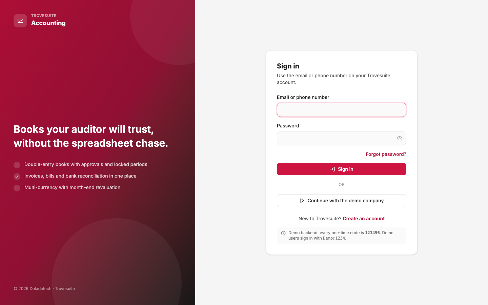
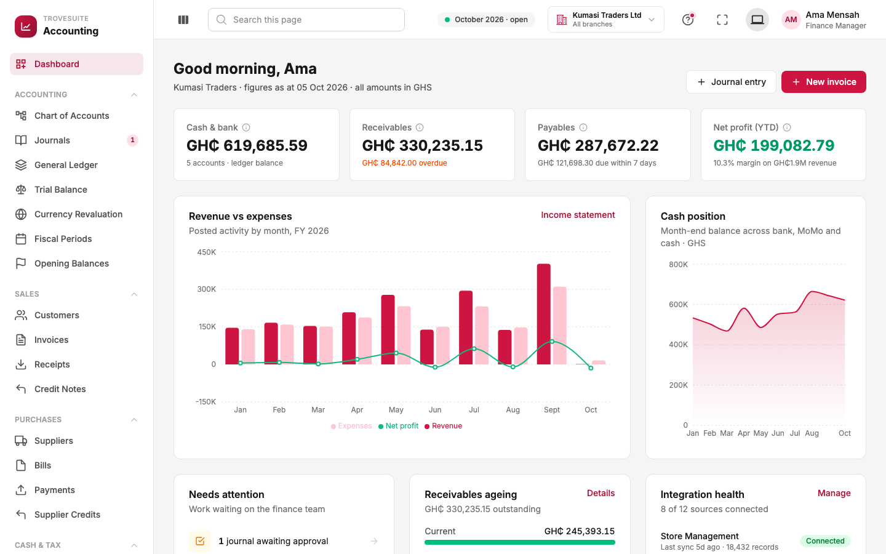
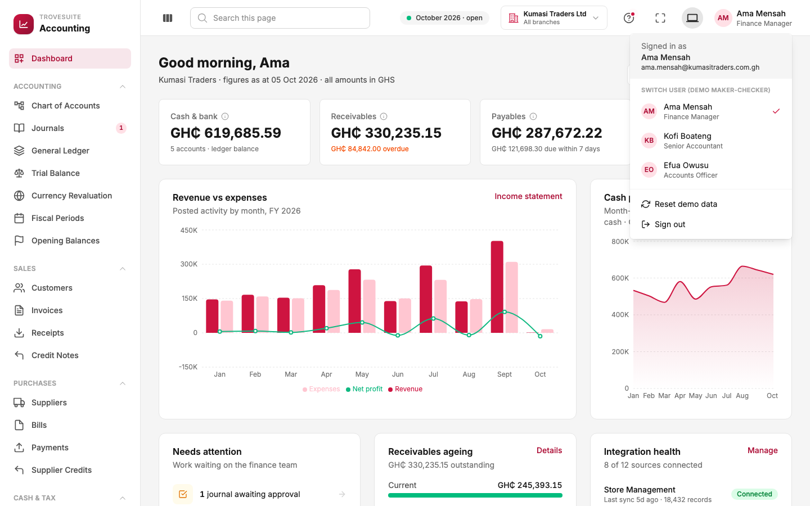

# 4. Tour: signing in, the layout and the dashboard

_How a company gets started, how the screen is organised, and the overview a finance manager sees first_

## Signing up and setting up a company

Sign-up and sign-in belong to the shared **Trovesuite Core Platform**, the same accounts customers use for other Trovesuite apps. A new company's journey is:

1. **Create an account** with the owner's name, email, phone, address and password.
2. Deladetech **approves the new company**, and the owner receives a six-digit verification code (in the prototype it is always `123456`).
3. The owner **signs in**.
4. On first use, Trovesuite Accounting asks a few setup questions: the company's trading and legal names, country, **base currency** (the currency the books are kept in, GH₵ for Ghana) and the month the **financial year** starts. Clicking **Open my books** creates the company's starter chart of accounts, tax codes and twelve monthly periods.
5. The owner lands on the dashboard, ready to add opening balances, customers and suppliers.

People who already use Trovesuite open Accounting from the Core Platform and skip straight to the books.

On the sign-in screen, **Continue with the demo company** opens Kumasi Traders Ltd with a year of pretend history.

## The screen layout

**The menu on the left** follows the accounting cycle:

| Section | What is in it |
| --- | --- |
| Dashboard | The overview below |
| Accounting | Chart of accounts, journals, general ledger, trial balance, currency revaluation, fiscal periods, opening balances |
| Sales | Customers, invoices, receipts, credit notes |
| Purchases | Suppliers, bills, payments, supplier credits |
| Cash & Tax | Bank accounts, reconciliation, tax |
| Insights | Reports |
| Integrations | Data sources, imports, field mappings, accounting rules |
| System | Audit trail, settings |

Small red numbers next to menu items count things waiting for action, for example **1** journal awaiting approval.

**The header across the top** always shows:

- **Search this page**: filters the current list.
- **October 2026 · open**: the current accounting month and its state. If it turns amber or red, the month is locked or closed and nothing can be posted into it.
- **Kumasi Traders Ltd · All branches**: which company and branch you are looking at.
- **The question-mark icon**: guided tours. Each main screen has a short walkthrough that points at each part and explains it. They are a good way to explore on your own.
- **Your name and role**: the user menu.

## Switching between demo users

The prototype lets you switch users to see approvals in action:

| User | Role | Typical work |
| --- | --- | --- |
| Ama Mensah | Finance Manager | Approves large entries, closes months, changes settings |
| Kofi Boateng | Senior Accountant | Posts journals, reconciles bank accounts, runs imports |
| Efua Owusu | Accounts Officer | Prepares invoices, bills and journals for approval |

Try it: as Efua, create a journal of GH₵60,000 and click **Submit for approval**. It goes to **Awaiting approval**. Open it and you will see *"You prepared this entry, so a different person has to approve it"*, with the **Approve & post** button disabled. Switch to Ama or Kofi, open the same entry and approve it.

**Reset demo data** in the same menu puts everything back to the original pretend data.

In the real product, roles and permissions come from the Core Platform, and each person signs in as themselves; the switcher exists only in the prototype.

## The dashboard

The dashboard answers "how is the business doing right now?" in one screen. Every figure is calculated by the server from the posted books, and most of them link to the report or list behind them.

**The four cards at the top:**

| Card | What it shows | Kumasi Traders on 5 Oct 2026 |
| --- | --- | --- |
| **Cash & bank** | Money in all bank accounts, mobile money wallets and cash floats | GH₵619,685.59 across 5 accounts |
| **Receivables** | What customers owe, with the overdue part in orange | GH₵330,235.15, of which GH₵84,842.00 is overdue |
| **Payables** | What the business owes suppliers, and how much falls due in the next 7 days | GH₵287,672.22 |
| **Net profit (YTD)** | Profit since the start of the financial year ("year to date"), with the margin on revenue | GH₵199,082.79, a 10.3% margin on GH₵1.9M revenue |

**The charts:**

- **Revenue vs expenses**: income and costs for each month of the year, with the profit line. Months where the line dips below zero were loss-making.
- **Cash position**: the total cash balance at each month end.

**Further down:**

- **Needs attention**: work waiting for the finance team, such as journals awaiting approval, overdue invoices, bank lines to reconcile and import rows held with errors.
- **Receivables ageing**: what customers owe, split into "current" (not yet due) and the overdue bands.
- **Integration health**: which connected systems are working (for example "8 of 12 sources connected", Store Management last synced 5 days ago with 18,432 records).

The **Journal entry** and **New invoice** buttons at the top right are shortcuts to the two most common tasks.
