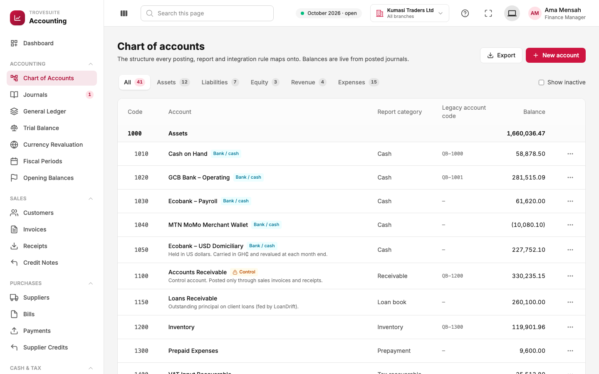
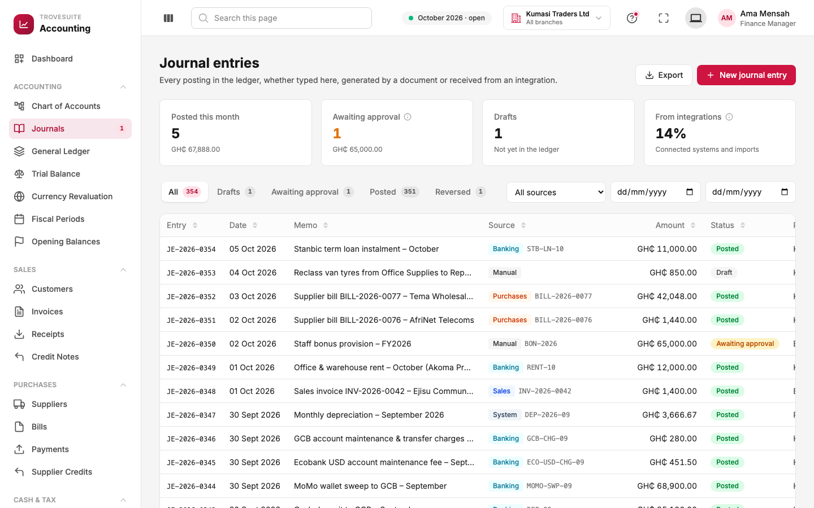
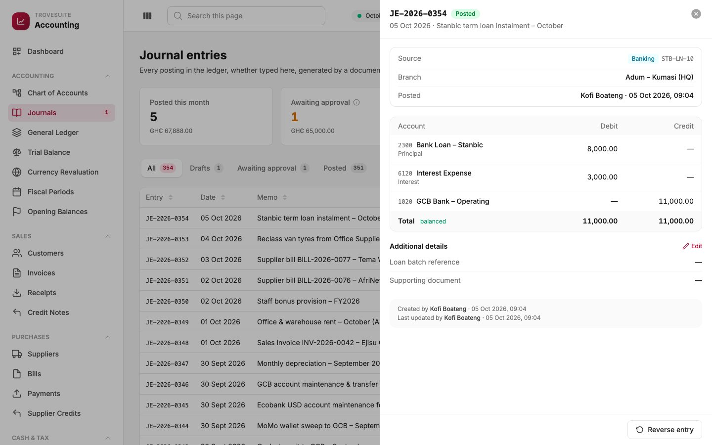
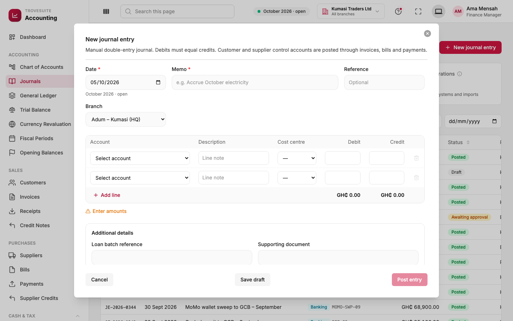
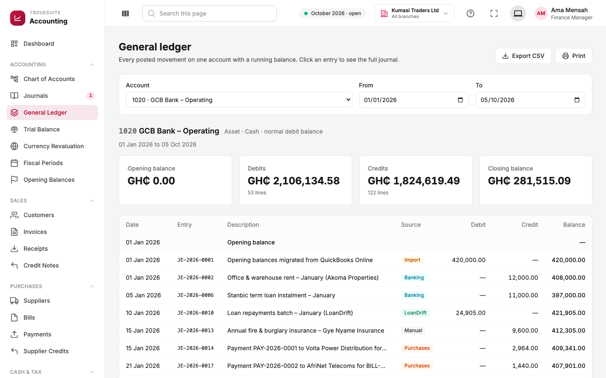
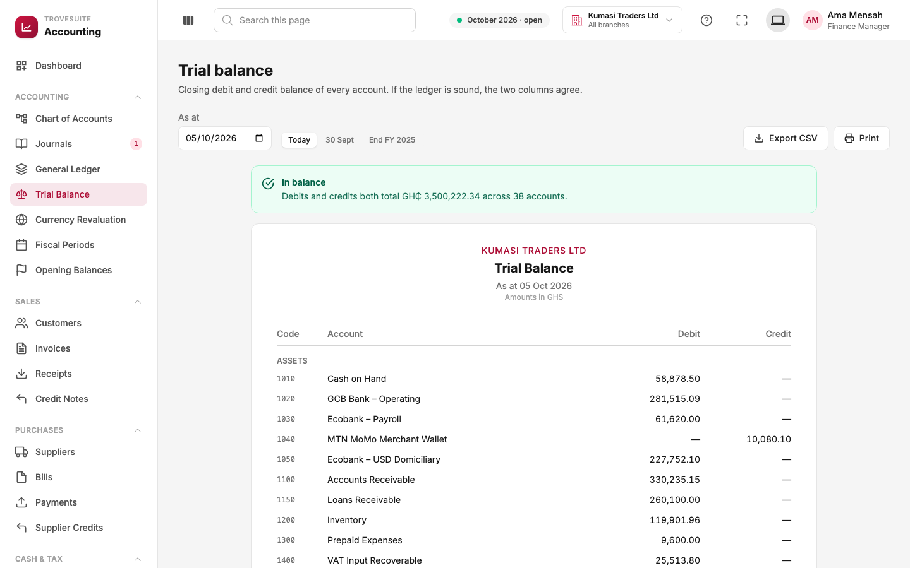
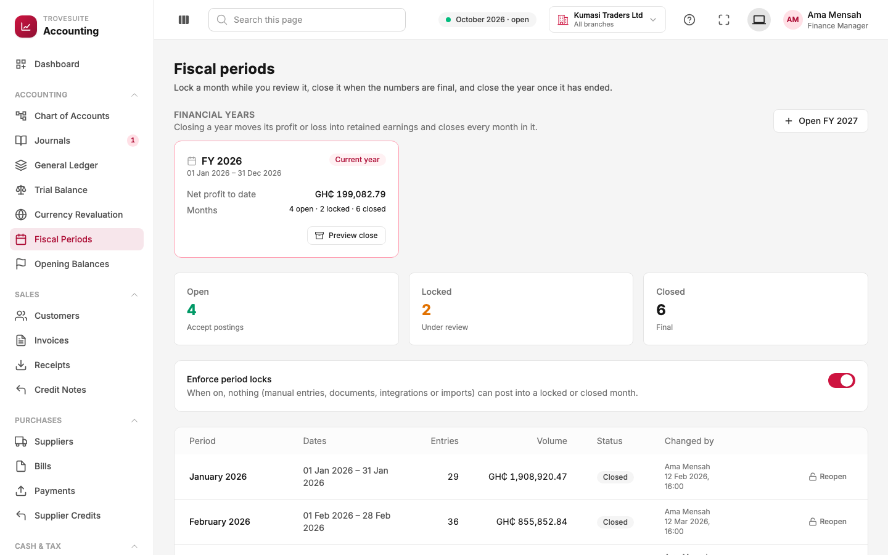
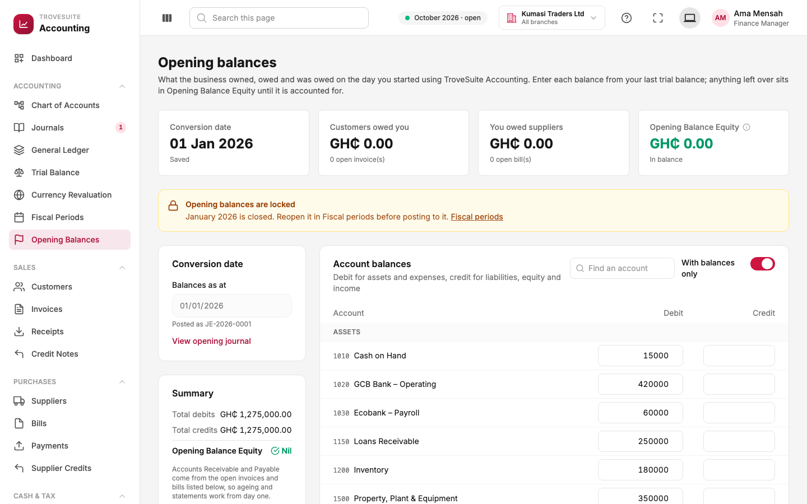
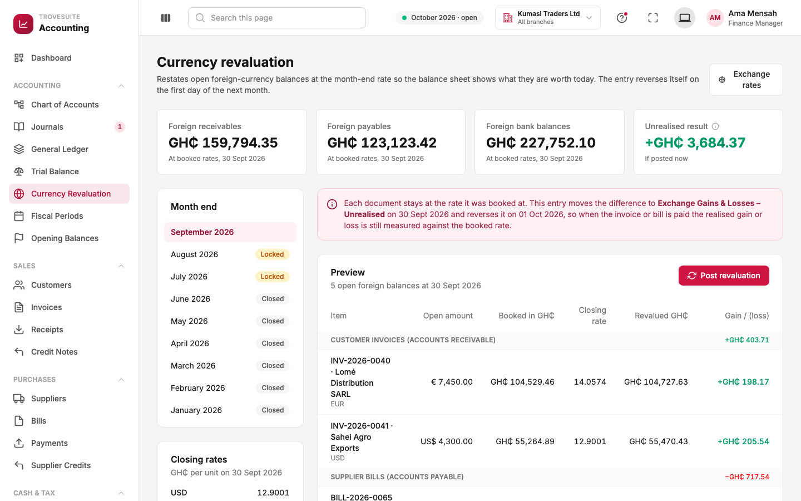

# 5. Tour: the accounting core

_The chart of accounts, journals, ledger, trial balance, periods, opening balances and currency revaluation_

These screens are used mostly by accountants. Everything in Sales, Purchases and Banking ends up here as journals.

## Chart of accounts

**What it is:** the list of every account (every "jar") the business records money in, with its current balance. It is the backbone of the books: every posting, report and integration rule points at these accounts.

**What you see:**

- **Tabs** for the five kinds of account (Assets 12, Liabilities 7, Equity 3, Revenue 4, Expenses 15).
- **Group rows** in bold, such as **1000 Assets**, which only total the accounts beneath them and cannot be posted to.
- **Badges**: *Bank / cash* marks accounts linked to a real bank account or wallet; *Control* marks Accounts Receivable and Payable, which only documents may change.
- **Report category**: where the account appears on the balance sheet or income statement.
- **Legacy account code**: the account's code in the system the company migrated from (here `QB-1001` from QuickBooks). This is a custom field, and shows how migration history is preserved.
- **Balances in brackets** are negative, the usual accounting convention.

**What you can do:** add an account, edit its name or description, deactivate it, and export the list. Codes are chosen by the company; the starter chart follows the standard numbering above.

## Journals

**What it is:** every entry in the books, whether typed by a person, generated by a document (invoice, bill, payment) or received from an integration.

**What you see:**

- **Cards**: entries posted this month, entries **awaiting approval**, **drafts** (not yet in the books) and the share that came **from integrations** (14% here).
- **Tabs** by status: Draft, Awaiting approval, Posted, Reversed.
- **Source** badges showing where each entry came from: *Manual* (typed by a person), *Sales*, *Purchases*, *Banking*, *System* (for example monthly depreciation), *Import*, or a connected app such as *LoanDrift*.

**Statuses:**

| Status | Meaning |
| --- | --- |
| Draft | Saved but not in the books; can still be edited or deleted |
| Awaiting approval | Submitted; waiting for a second person because it is at or above the approval limit |
| Posted | Final and counted in every report |
| Reversed | Cancelled by a mirror-image entry; both remain visible |

Click any entry to see its detail:

This entry records a monthly loan instalment of GH₵11,000 paid from the GCB account: GH₵8,000 reduces the loan (principal) and GH₵3,000 is interest, an expense. Debits (8,000 + 3,000) equal the credit (11,000), so it is marked **balanced**. The panel also shows the **source** (Banking, bank reference `STB-LN-10`), the branch, who posted it and when, and any additional custom details. Since posted entries cannot be edited, the only action is **Reverse entry**.

### Creating a journal

Accountants use manual journals for things no document covers: accruals (recording a cost before the bill arrives), corrections, depreciation, salary provisions and reclassifications.

- **Date** shows which month it falls in and whether that month is open.
- **Memo** describes the entry; **Reference** is optional (for example a voucher number).
- **Branch** and **Cost centre** tag the lines for management reporting.
- Each line has an **account** and either a **debit** or a **credit**. The form totals both columns and shows whether they balance.
- **Save draft** keeps it without posting. **Post entry** posts it, or sends it for approval when it is GH₵50,000 or more (the button then reads **Submit for approval**).

The form will not let you pick Accounts Receivable or Payable: those change only through invoices, bills and payments.

## General ledger

**What it is:** every posted movement on one account over a date range, with a running balance. It answers "why is this balance what it is?"

The example shows the GCB operating account for 2026: opening balance, total debits (money in) and credits (money out), the closing balance, and every line with its journal number and source. Clicking a line opens the full journal. Export to CSV and print are available on every report.

## Trial balance

**What it is:** the closing balance of every account on a chosen date, in a debit column and a credit column. The green banner, **In balance: debits and credits both total GH₵3,500,222.34 across 38 accounts**, is the system confirming that the books are arithmetically sound.

Quick buttons pick common dates (today, last month end, the end of last year). Clicking an account opens its general ledger at the same date. Accountants and auditors usually start every review here.

## Fiscal periods and the year-end close

**What it is:** the accounting calendar, and the controls that stop anyone from changing the past.

- **Financial year card (FY 2026)**: profit so far this year, and how many months are open, locked and closed. **Preview close** shows exactly what the year-end entry will be and lists anything blocking it (for example drafts still in the year). The year can only be closed after it has ended.
- **Open / Locked / Closed counts**: Kumasi Traders has closed January to June, locked July and August while they are reviewed, and left September onwards open.
- **Enforce period locks**: when on, nothing (manual entries, documents, integrations or imports) can post into a locked or closed month.
- **The table** lists each month with the number and value of entries in it and who last changed its state. Months must be closed in order, and a month cannot be closed while it still contains drafts or entries awaiting approval.
- **Open FY 2027** creates next year's twelve months ahead of time.

## Opening balances

**What it is:** where a company that is switching to Trovesuite enters what it owned, owed and was owed on the day it started (the **conversion date**), usually copied from the old system's last trial balance.

- **Account balances** are entered as debits (assets and expenses) or credits (liabilities, equity and income).
- **Unpaid customer invoices and supplier bills** from the old system are entered one by one, so that ageing, statements and payments work from day one. They make up the Receivable and Payable balances.
- **Opening Balance Equity** is a temporary holding account that absorbs any difference while balances are being entered. It should end at zero (**Nil**). If it does not, something is missing.
- Kumasi Traders converted on **1 January 2026** from QuickBooks Online. The banner shows the opening balances are now **locked**, because January 2026 is closed.

## Currency revaluation

**What it is:** the month-end step that restates unpaid foreign-currency balances at the month-end exchange rate, so that the balance sheet shows what they are worth today.

- The cards show foreign receivables (for example invoices in euros to a customer in Togo), foreign payables (bills in US dollars from a supplier in China), foreign bank balances, and the **unrealised result** if the revaluation were posted now (a gain of GH₵3,684.37).
- **Month end** on the left chooses the month; **Closing rates** shows the rates used (US$1 = GH₵12.9001 on 30 September).
- **Preview** lists each open item: its amount in the foreign currency, its value at the booked rate, its value at the closing rate, and the gain or loss.
- **Post revaluation** posts one entry on the last day of the month and an automatic reversal on the first day of the next. The pink note explains why: each document stays at its booked rate, so the real (realised) gain or loss is still measured correctly when it is paid.
- **Exchange rates** (top right) is where daily rates are recorded, typed in by hand or fetched from a reference source.
