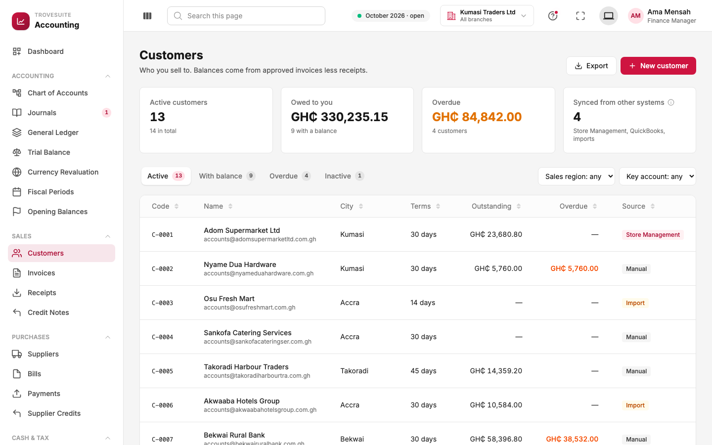
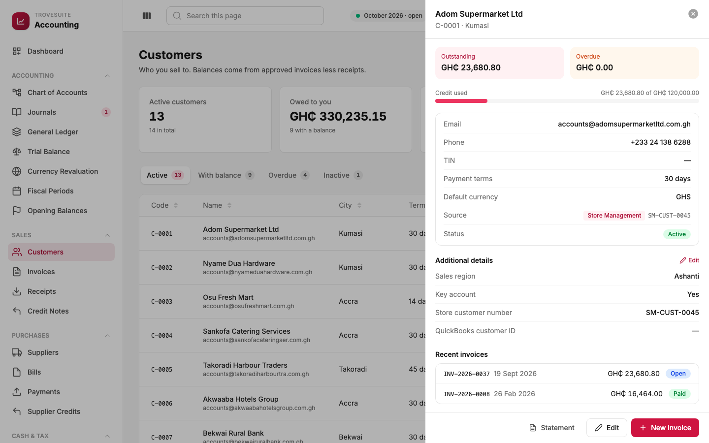
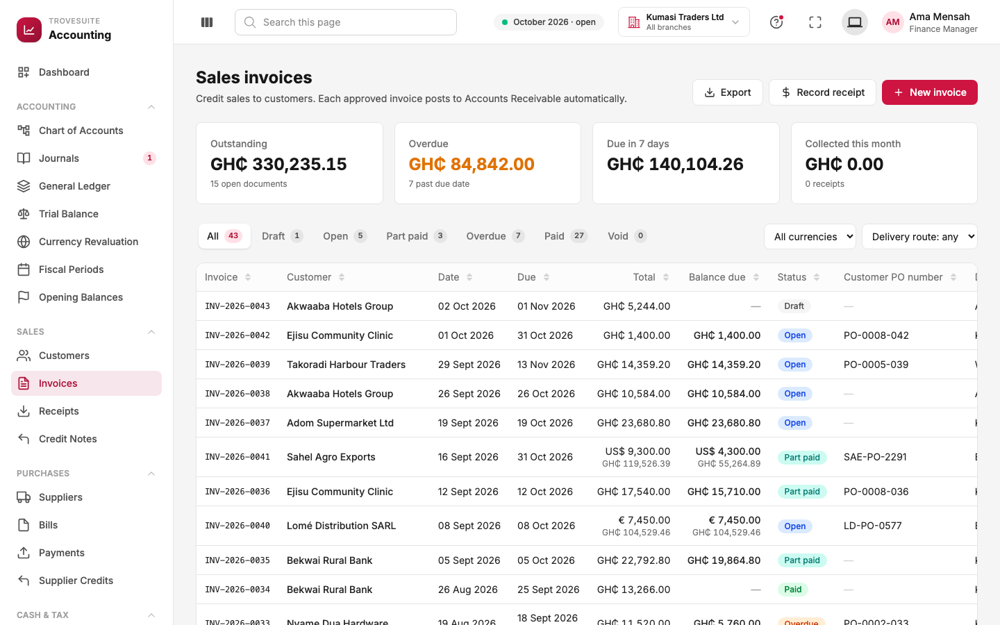
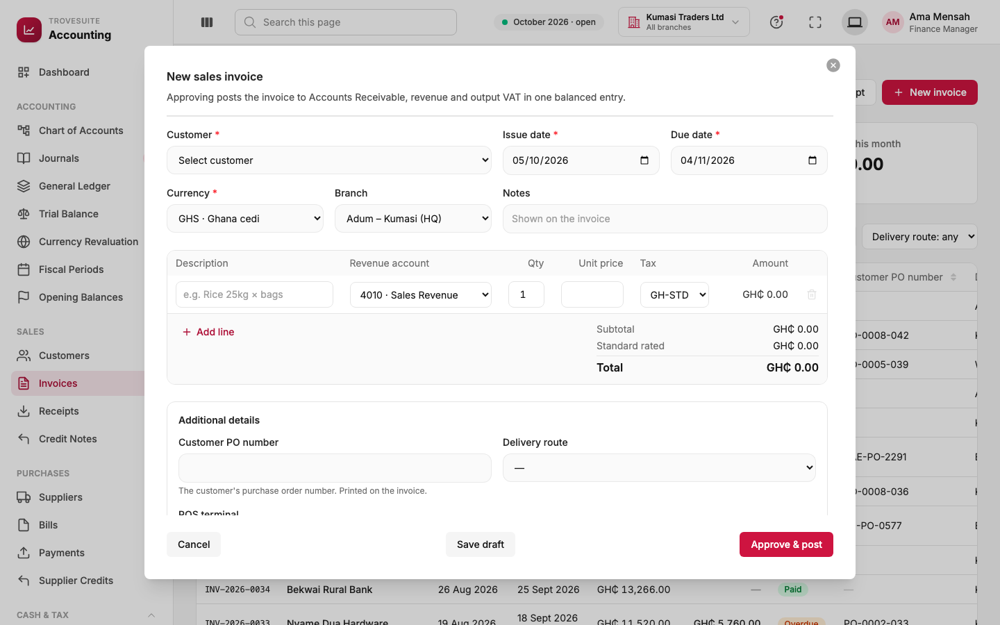
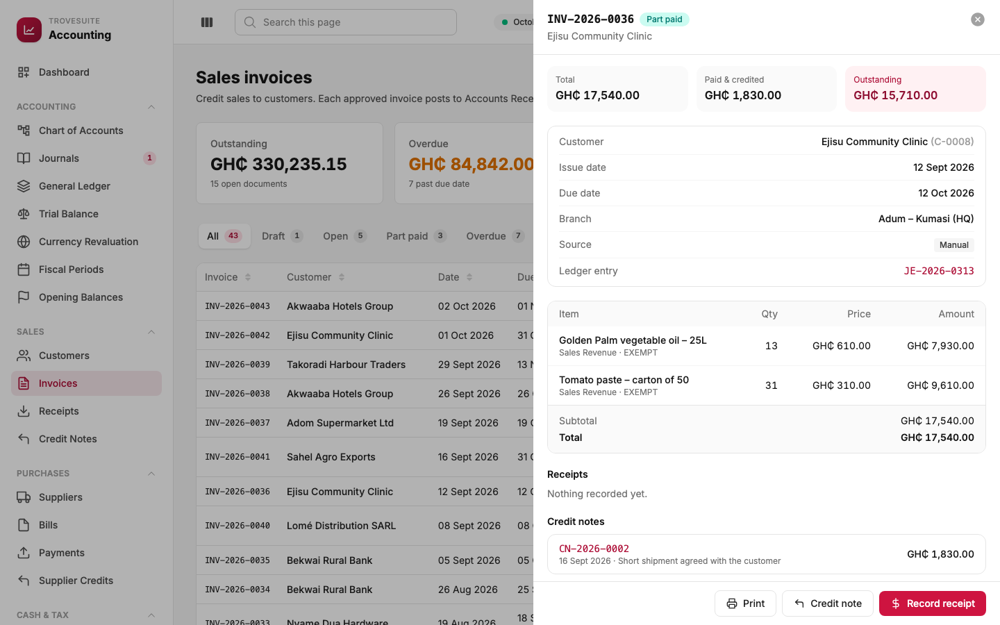
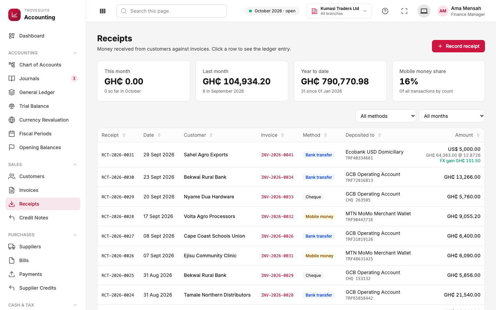
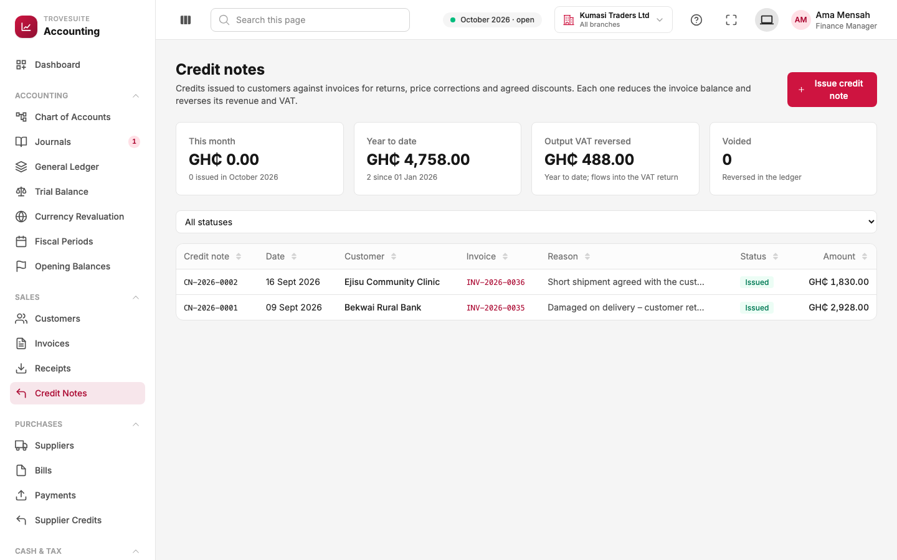

# 6. Tour: sales and money coming in

_Customers, sales invoices, receipts and credit notes: the "accounts receivable" side_

This section covers selling on credit: the business delivers goods or services, sends an **invoice**, and the customer pays later. Until they pay, the amount sits in **Accounts Receivable** (money owed to us).

## Customers



**What it is:** everyone the business sells to, with what each one owes.

- **Cards**: active customers, the total **owed to you** (GH₵330,235.15 from 9 customers), the **overdue** part, and how many customers were **synced from other systems** (Store Management, QuickBooks or imports).
- **Tabs**: Active, With balance, Overdue, Inactive.
- **Columns**: customer code (`C-0001`), name and email, city, **payment terms** (how many days they have to pay, for example 30 days), **outstanding**, **overdue** (in orange), and **source**: *Manual* (typed in), *Store Management* or *Import*.
- Filters at the top right come from **custom fields** the company defined, such as *Sales region* and *Key account*.

Click a customer to see their profile:



- **Outstanding** and **Overdue** at the top, and **Credit used**: how much of their credit limit (the most we let them owe, GH₵120,000 here) is in use.
- Contact details, tax identification number (TIN), payment terms, default currency, and **Source**: this customer came from Store Management, where their number is `SM-CUST-0045`. That link is how a sale in the shop is matched to the right customer in the books.
- **Additional details** shows the company's own custom fields, including the customer's ID in the old QuickBooks system.
- **Recent invoices**, and buttons for the customer's **Statement**, **Edit** and **New invoice**.

## Sales invoices



**What it is:** the bills Kumasi Traders sends to customers.

- **Cards**: total **outstanding**, how much is **overdue**, how much falls **due in the next 7 days**, and how much was **collected this month**.
- **Tabs and statuses:**

| Status | Meaning |
| --- | --- |
| Draft | Prepared but not approved; not in the books |
| Open | Approved and posted; not yet due, nothing paid |
| Part paid | Some money received, some still owed |
| Overdue | Past its due date and not fully paid |
| Paid | Fully settled |
| Void | Cancelled; its entry has been reversed |

- **Foreign-currency invoices** show both amounts: for example **US$9,300.00** with **GH₵119,526.39** below it, the cedi value at the booked rate.
- **Balance due** is what is still owed on each invoice.
- **Record receipt** (top right) records a customer payment; **Export** downloads the list.

### Creating an invoice



- **Customer**, **issue date** and **due date** (filled in from the customer's payment terms).
- **Currency**: the base currency (GH₵) or any active foreign currency. A foreign invoice asks for the exchange rate and warns if it is far from the day's recorded rate.
- **Branch**: which branch made the sale.
- **Lines**: description, **revenue account** (which income account it counts as, usually 4010 Sales Revenue), quantity, unit price and **tax code**. The form calculates the subtotal, tax and total as you type, but the server recalculates them when saving, and the server's figures are final.
- **Additional details**: custom fields, such as the customer's purchase-order number and delivery route.
- **Save draft** keeps it for later. **Approve & post** makes it official.

**What happens in the books on approval.** For an invoice of GH₵1,000 plus GH₵200 of VAT:

```
Dr  1100 Accounts Receivable        1,200.00   (the customer owes us)
    Cr  4010 Sales Revenue                      1,000.00   (we earned income)
    Cr  2100 VAT & Levies Payable                 200.00   (tax we owe GRA)
```

The system writes this entry itself and links it to the invoice. The person approving never types a debit or credit.

### An invoice in detail



This invoice to Ejisu Community Clinic was for GH₵17,540.00. The goods were VAT-exempt, so there is no tax. A **credit note** of GH₵1,830.00 (for a short shipment) has reduced it, so GH₵15,710.00 is still **outstanding** and the status is **Part paid**.

The panel shows the customer, dates, branch, source, and the **ledger entry** (`JE-2026-0313`, which opens the journal). Then come the lines, any **receipts** and **credit notes** recorded against it, and the actions: **Print**, **Credit note** and **Record receipt**.

An invoice that has been approved cannot be edited. To cancel it entirely, **void** it with a reason, which posts a reversing entry dated today. That is only possible while nothing has been paid or credited on it.

## Receipts



**What it is:** money received from customers, each against one invoice.

- **Cards**: received this month, last month and year to date, and the share of receipts paid by **mobile money**.
- **Columns**: receipt number, date, customer, the invoice it pays, the **method** (bank transfer, mobile money, cheque or cash), the account it was **deposited to**, and the amount.
- **Foreign-currency receipts** show the exchange difference. In the first row, Sahel Agro Exports paid US$5,000 at a rate of 12.8726, worth GH₵64,363.00. The invoice had been booked at a lower rate, so there is a **realised exchange gain** of GH₵101.50.

**What happens in the books.** For a GH₵1,200 receipt into the GCB account:

```
Dr  1020 GCB Bank – Operating       1,200.00   (money arrived)
    Cr  1100 Accounts Receivable                1,200.00   (the customer owes less)
```

A receipt cannot be for more than is still owed on the invoice. Customer prepayments and overpayments are not supported yet (see page 14).

## Credit notes



**What it is:** a document that reduces what a customer owes on an invoice, for returned goods, a price correction or an agreed discount. It is how an approved invoice is reduced without being edited.

- **Cards**: credits issued this month and year to date, the **output VAT reversed** (tax that no longer has to be paid to GRA, which flows into the VAT return automatically), and how many credit notes have been voided.
- Each credit note names the invoice it applies to and the **reason** (for example *"Damaged on delivery – customer returned…"*).

**What happens in the books.** It is the invoice's entry in reverse, for the credited lines only:

```
Dr  4010 Sales Revenue                1,000.00   (less income)
Dr  2100 VAT & Levies Payable           200.00   (less tax owed)
    Cr  1100 Accounts Receivable                  1,200.00   (the customer owes less)
```

A credit note cannot be larger than what is still owed on the invoice.
