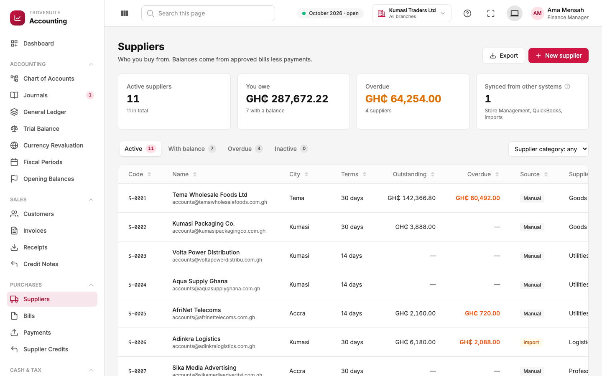
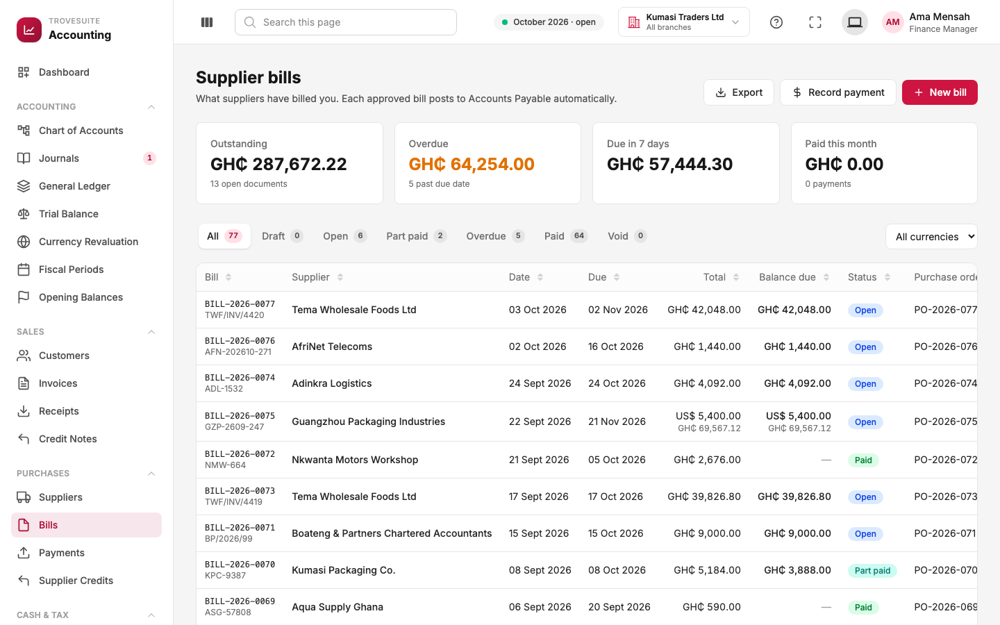
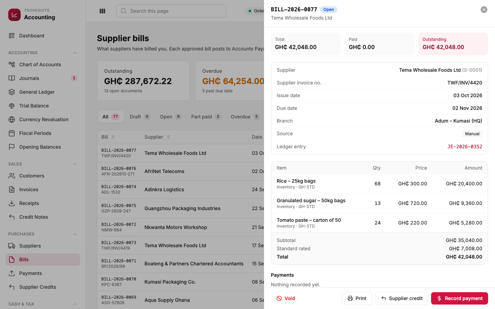
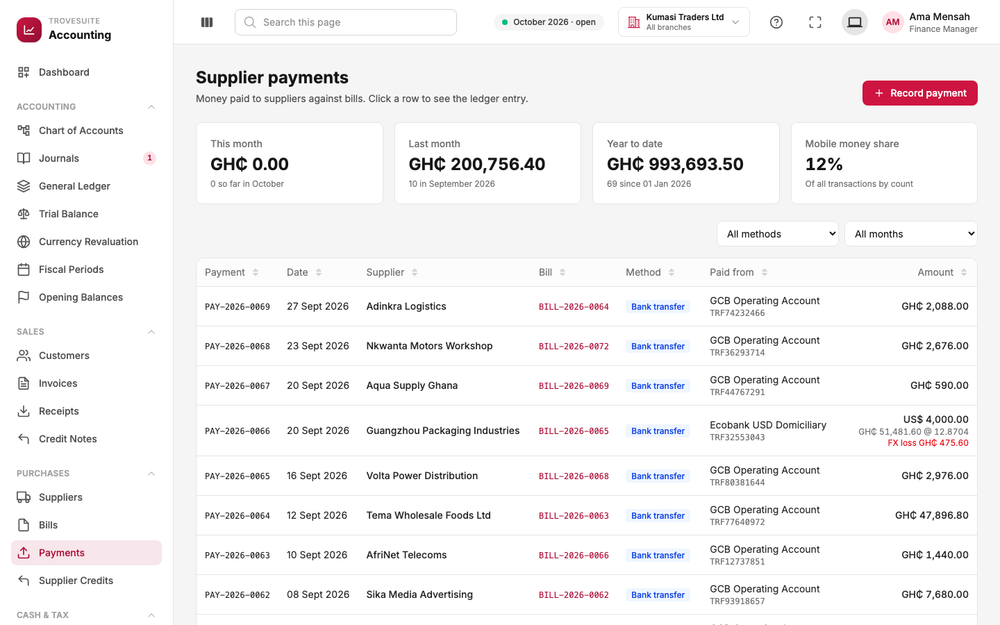
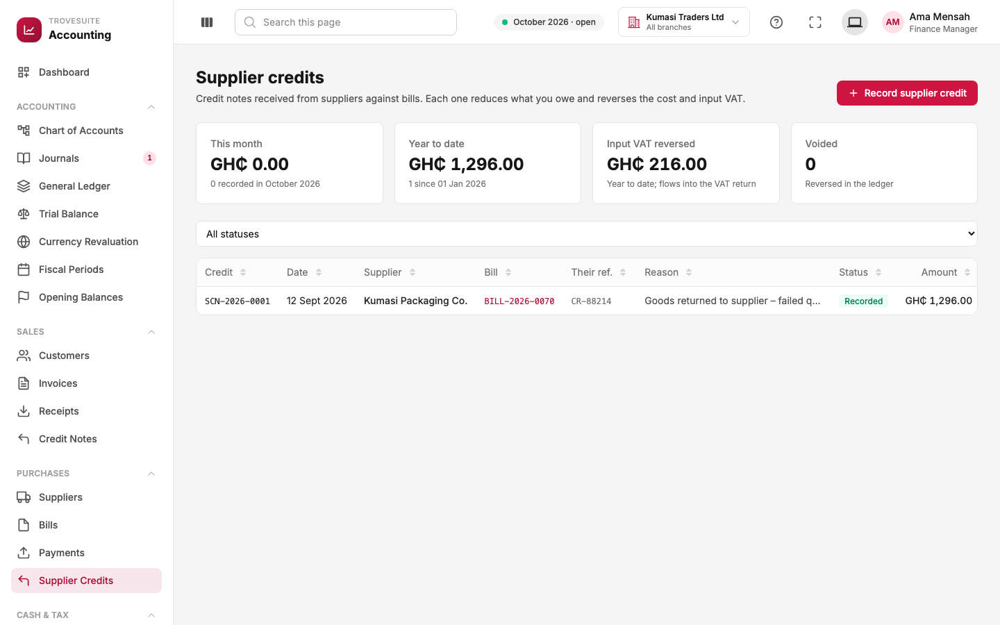

# 7. Tour: purchases and money going out

_Suppliers, bills, supplier payments and supplier credits: the "accounts payable" side_

Purchases mirror sales. A supplier delivers, sends a **bill** (their invoice to us), and Kumasi Traders pays later. Until it pays, the amount sits in **Accounts Payable** (money we owe).

## Suppliers



**What it is:** everyone the business buys from, with what it owes each one.

- **Cards**: active suppliers, the total **you owe** (GH₵287,672.22 to 7 suppliers), the **overdue** part (bills past their due date: late payment can cost discounts, goodwill or deliveries), and suppliers synced from other systems.
- **Columns**: supplier code (`S-0001`), name, city, payment terms, outstanding, overdue, source, and the company's own **supplier category** custom field (goods for resale, utilities, professional services, and so on).
- Clicking a supplier opens a profile like the customer one, with recent bills and a supplier statement.

## Supplier bills



**What it is:** the invoices suppliers have sent to Kumasi Traders.

- The cards and statuses work exactly like sales invoices: outstanding, overdue, due in the next 7 days, paid this month; Draft, Open, Part paid, Overdue, Paid, Void.
- Under each bill number is the **supplier's own invoice number** (for example `TWF/INV/4420`). It is required, and the system **refuses the same supplier invoice number twice for the same supplier**, which is a common way businesses accidentally pay a bill twice.
- *Purchase order* is a custom field that links the bill to the order that requested the goods.



This bill from Tema Wholesale Foods is for rice, sugar and tomato paste: GH₵35,040.00 of goods plus GH₵7,008.00 of tax (standard rated), GH₵42,048.00 in total. Each line's account is **Inventory**, because the goods go into stock for resale. A bill for electricity would use an expense account instead. The **ledger entry** `JE-2026-0352` is the posting, and the actions are **Void**, **Print**, **Supplier credit** and **Record payment**.

**What happens in the books on approval:**

```
Dr  1200 Inventory                   35,040.00   (stock we now own)
Dr  1400 VAT Input Recoverable        7,008.00   (tax we can claim back)
    Cr  2010 Accounts Payable                     42,048.00   (we owe the supplier)
```

## Supplier payments



**What it is:** money paid to suppliers, each against one bill.

- **Cards**: paid this month, last month and year to date, and the mobile money share.
- **Paid from** shows which bank account or wallet the money left.
- **Foreign payments** show the exchange result. Row `PAY-2026-0066` paid Guangzhou Packaging US$4,000 at 12.8704, worth GH₵51,481.60. The bill had been booked at a lower rate, so paying it cost more cedis than expected: a **realised exchange loss** of GH₵475.60, recorded automatically in the exchange gains and losses account.

**What happens in the books.** For a GH₵1,200 payment from the GCB account:

```
Dr  2010 Accounts Payable            1,200.00   (we owe less)
    Cr  1020 GCB Bank – Operating               1,200.00   (money left the bank)
```

## Supplier credits



**What it is:** a credit note **received** from a supplier, for example when goods are returned. It reduces what we owe on a bill and reverses the cost and the input VAT we would otherwise reclaim.

- **Their ref.** is the supplier's own credit note number; like bills, it cannot be entered twice.
- **Input VAT reversed** shows the tax we can no longer claim back, which flows into the VAT return.

**What happens in the books** (the bill's entry in reverse, for the credited lines):

```
Dr  2010 Accounts Payable            1,296.00   (we owe less)
    Cr  Expense or Inventory                    1,080.00
    Cr  1400 VAT Input Recoverable                216.00
```
