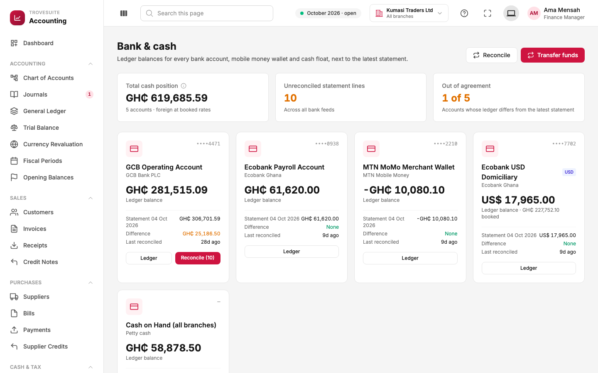
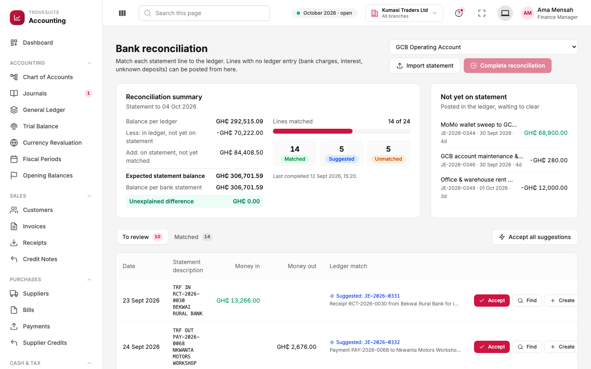
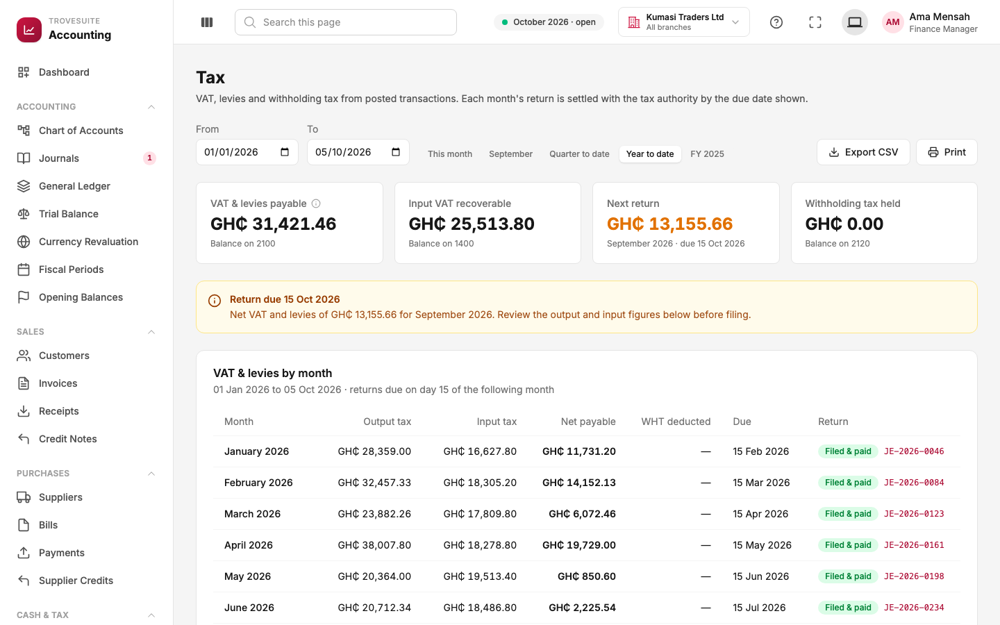

# 8. Tour: bank, cash and tax

_Bank and mobile money accounts, bank reconciliation, and VAT_

## Bank and cash accounts

**What it is:** every place the business keeps money (bank accounts, mobile money wallets and cash floats), with the balance **according to our books** next to the balance **according to the bank's latest statement**.

- **Total cash position**: all five accounts together (foreign accounts converted at their booked rates).
- **Unreconciled statement lines**: bank lines not yet matched to the books (10 here).
- **Out of agreement**: accounts where the books and the latest statement differ (1 of 5).

Each card shows one account:

- **Ledger balance**: what our books say.
- **Statement** balance and date: what the bank or telco last reported.
- **Difference**: the gap to explain. GCB shows GH₵25,186.50 and was last reconciled 28 days ago, so it has a **Reconcile (10)** button for its 10 waiting lines.
- **Ecobank USD Domiciliary** is held in US dollars (US$17,965.00), carried in the books at GH₵227,752.10.

**Transfer funds** moves money between accounts, for example sweeping the MoMo wallet into GCB. It posts one entry: money in to one account, money out of the other. Each account is linked to a bank account in the chart of accounts, so its ledger is visible in the general ledger.

## Bank reconciliation

**What it is:** the monthly check that the bank's statement and our books agree, line by line. Every difference must be explained before the month can be trusted.

**Getting the statement in.** Lines arrive from a bank feed, or through **Import statement**, which reads the CSV file downloaded from online banking. The importer asks which column is the date, description and amount, skips headings and balance rows, and recognises lines that were already imported, so overlapping downloads are safe.

**The summary (top left)** works like a school maths proof:

| Line | Amount | Meaning |
| --- | --- | --- |
| Balance per ledger | GH₵292,515.09 | Our books on the statement date |
| Less: in ledger, not yet on statement | −GH₵70,222.00 | Things we recorded that the bank has not processed yet (listed on the right under **Not yet on statement**, such as a wallet sweep and the October rent) |
| Add: on statement, not yet matched | GH₵84,408.50 | Things the bank shows that we have not matched yet |
| Expected statement balance | GH₵306,701.59 | What the bank should say if everything else is right |
| Balance per bank statement | GH₵306,701.59 | What the bank actually says |
| **Unexplained difference** | **GH₵0.00** | Green means every cedi is accounted for |

**The progress bar** shows 14 of 24 lines matched, 5 with a **suggested** match and 5 **unmatched**.

**Working through the lines** (bottom table):

- **Suggested** (blue): the system found a ledger entry with the same amount within 7 days, for example a customer receipt. Click **Accept** to confirm it, or **Accept all suggestions**. Nothing is matched without a person accepting it.
- **Find**: search the ledger for the right entry yourself.
- **Create**: for things only the bank knows about (bank charges, interest, an unexpected deposit), post the missing entry straight from the statement line and match it in one step.

When every line is matched, **Complete reconciliation** signs it off and records when and by whom.

## Tax

**What it is:** how much VAT, levies and withholding tax the business owes, month by month, and whether each month's return has been filed and paid.

**The cards:**

- **VAT & levies payable** (GH₵31,421.46): the output tax balance, collected on sales and owed to GRA.
- **Input VAT recoverable** (GH₵25,513.80): tax paid on purchases that can be offset.
- **Next return** (GH₵13,155.66): what is due for September 2026, **due 15 October 2026**.
- **Withholding tax held**: tax withheld from suppliers and owed to GRA on their behalf.

**The amber banner** is a reminder: the September return is due on 15 October; review the figures before filing.

**VAT & levies by month:** for each month, **output tax** (on sales) minus **input tax** (on purchases) gives the **net payable**. Paying GRA is recorded as an ordinary journal referencing the month (for example `VAT-2026-08`); once it is posted, that month shows **Filed & paid** with a link to the entry. All figures are read from the posted books, so a credit note issued in September automatically reduces September's VAT.

The tax codes themselves (standard rated 20%, zero rated, exempt, flat rate 3%, withholding 7.5%) are set up for Ghana. Configurable tax systems for other countries, tax periods and electronic filing come in a later phase.
