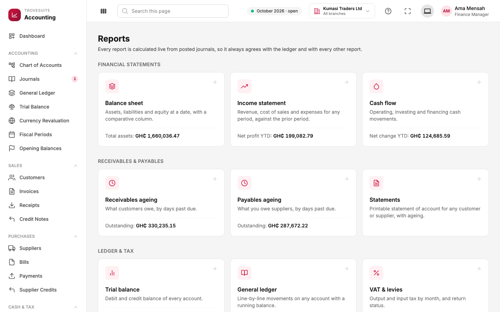
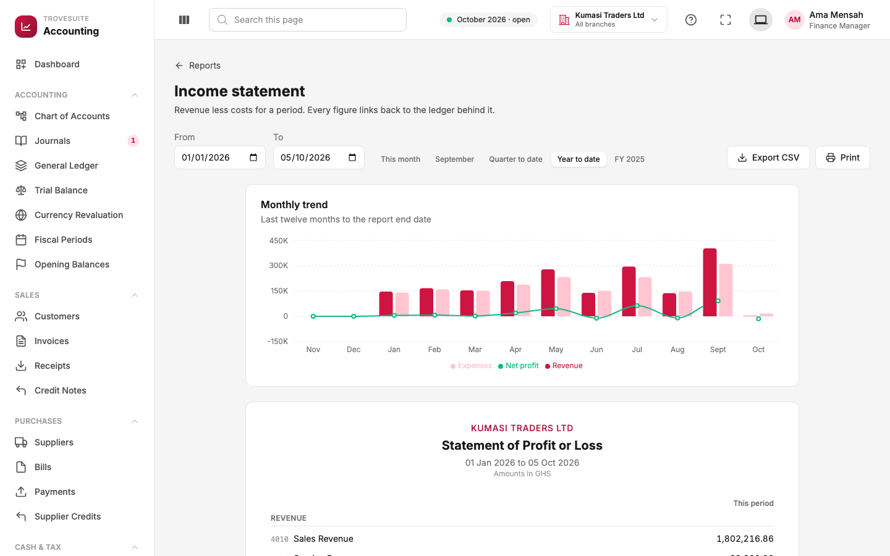
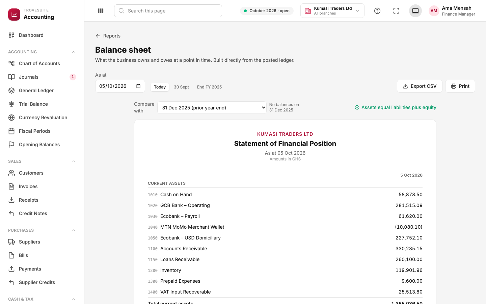
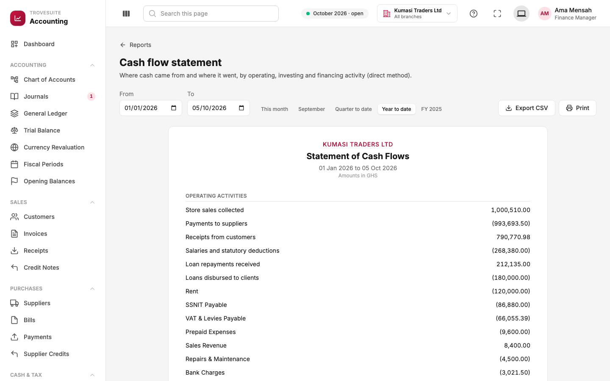
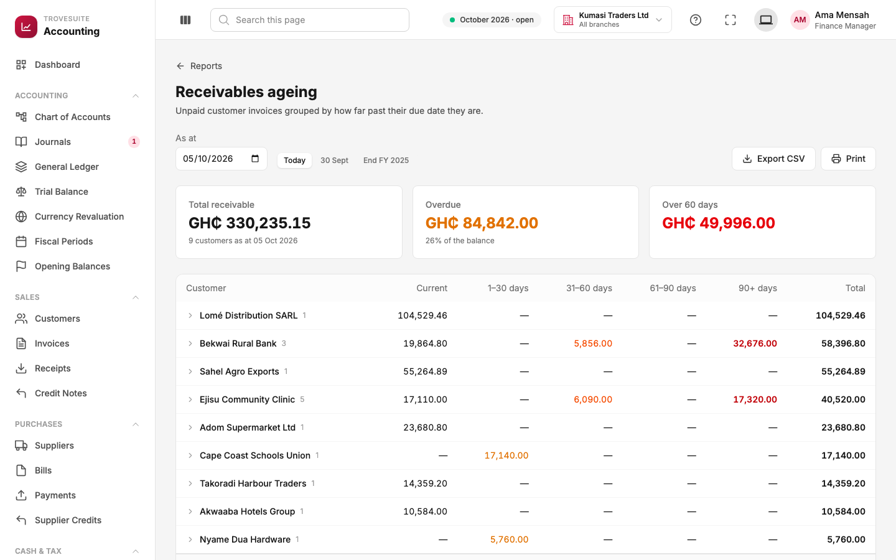
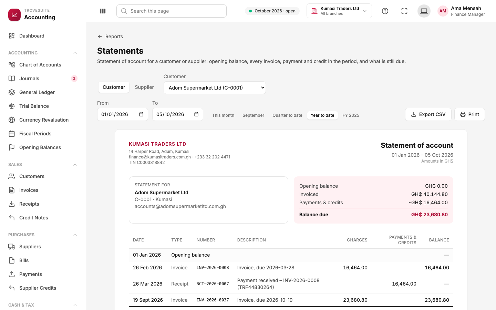

# 9. Tour: reports

_The financial statements and the receivables and payables reports_

Every report is **calculated live by the server from the posted journals**. Nobody types a figure into a report, so the reports always agree with each other and with the ledger. Most figures can be clicked to see the entries behind them ("drill down"), and every report can be exported to CSV (opens in Excel) or printed.

## The reports centre

Reports are grouped into **financial statements** (balance sheet, income statement, cash flow), **receivables and payables** (ageing and statements) and **ledger and tax** (trial balance, general ledger, VAT and levies). Each card shows a headline figure, such as total assets or net profit year to date.

Date ranges use quick buttons (**This month**, **September**, **Quarter to date**, **Year to date**, **FY 2025**) that follow the company's own financial year.

## Income statement (profit and loss)

**The question it answers:** did we make money over this period, and where did it come from and go?

- **Monthly trend**: revenue (dark bars), expenses (light bars) and net profit (green line) for the last twelve months.
- **The statement**: revenue first (for example **4010 Sales Revenue** GH₵1,802,216.86), then the cost of the goods sold, gross profit (revenue minus the cost of what was sold), operating expenses (salaries, rent, utilities, transport), and finally **net profit**.
- A comparison column can show the same figures for the previous period, so growth or decline is easy to see.
- Each line links to the general ledger for that account and period.

## Balance sheet

**The question it answers:** on a given day, what does the business own, what does it owe, and what is left for the owners?

- **Assets**, split into current (cash, receivables, stock, prepaid expenses and VAT recoverable, all turning into cash within a year) and fixed (property, vehicles, equipment, less the depreciation recorded on them).
- **Liabilities**, split into current (supplier balances, tax owed, anything due within a year) and long-term (loans repaid over several years).
- **Equity**: retained earnings plus this year's profit so far.
- The green tick, **Assets equal liabilities plus equity**, is the golden rule from page 2, checked live.
- **Compare with** adds a second column for an earlier date, such as the previous year end.

## Cash flow statement

**The question it answers:** where did the cash actually come from and go? A business can be profitable and still run out of cash, if customers pay late or a lot of money goes into stock, so this report matters as much as profit.

It uses the **direct method**: actual cash movements grouped into

- **Operating activities**: store sales collected, receipts from customers, payments to suppliers, salaries, rent, tax paid;
- **Investing activities**: buying or selling equipment, vehicles and other long-term assets;
- **Financing activities**: loans received and repaid, owners' money in and out.

The three sections add up to the change in cash over the period.

## Receivables ageing

**The question it answers:** who owes us money, and how late is it?

- **Total receivable** (GH₵330,235.15), **overdue** (26% of it) and **over 60 days** (GH₵49,996.00, the riskiest part).
- One row per customer, with the amount in each band: **Current** (not yet due), **1–30 days**, **31–60**, **61–90** and **90+ days** late. Red figures need chasing first. Bekwai Rural Bank, for example, owes GH₵32,676.00 that is more than 90 days late.
- Expand a customer to see the individual invoices; each links to the invoice and to the customer's statement.

**Payables ageing** is the same report for what the business owes suppliers. It helps plan which bills to pay first.

## Customer and supplier statements

**What it is:** a printable **statement of account** for one customer or supplier: the letter a business sends saying "here is everything between us, and this is what you owe".

- The company's letterhead and the customer's details.
- A summary: **opening balance**, **invoiced**, **payments & credits**, and the **balance due** (GH₵23,680.80 for Adom Supermarket).
- Every invoice, receipt and credit note in the period, with a running balance.
- Statements in a foreign currency are shown in that currency.

The balance due on every statement always equals what the ageing report shows for that customer, because both come from the same data.

## Ledger and tax reports

- **Trial balance** and **general ledger**: see page 5.
- **VAT & levies**: the tax page, see page 8.
