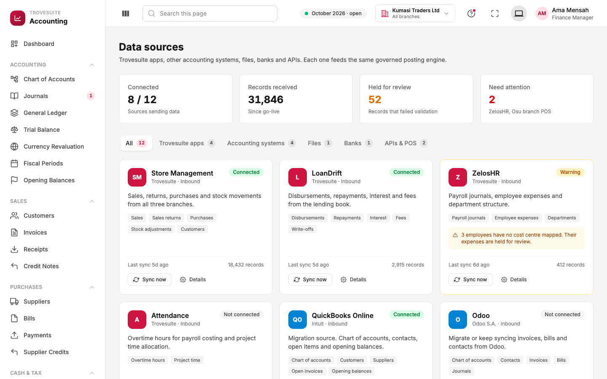
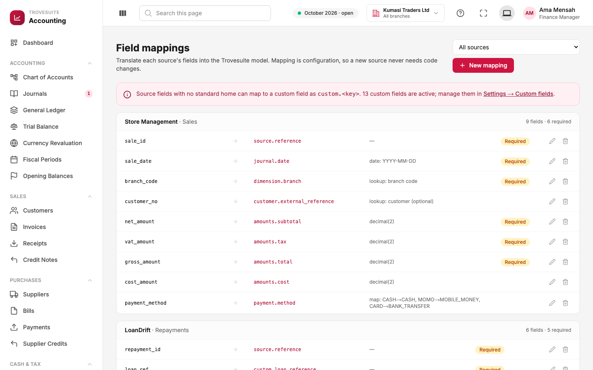
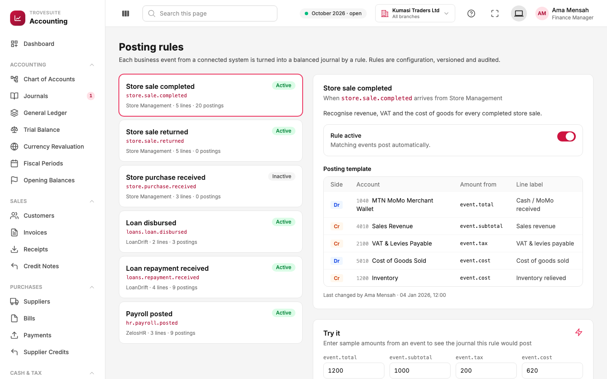
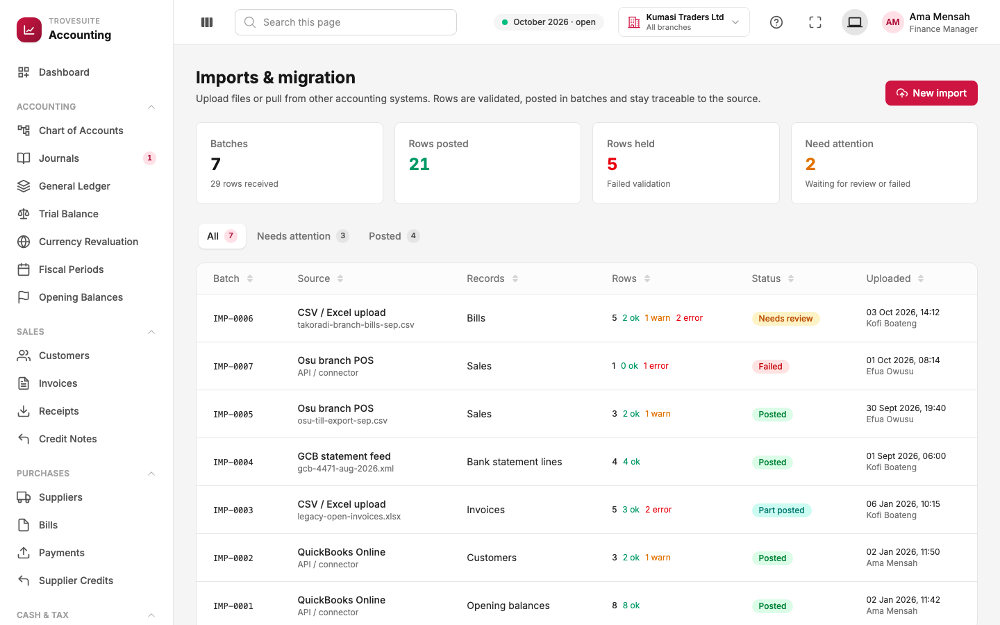
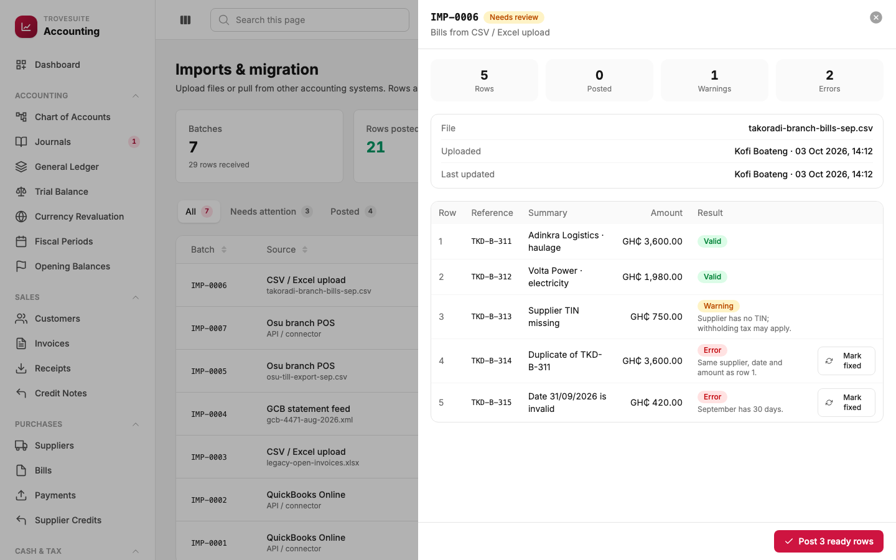

# 10. Tour: integrations and migration

_How data gets in from Trovesuite apps, other accounting systems, files and banks, and how it is checked before it reaches the books_

This is the part of the product the research singled out as the main differentiator: **"Bring your business data with you."** Four screens work together:

| Screen | Question it answers |
| --- | --- |
| **Data sources** | Which systems are connected, and are they healthy? |
| **Field mappings** | What does each field in the outside system mean in Trovesuite? |
| **Posting rules** | How does each kind of outside event become a balanced entry in the books? |
| **Imports** | What came in, what was posted, and what is held for correction? |

## Data sources

**What it is:** every system that sends data to Trovesuite Accounting, each shown as a card.

- **Cards at the top**: how many sources are connected (8 of 12), how many records have been received since go-live (31,846), how many records are **held for review** because they failed validation (52), and how many sources **need attention** (2).
- **Tabs** group the sources: Trovesuite apps, other accounting systems, files, banks, and APIs and POS tills.
- **Each card** shows what the source sends (for example Store Management sends sales, returns, purchases, stock adjustments and customers), its status, when it last synced and how many records it has sent.

| Status | Meaning |
| --- | --- |
| Connected | Working normally |
| Warning | Working, but some records are held. ZelosHR shows *"3 employees have no cost centre mapped. Their expenses are held for review."* |
| Error | The connection has failed and nothing can sync until it is fixed |
| Not connected | Available but not set up (for example Attendance, Odoo) |

**Connecting a source** asks which kinds of record to bring in, how often (the schedule), and the connection details (for example an API key). Secrets are masked and, in the real product, stored in a secure vault and never shown again. **Sync now** pulls immediately. **Disconnect** stops the flow but keeps all history, mappings and past batches.

The sources in the demo show the three ways of using the product: **Trovesuite apps** (Store Management, LoanDrift, ZelosHR, Attendance), **migration sources** (QuickBooks Online, Odoo and other accounting systems) and **operational feeds** (a bank statement feed, a branch POS till, file uploads).

## Field mappings

**What it is:** the dictionary that translates each source's own field names into Trovesuite's standard format (the "canonical model"). Mapping is configuration, so **a new source never needs a developer to change the accounting code**.

Reading the Store Management sales mapping, left to right:

| Store Management field | → Trovesuite field | Transformation |
| --- | --- | --- |
| `sale_id` | `source.reference` | none: kept so the entry can be traced back to the sale |
| `sale_date` | `journal.date` | read as a date in YYYY-MM-DD format |
| `branch_code` | `dimension.branch` | looked up in the branch list |
| `customer_no` | `customer.external_reference` | looked up in customers (optional) |
| `net_amount`, `vat_amount`, `gross_amount` | `amounts.subtotal`, `amounts.tax`, `amounts.total` | rounded to 2 decimals |
| `cost_amount` | `amounts.cost` | what the goods cost, for the cost-of-sales entry |
| `payment_method` | `payment.method` | translated: CASH → CASH, MOMO → MOBILE_MONEY, CARD → BANK_TRANSFER |

**Required** fields must be present on every record, or the record is held. A field with no standard home can be mapped to a **custom field** (`custom.<name>`), so nothing the customer cares about is lost.

## Posting rules

**What it is:** for each kind of event an outside system sends, the template for the journal it produces. This is the "accounting rules engine" from the research: operational systems describe *what happened*, and Trovesuite decides *how to account for it*.

The selected rule, **Store sale completed** (`store.sale.completed` from Store Management), posts five lines for every completed sale:

| Side | Account | Amount from the event | Why |
| --- | --- | --- | --- |
| Dr | 1040 MTN MoMo Merchant Wallet | total | the cash or MoMo received |
| Cr | 4010 Sales Revenue | subtotal | the income earned |
| Cr | 2100 VAT & Levies Payable | tax | tax owed to GRA |
| Dr | 5010 Cost of Goods Sold | cost | what the goods sold cost us |
| Cr | 1200 Inventory | cost | the stock that left the shelf |

- **Rule active** switches automatic posting on or off. *Store purchase received* is inactive, so purchases from Store Management are not posted automatically.
- **Try it** lets you type sample amounts (total 1,200, subtotal 1,000, tax 200, cost 620) and see the exact journal the rule would post, before switching it on.
- Each rule shows how many entries it has posted, and every change is recorded in the audit trail ("Last changed by Ama Mensah").

Other rules cover loans disbursed and repaid (LoanDrift), store returns and payroll (ZelosHR).

> **Prototype limitation.** In the prototype, rules can be viewed, tested and switched on or off, but incoming events are not yet run through them; that is backend work. See page 13.

## Imports and migration

**What it is:** every batch of records that has come in, from a file upload or a connected system, with the result of checking each row.

- **Cards**: batches received, rows posted, rows held (failed validation) and batches needing attention.
- **Each batch** shows its source (a CSV upload, the Osu branch POS, the GCB statement feed, QuickBooks Online), what kind of records it holds (sales, bills, invoices, customers, opening balances, bank statement lines), how many rows were **ok**, had **warnings** or had **errors**, and its status:

| Status | Meaning |
| --- | --- |
| Needs review | Checked but not posted yet; waiting for a person |
| Posted | Every row is in the books |
| Part posted | Good rows posted; rows with errors held for correction |
| Failed | The source could not deliver the batch |

The history tells the migration story: Kumasi Traders brought its **opening balances** and **customers** from QuickBooks Online on 2 January, then its **unpaid invoices** from a spreadsheet, and now receives branch sales, bank statements and bills regularly.

### Checking a batch

This batch of five supplier bills from the Takoradi branch shows the validation in action:

- Rows 1 and 2 are **Valid**.
- Row 3 has a **Warning**: *"Supplier has no TIN; withholding tax may apply."* It can be posted, but someone should look at it.
- Row 4 is an **Error**: *"Duplicate of TKD-B-311. Same supplier, date and amount as row 1."* Duplicates are also checked against earlier batches, so the same bill cannot be imported twice.
- Row 5 is an **Error**: *"Date 31/09/2026 is invalid. September has 30 days."*

**Post 3 ready rows** posts the valid and warning rows and holds the two errors. After someone corrects them in the source, **Mark fixed** sends them back for posting. Bad data is never silently posted and never silently dropped.

### New import

**New import** opens a five-step wizard: **Source** (choose what you are importing: invoices, bills, sales, customers or suppliers) → **Upload** (a CSV file; a sample file is offered) → **Map columns** (match the file's columns to Trovesuite fields) → **Validate** (see every row's result before anything is saved) → **Post**.
