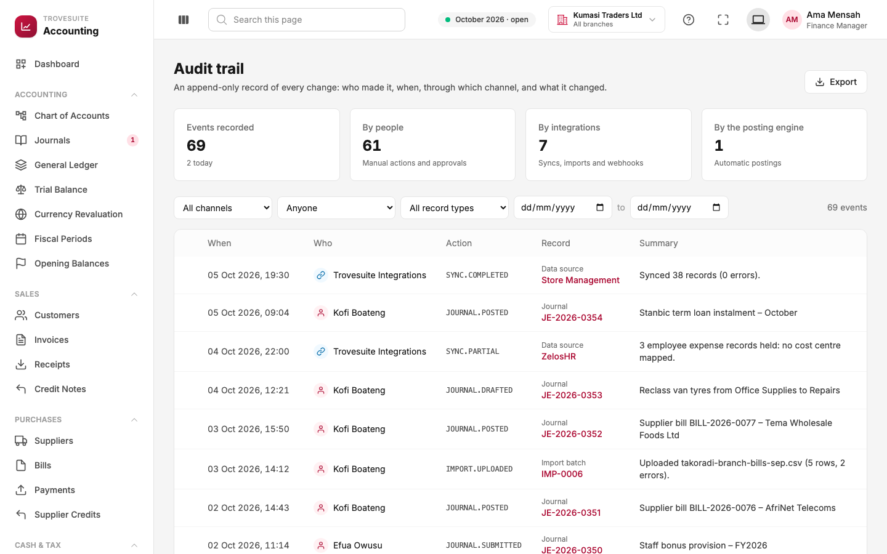
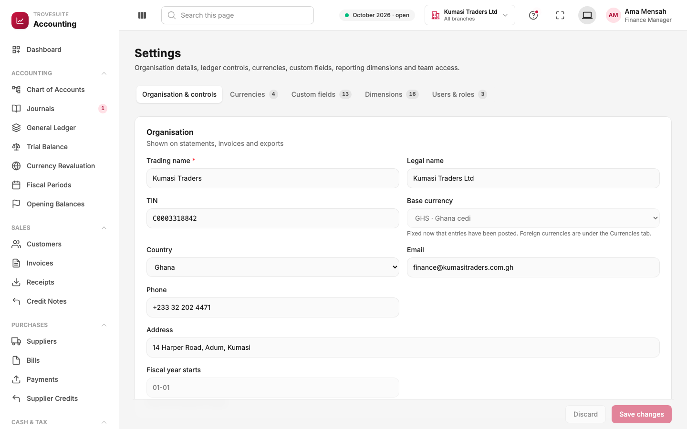

# 11. Tour: audit trail and settings

_The permanent record of every change, and where the company configures its books_

## Audit trail

**What it is:** an **append-only** record of every change in the books. Entries are only ever added; nothing in it can be edited or deleted, by anyone. It answers the auditor's question: *who did what, when, and through which channel?*

- **Cards**: events recorded (69, of which 2 today), split by **who** acted: **people** (manual actions and approvals), **integrations** (syncs, imports, webhooks) and the **posting engine** (entries the system posts by itself).
- **Filters**: by channel, by person, by type of record (journal, invoice, data source, import batch, settings and so on) and by date range.
- **Each row** shows when it happened, who did it (a person icon or an integration icon), the **action** in a fixed code (for example `JOURNAL.POSTED`, `SYNC.PARTIAL`, `IMPORT.UPLOADED`), the record it concerns (a link to it), and a plain summary.
- Rows that changed values can be expanded to show **before and after**, for example when the approval limit in settings was raised from GH₵25,000 to GH₵50,000.
- **Export** downloads the filtered events for an auditor.

Reading the screenshot from the top: an integration synced 38 records from Store Management; Kofi posted the October loan instalment; ZelosHR's sync held 3 records because no cost centre was mapped; Kofi drafted a reclassification; Kofi uploaded a file of Takoradi bills with 2 errors; Efua submitted the staff bonus provision for approval.

## Settings

Settings has five tabs.

### Organisation & controls

- **Organisation**: trading and legal names, tax identification number (TIN), country, contact details and address, all printed on invoices and statements. The **base currency** is locked once entries have been posted, because every past figure is stated in it. The **financial year start** sets when each year begins.
- **Controls**, the rules the ledger enforces on every posting:
  - whether manual journals need approval, and the **approval limit** (GH₵50,000 in the demo);
  - whether **period locks are enforced**.
- **Numbering**: the prefixes for new journals, invoices and bills (for example `INV-2026-`). Existing numbers never change.
- **Default accounts and tax**: the revenue account, expense account and tax codes pre-filled on new invoice and bill lines.
- **Exchange differences**: which accounts realised and unrealised exchange gains and losses post to, and how far (in %) a document's exchange rate may stray from the day's recorded rate before the form warns.

### Currencies

The currencies the company trades in (GH₵, US$, € and £ are active in the demo), the exchange rates recorded for each, and, for each currency, the **exposure**: how much is owed to and by the company in that currency, and which bank accounts hold it.

### Custom fields

The company's own extra fields on customers, suppliers, invoices, bills, journals and accounts: text, long text, number, date, dropdown and yes/no. Each can be required, have a default, and appear as a column and filter in lists. Fields are marked as either **business data** (for example *Sales region*) or **source reference** (an ID in another system, for example *QuickBooks customer ID*). A field already holding values cannot be deleted, only deactivated, so history is kept. The demo has 13.

### Dimensions

The reporting tags from page 2: legal entities, branches, departments, cost centres and projects (16 in the demo).

### Users & roles

The team (3 in the demo) and what each role may do in accounting. In the real product, users and roles come from the Trovesuite Core Platform, and the server checks a named permission for every action. Hiding buttons a user is not allowed to use is part of the next phase.
